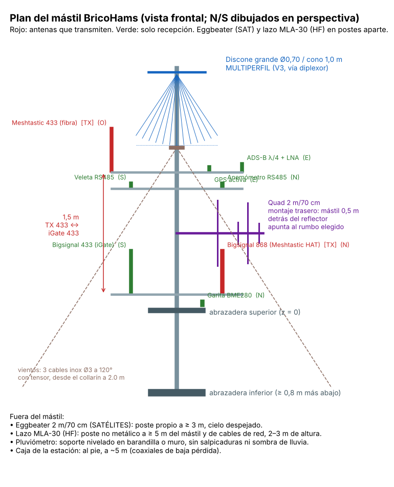

# 11 · Mástil, plan de antenas, soportes y carga de viento

<!-- guia-visual:inicio -->
> **Ruta visual:** [Caja, antenas, filtros, alimentación y anclajes](../GUIA_VISUAL_MODULOS.md#hardware).
> Consulta allí requisitos, ilustración, cuadro de instalación, comprobaciones y restauración.
> Los comandos de este manual se ejecutan en Bash en la Pi; revisa el backup antes de cambiarla.
<!-- guia-visual:fin -->

**Comprobación RF antes del montaje:** [laboratorio y hojas de ensayo](../laboratorio-rf/README.md)
y [manual NanoVNA](45_NANOVNA.md). Una ROE baja no acredita ganancia ni eficiencia.
Medir sin transmisores conectados y con el plano de referencia documentado.

## 1. Qué va en el mástil y por qué ahí

| Altura sobre la abrazadera superior | Antena | Por qué |
|---|---|---|
| 2,9 m (punta) | **Discone grande** (MULTIPERFIL) | omnidireccional y de banda ancha: lo más alto y despejado |
| 1,7 m · brazo E/O de 1,6 m | **ADS-B** (E, 0,8 m), **GPS** (E, 0,4 m), **Meshtastic 433 fibra** (O, 0,8 m) | ADS-B y GPS necesitan horizonte y cielo; el 433 que transmite, lejos del iGate |
| 1,5 m · brazo N/S de 1,6 m | **anemómetro** (N) y **veleta** (S) | lo más alto posible sin tapar la discone |
| 0,95 m | **Quad 2 m/70 cm** fija (rumbo 205°) | montaje trasero: el mástil queda 0,5 m detrás del reflector |
| 0,2 m · brazo N/S de 1,6 m | **Bigsignal 868** (N) y **Bigsignal 433 iGate** (S) | 1,5 m por debajo del 433 que transmite |
| 0,05 m · brazo N corto | **garita del BME280** | cara norte, a la sombra |

**Fuera del mástil:**
- **Eggbeater (satélites):** poste propio a ≥ 3 m.
- **Lazo MLA-30:** poste no metálico a ≥ 5 m, lejos de cables de red.
- **Pluviómetro:** nivelado en un muro.

### Separaciones (`python3 tools/mastil.py`)
| Transmite | Recibe | Distancia | En λ |
|---|---|---|---|
| Meshtastic 433 | iGate 433 | 1,88 m (1,5 m en vertical) | 2,7 |
| Meshtastic 868 | iGate 433 | 1,60 m | 4,6 |
| Meshtastic 433 | quad | 1,10 m | 1,6 |
| Meshtastic 433 | discone | 1,44 m | 2,1 |
| Meshtastic 433 | X50 | 5,90 m (5,85 m en vertical) | 8,5 |
| Meshtastic 433 | discono Moonraker | 3,64 m (3,4 m en vertical) | 5,3 |

- **Separación vertical:** aísla mucho más que la horizontal (las antenas verticales no radian hacia arriba ni hacia abajo). Por eso los dos 433 van uno encima del otro.
- **Lo que queda:** el iGate puede perder algún paquete justo cuando transmite el Meshtastic. Es inevitable con dos equipos a 100 kHz y no tiene arreglo con filtros.

### Antenas nuevas y mástil telescópico
- **Mástil:** telescópico de 3 tramos × 3,00 m con 2 solapes de 0,35–0,45 m (nominal 0,40): **8,20 m** montado (8,10–8,30 m). Las alturas del plan se miden desde el pie; las antenas existentes conservan sus separaciones, desplazadas 1,3 m.
- **Diamond X50 (X-50N):** en la punta, base a 8,00 m (colineal de 1,70 m, ~1,1 kg, 2 m/70 cm, conector N). **PENDIENTE:** diámetro de mástil admitido y carga de viento (hoja de Diamond); el tramo superior es el más fino (Ø40 típico).
- **Discono Moonraker SkyScan Desktop** (0,95 m, radiales 4 × 8 cm + 8 × 29,5 cm, 25–2000 MHz, ~1,4 kg): debajo del X50, a ~5,9 m, en un brazo de 0,5 m al este. Es de sobremesa con base magnética: necesita una **placa metálica** (≥ Ø250 mm) y un soporte en el brazo; cambia su RG58 de 4 m con BNC por coaxial de baja pérdida y conector N.
- **Se mantiene la tabla de aislamiento:** el X50 transmite (2 m/70 cm) y queda ≥ 5 m por encima de las antenas de 433/868.

## 2. Carga de viento: **el mástil necesita vientos**

`tools/mastil.py` modela el mástil telescópico como una viga de elementos finitos (EI variable, apoyo rígido en el anclaje a pared, vientos como muelles) bajo el **viento de diseño del CTE DB-SE-AE para Murcia: vb,0 = 26 m/s, zona A** (presión básica 422 N/m², grado de aspereza III; equivale a ~140 km/h a 8,8 m, por encima de las rachas observadas de ~100 km/h). Cd 1,2 y coeficiente 1,5 frente a 235 MPa (S235). Valores **PENDIENTES** de medir: diámetros y paredes (50×2 / 45×2 / 40×2 mm típicos), anclaje a 2,0 m, vientos a 5,5 y 7,6 m con anclajes a 4 m del pie.

Calcula la tensión en el pie, en cada solape (con concentración en la boca del tubo exterior), la flecha en cabeza (límite H/50) y las tensiones de los cables, con el pie articulado y empotrado y los solapes de 0,35, 0,40 y 0,45 m: ejecuta `python3 tools/mastil.py`.

**Conclusión:** sin vientos, 8 m de telescópico con el X50 arriba **no aguantan** el viento de diseño. Con 2 niveles de vientos (3 cables inox Ø3 a 120° cada uno, tensores y anclajes M8), el modelo da el veredicto con los datos reales; **mídelos y repite el cálculo antes de levantarlo**. Cerca de las antenas, usa vientos dieléctricos (Dyneema o poliéster).

## 3. Soportes impresos (`hardware/antenas/stl`)

| Pieza | Cant. | Uso |
|---|---|---|
| `brazo_mastil` | 4 | silla cruzada mástil Ø40 ↔ brazo Ø25 (U M8 al mástil, U M6 al brazo) |
| `soporte_fibra` | 3 | silla cruzada brazo Ø25 ↔ antena de fibra (`FIBRA_D`, mide tus Bigsignal y la fibra) |
| `gps_soporte` | 1 | cuna para la antena GPS sobre el brazo |
| `tapon_brazo` | 6 | tapones de los brazos (evitan agua y pájaros) |
| `separador_coax` | 15 | coaxial a 30 mm del mástil, con brida, cada 50 cm |
| `funda_n` / `funda_sma` | 12 / 6 | fundas de TPU sobre los conectores (más cinta autovulcanizante) |

**Impresión:**
- **Material:** ASA (mejor ante los UV) o PETG **blanco**.
- **Parámetros:** 6 perímetros y 50 % de relleno giroide.
- **Las piezas solo reparten el apriete:** la carga la llevan las abrazaderas en U de acero inox. No uses piezas impresas como único sujeto de nada que pese más de 1 kg.

## 4. Montaje paso a paso

1. **Vientos:** marca y taladra los 3 anclajes a 120°, a una distancia del mástil de 1–1,5 veces la altura del collarín. Pon el collarín a 2 m y presenta los cables sin tensar.
2. **En el suelo, con el mástil tumbado:** monta de arriba abajo los brazos (`brazo_mastil` + U), sus antenas y los `tapon_brazo`.
3. **Discone grande** en la punta con su `discone_adaptador_mastil` (manual 13).
4. **Coaxiales:** baja cada uno con un `separador_coax` cada 50 cm. Haz un bucle de goteo bajo cada conector y pon `funda_n` + autovulcanizante.
5. **Izado:**
   1. Sube el mástil a las abrazaderas de pared, entre dos personas.
   2. Aprieta las abrazaderas.
   3. Tensa los vientos en estrella hasta que el mástil quede a plomo.
6. **Quad:** monta la quad (manual 12) con su abrazadera y orienta el boom a **205°** (cubre Sierra Espuña 229°, Peña Rubia 222°, Águilas 201° y Carrascoy 176° dentro del ancho a −3 dB).
7. **Tierra:** une el mástil a la tierra del edificio con cable de 16 mm² (como en cualquier ICT). Los pasamuros N de la caja pueden ir a la tierra de la caja con un descargador coaxial por línea, opcional pero recomendado.

## 5. Rumbos desde tu QTH (para orientar la quad)

| Repetidor | Rumbo | Distancia |
|---|---|---|
| Sierra Espuña (ED5YAK, ED5YAL, ED5ZAN) | 229° | 37 km |
| Peña Rubia, Lorca (RU-71) | 222° | 59 km |
| Águilas (ED5YAT) | 201° | 80 km |
| Carrascoy (ED5YBF / ED5YAY) | 176° | 22 km |
| Murcia ciudad | 133° | 15 km |
| Alicante (ED5YAG) | 66° | 74 km (cae detrás: la F/B lo atenúa) |
