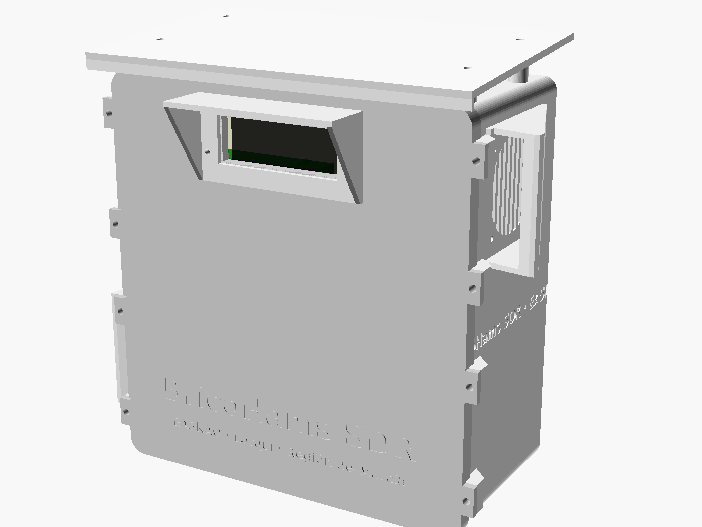
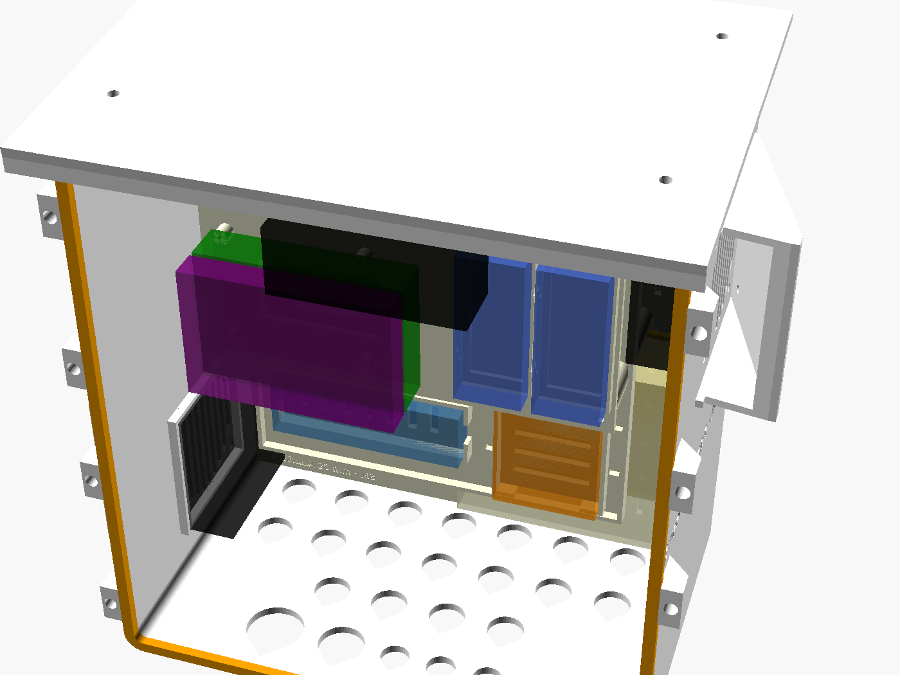
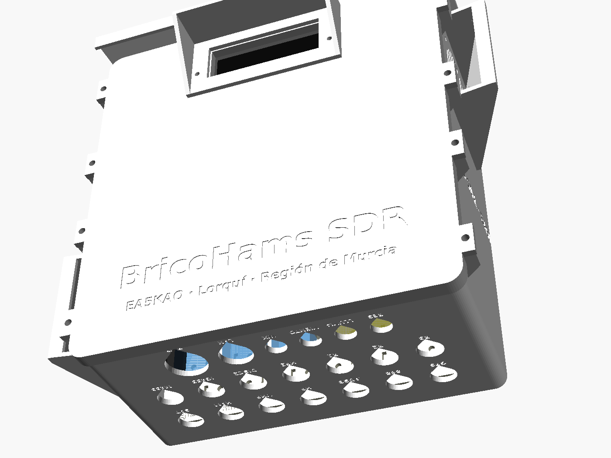
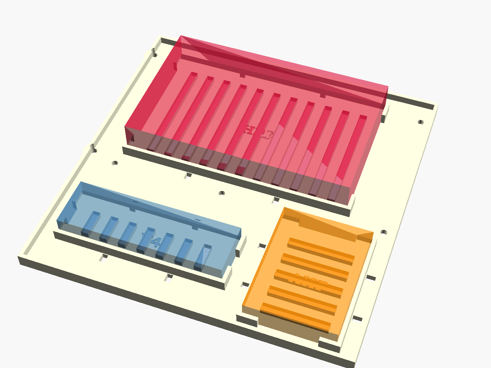
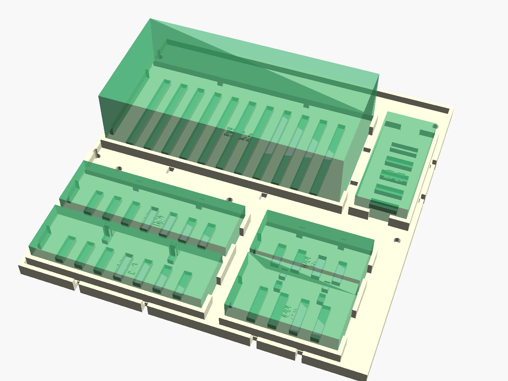
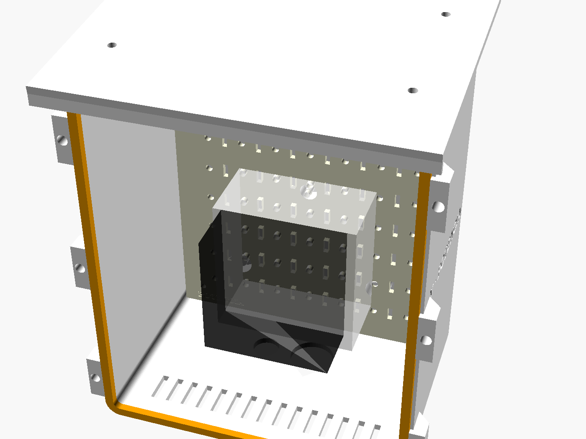
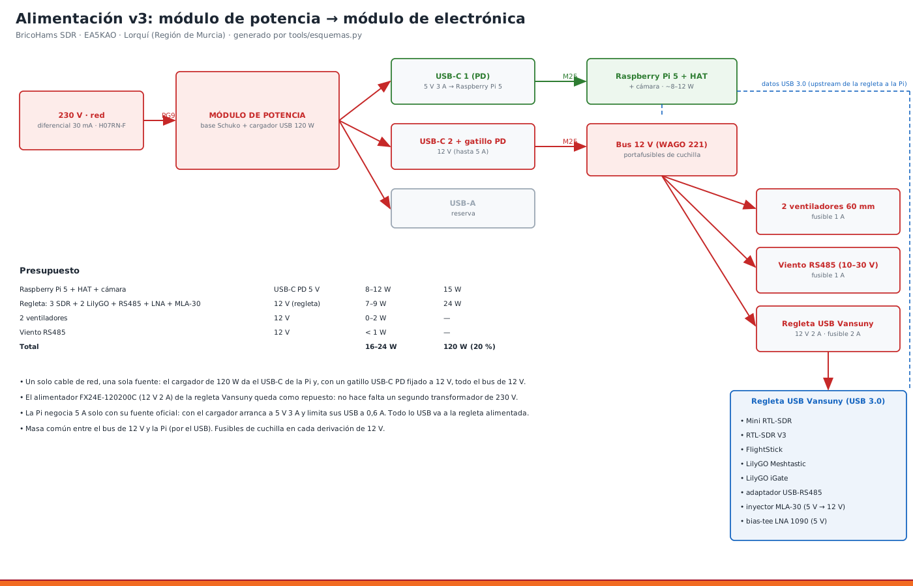
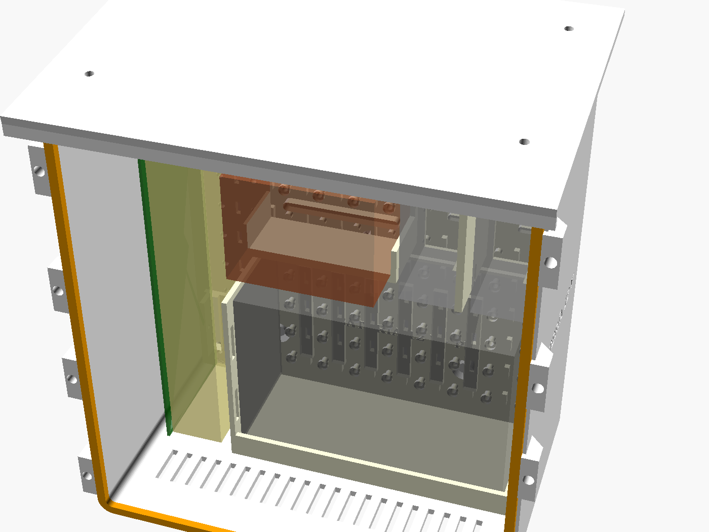

# 17 · Caja v3: dos módulos al pie del mástil

<!-- guia-visual:inicio -->
> **Ruta visual:** [Caja, antenas, filtros, alimentación y anclajes](../GUIA_VISUAL_MODULOS.md#hardware).
> Consulta allí requisitos, ilustración, cuadro de instalación, comprobaciones y restauración.
> Los comandos de este manual se ejecutan en Bash en la Pi; revisa el backup antes de cambiarla.
<!-- guia-visual:fin -->

> **v4:**
> - **Sensores y ventiladores:** la **Pico «bricohams-io»** va en su `pico_soporte` (hardware/anclajes) atornillada a la rejilla, junto a la regleta USB, con la placa perforada de los MOSFET ([manual 20](20_PICO_IO.md)).
> - **Anclajes:** las piezas para fijar antenas y sensores al mástil están en el [manual 21](21_ANCLAJES.md).









**Por qué dos módulos al pie y no una caja en el mástil** (decisión del usuario, ADR-21):
- **Mástil:** con el telescópico de 8,2 m, el X50 y el discono Moonraker, el mástil trabaja con vientos de cable (ver `tools/mastil.py` y manual 19 §5b). Una caja de 2–3 kg en lo alto sumaría superficie al viento y un momento que no hace falta.
- **A 5 m, al pie:** se abre sin subir, se amplía sin desmontar y no carga el mástil.
- **Cables:** la pérdida que añade la bajada se compensa con coaxial de baja pérdida (LMR-400 en VHF/UHF y el LNA en la antena para ADS-B).

| Módulo | Medidas (an × al × fondo) | Lleva |
|---|---|---|
| **Electrónica** | 228 × 240 × 192 mm | Pi 5 + HAT, 3 SDR + FlightStick, **bandeja de SDR con HackRF Pro/One, RTL-SDR V4 y Airspy HF+**, **2.ª bandeja con Hermes-Lite 2 y 5 plazas más**, bahía del suelo para RSPdx, LilyGO + **RAK4631 (RAK19007)**, hub USB de 10 puertos (Amazon Basics, 145 × 44 × 23 mm, PENDIENTE de medir), filtro 433, bias-tee, inyector MLA-30, diplexores, RS485, DS18B20, **2 ventiladores de 60 mm**, cámara (opcional) |
| **Potencia** | 170 × 200 × 112 mm | base Schuko de superficie, cargador de 120 W (2 USB-C PD + 2 USB-A QC; **12 V PD por comprobar**, §1.5), gatillo USB-C PD si hay 12 V, portafusibles, WAGO 221 |
| **SAI** (opcional, debajo del de potencia) | 228 × 240 × 140 mm | placa, transformador y batería de plomo 12 V 7–9 Ah de un SAI reaprovechado, **2 filtros EMI** de red, fusible de batería ([§1.2](#12-módulo-sai-reaprovechar-un-sai-con-filtros-emi)) |

> La **caja v2** (`hardware/caja`, manual 10) sigue siendo válida si se quiere todo en el mástil y solo con los SDR actuales. La v3 es la recomendada.

## Clima de diseño (Vega Media del Segura (Murcia))

No se publica el municipio exacto: se usan los datos de la estación AEMET de Murcia (7178I, 62 m), a pocos km de la instalación.

**Normales AEMET Murcia 7178I (1984-2010)**

| Mes | T media °C | Máx media °C | Mín media °C | Lluvia mm | HR % | Días ≥ 1 mm | Sol h |
|---|---|---|---|---|---|---|---|
| Ene | 10,6 | 16,6 | 4,7 | 27 | 65 | 3,8 | 189 |
| Feb | 12,2 | 18,4 | 5,9 | 27 | 63 | 3,6 | 190 |
| Mar | 14,3 | 20,9 | 7,7 | 30 | 59 | 3,3 | 223 |
| Abr | 16,5 | 23,3 | 9,7 | 25 | 53 | 3,6 | 256 |
| May | 20,0 | 26,6 | 13,3 | 28 | 52 | 3,9 | 289 |
| Jun | 24,2 | 31,0 | 17,4 | 18 | 49 | 2,0 | 323 |
| Jul | 27,2 | 34,0 | 20,3 | 3 | 50 | 0,6 | 353 |
| Ago | 27,6 | 34,2 | 20,9 | 8 | 54 | 1,0 | 316 |
| Sep | 24,2 | 30,4 | 18,0 | 32 | 59 | 3,0 | 239 |
| Oct | 19,8 | 25,6 | 13,9 | 36 | 64 | 3,7 | 217 |
| Nov | 14,6 | 20,3 | 8,9 | 32 | 65 | 4,1 | 186 |
| Dic | 11,5 | 17,2 | 5,8 | 29 | 68 | 3,9 | 172 |
| **Año** | 18,6 | 24,9 | 12,3 | 297 | 58 | 36,5 | 2967 |

Fuente: [AEMET, valores climatológicos de Murcia 7178I](https://www.aemet.es/es/serviciosclimaticos/datosclimatologicos/valoresclimatologicos?l=7178I&k=mur). Contraste, periodo 1991-2020 de una fuente no oficial (snowy.es, estación Murcia, con precipitación de reanálisis ERA5-Land): agosto con máxima media de 34,3 °C y mínima media de 21,8 °C; 301 mm al año.

**Extremos de referencia**
- **46,0 °C** en Molina de Segura - Los Valientes, julio de 2022 (máxima absoluta mensual del boletín AEMET de julio de 2022). Estación vecina.
- **Lluvia:** ~300 mm al año, muy concentrada en DANAs de septiembre a noviembre. Récord en 24 h en Murcia-San Javier: 203,7 mm (AEMET, vía Alicante Plaza). Las tormentas pueden superar los 100 mm/h durante minutos.
- **Viento:** rachas de ~100 km/h registradas en la región (Águilas, 99 km/h en enero de 2023).

**Valores de diseño derivados**

| Magnitud | Valor | Dónde se aplica |
|---|---|---|
| Aire exterior a la sombra | **47 °C** (máxima absoluta 46 °C + margen) | `tools/termica_caja.py`, [manual 18](18_VENTILACION.md), curva de ventiladores |
| Interior en verano sin sombra | 55–65 °C | todo material rígido en **ASA** (HDT ~95 °C); el PETG (HDT ~70 °C) queda fuera |
| Sol | 1000 W/m², ASA blanco α ≈ 0,3, tejadillo con cámara de aire | `tejadillo`, §6 |
| Lluvia | viento de 100 km/h y chubascos > 100 mm/h | goterón, `ceja_techo`, capotas hacia abajo, juntas TPU al 20–30 %, 4 drenajes y respiradero de membrana |
| Condensación | HR 65–68 % en invierno con noches frías | respiradero PG7, drenaje inferior |
| UV | ~3000 h de sol al año | ASA blanco o pintura UV; nada de PLA ni PETG al exterior |

## 1. Piezas (`hardware/caja_v3/stl`, todas ≤ 250 mm, Kobra S1)

> **Antes de imprimir ASA:** seguir la [guía Kobra S1 Combo de BricoHams](43_KOBRA_S1_ASA.md),
> con calibración, pruebas y mantenimiento. Las tapas (con faldón de intemperie)
> llegan a 247 × 247 mm:
> caben nominalmente, pero **no con brim exterior de 5 mm**. Comprobar huella
> tras compensar contracción, purga y soportes; no escalar los STL para hacer sitio.
> Los tiempos y pesos siguientes son estimaciones previas, no un laminado
> validado del nuevo diseño de 192 mm ni del perfil ASA de tu máquina.

| Módulo | Pieza | Material | Relleno |
|---|---|---|---|
| ambos | `cuerpo`, `tapa`, `tejadillo` | **ASA** blanco | 30 % giroide, 9 perímetros (`cuerpo` y `tapa`), 6 (`tejadillo`) |
| ambos | `placa_rejilla` | **ASA** (era PETG: porta todo, interior hasta 55–65 °C) | 40 % |
| ambos | `junta_tapa` | **TPU 95A** | 100 % |
| ambos | `pletina_pared`, `soporte_mastil` | **ASA** (al sol, exterior) | 60 % |
| electrónica | `bandeja`, `poste_bandeja` ×6, `poste_medio` ×6, `poste_superior` ×4 | **ASA** (era PETG: portantes, HDT 70 °C al límite) | 40 % |
| electrónica | `bandeja_sdr2` (Hermes-Lite 2 y plazas futuras) | **ASA** (era PETG) | 40 %, 4 perímetros |
| electrónica | `bandeja_sdr` (HackRF One, RTL-SDR V4, Airspy HF+) | **ASA** (era PETG) | 40 %, 4 perímetros |
| electrónica | `capota` ×2, `rejilla_ventilador` ×2 | ASA | 30 % |
| electrónica | `soporte_dongle` ×4, `soporte_hub`, `soporte_lilygo`, `soporte_rak`, `soporte_sdrplay`, `soporte_wago` | **ASA** (eran PETG: sujetan equipos en caja cerrada) | 40 % |
| electrónica | `tapon_n` (para los N sin usar), `tapon_pg` | TPU | 100 % |
| electrónica | `visera`, `soporte_camara` | ASA | 30 % |
| potencia | `soporte_schuko`, `brida_cargador` | **ASA** (era PETG: el cargador llega a ~64 °C de aire) | 40 % |
| SAI | `soporte_bateria` (cuna con repisa y ventanas de correa) | **ASA** (era PETG: 2–3 kg de plomo a 58 °C) | 60 %, 6 perímetros |
| SAI | `guia_pcb` ×2, `pletina_trafo`, `soporte_filtro` ×2, `soporte_wago`, `tapon_pg` | **ASA** (era PETG; `tapon_pg` en TPU) | 50 % |

- **Criterio (47 °C de ambiente y sol):** el PETG reblandece hacia 70 °C (HDT) y el aire interior llega a 55–65 °C, con puntos calientes junto a los reductores y el cargador. Ninguna pieza rígida queda en PETG: ninguna es lo bastante ligera, ventilada y descargada como para justificarlo. El ASA (HDT ~95 °C) imprime con la misma boquilla y el mismo perfil que la caja. El TPU 95A se mantiene (junta y tapones, sin carga, ≤ 80–100 °C).
- **Tiempo:** ~44 h de impresión en total.
- **Material:** ~1,9 kg de ASA y ~60 g de TPU.
- **Para regenerar:** `tools/caja_v3.sh`.

### 1.1 Bandeja de SDR: 3 receptores más
La `bandeja_sdr` va entre la fila de dongles (y la bahía SDRplay) y la bandeja de la Pi, a 38 mm de la rejilla. Por eso el módulo de electrónica tiene 192 mm de fondo en vez de 112 (con la 2.ª bandeja de §1.3).

| Bahía | SDR | Hueco (largo × ancho × alto) | Dónde |
|---|---|---|---|
| `HRF` | **HackRF One** (con caja) | 124 × 79 × 20 mm | atrás, bajo la Pi; SMA a la izquierda y USB a la derecha |
| `V4` | **RTL-SDR Blog V4** | 85 × 26 × 13 mm | delante a la izquierda |
| `AHF` | **Airspy HF+ Discovery** (45 × 60 × 10) | 45 × 60 × 12 mm | delante a la derecha, conectores hacia delante y atrás |

- **Bahías:** cada una tiene carriles en los lados largos y extremos abiertos para los conectores, con ≥ 12 mm libres para el cable. Debajo lleva rejillas de aire y ranuras para una brida a cada lado.
- **Otro modelo:** cada SDR es una línea de `SDR_DECK` en `caja_v3.scad` (`[nombre, [x, y], [largo, ancho, alto]]`). Si cambias una medida y algo deja de caber, la exportación falla (`assert`) y también `test_v3_hardware.py`.
- **Airspy HF+ Dual Port** (55 × 90 × 12): no cabe en la bahía `AHF`. Si no usas SDRplay, va en la bahía de expansión de la rejilla (100 × 90), sujeto con bridas sobre el `soporte_sdrplay`.
- **Antenas:** la 3.ª fila de pasamuros N (HRF, AHF, V4, R4) es para estos SDR. `R4` queda libre para un 4.º repetidor o para lo que añadas.
- **USB:** suman 3 puertos a la regleta (11 en total). Si no los tiene, pon un segundo hub USB 3.0 alimentado por el bus de 12 V.
  - Para no saturar el USB, el HackRF va con perfiles de ≤ 10 MS/s en OpenWebRX+.
  - Los 3 SDR consumen ~4,5 W a 5 V (HackRF ~0,35 A, V4 ~0,3 A, Airspy ~0,2 A): la regleta pasa de 7–9 W a 12–14 W, dentro de su fusible de 2 A a 12 V.
- **Calor:** ~4,5 W más. Los ventiladores PWM (manual 18) suben de vueltas solos; la bandeja tiene rejillas para que el aire de la diagonal pase por debajo de los SDR.

### 1.3 Diseño v5.5, bandeja 2 de SDR, RAK4631 y potencia reservada
- **Diseño:** cuerpo con faldón perimetral chaflanado a 45° que enrasa con la tapa, tapa con marco y aspa en X hundidos (sin voladizos al imprimir) y cierres laterales más anchos.
- **Bandeja de la Pi:** el 2.º LilyGO se sustituye por la cuna `soporte_rak` del **RAK19007 + RAK4631** (30 × 60 mm, con el GPS en el slot A).
- **Bandeja 2 (`bandeja_sdr2`)** a 82 mm de la rejilla, con 42 mm libres hasta la bandeja de la Pi:

| Bahía | Equipo previsto | Hueco (largo × ancho × alto) |
|---|---|---|
| `HL2` | **Hermes-Lite 2** (12 V + Ethernet; medida a verificar con tu unidad) | 125 × 62 × 36 mm |
| `S1`, `S2` | dongles RTL/FlightStick | 85 × 26 × 13 mm |
| `S3`, `S4` | Airspy Mini, RSP1B de canto o similar | 52 × 30 × 15 y 52 × 24 × 15 mm |
| `S5` | dongle en vertical | 26 × 60 × 13 mm |

- **Reparto de los SDR de las imágenes:** HackRF Pro en `HRF` (120 × 75 × 20, bandeja 1), Airspy HF+ Discovery en `AHF`, **RSPdx** en la bahía de expansión del suelo (`soporte_sdrplay`, 100 × 90 × 32) y Hermes-Lite 2 en `HL2`. Todas las cotas son nominales: mide tu unidad y edita `SDR_DECK` / `SDR_DECK2`; los `assert` y `test_v3_hardware.py` avisan si algo choca.
- **Potencia reservada:** hueco en el suelo (x 20, y 186, 60 × 26 × 22 mm) para fusibles ATO por carril y **dos reductores 12→5 V de 5 A**, uno solo para la Pi y otro para el hub de los SDR USB. El Hermes-Lite 2 va a 12 V con su fusible de 3 A.
- **Presupuesto (`python3 tools/presupuesto_potencia.py`, consumos nominales):** con todos los equipos futuros la estación toma ~52 W (44 % del cargador de 120 W); el reductor más cargado, 3,6 A de 5 A; el carril de 12 V, 1,1 A. Es una estimación: revisa los consumos con las hojas de datos.
- **Servidor:** `bricohams.env.example` declara `HACKRF_PRO_SERIAL`, `AIRSPY_HF_SERIAL` y `HERMES_LITE2_IP`, todos vacíos, y permite poner esos equipos en `HARDWARE_PENDIENTE` para que `bricohams-check` no los dé por fallo.
### 1.2 Módulo SAI: reaprovechar un SAI con filtros EMI
Tercer módulo, **debajo del de potencia**, para un SAI *line-interactive* pequeño (600 VA, placa tipo 16-500014, batería de plomo 12 V 7–9 Ah). Los cuerpos, la tapa, la junta y el tejadillo salen de `caja_v3.scad` con `VARIANTE="sai"` y miden lo mismo que el de electrónica (228 × 240 × 140 mm, cabe en la Kobra S1).



**Esquema (opción A, la que se monta):**
```
230 V casa ─PG9 «RED»─► FILTRO EMI 1 ─► SAI (placa + trafo + batería) ─► FILTRO EMI 2 ─PG9 «SALIDA»─►
   ─► (cable H07RN-F 3G1,5 por fuera) ─► PG9 «230 V» del módulo de potencia ─► Schuko ─► cargador de 120 W ─► 5 V Pi / 12 V bus
                                                            BAT+ ─ fusible ATO 15 A (≤ 10 cm del borne) ─ batería ─ BAT−
```

| Hueco (`SAI_LAYOUT`) | Qué va | Medida reservada | Pieza |
|---|---|---|---|
| `BAT` | batería 12 V 7–9 Ah **de pie, bornes arriba** (151 × 65 × 94 + bornes) | 159 × 106 × 74 | `soporte_bateria` + correa de velcro 20 mm por las ventanas |
| `PCB` | placa del SAI **de canto**, componentes hacia la batería (≈ 210 × 70) | 40 × 216 × 82 | `guia_pcb` ×2 (ranura 2,2 mm + prisionero M3) |
| `TRAFO` | transformador del SAI (≈ 80 × 62 × 65, 1,5–2 kg) | 85 × 70 × 70 | `pletina_trafo` (repisa + colisos M5 para sus patas) |
| `EMI_OUT`, `EMI_IN` | filtros EMI monofásicos de chasis 250 V 6 A (≈ 85 × 50 × 30) | 34 × 86 × 54 | `soporte_filtro` ×2 (escuadra, colisos M4 para las orejas) |
| `DC` | portafusibles ATO + WAGO 221 | 86 × 28 × 25 | `soporte_wago` |

- **Mide tu SAI** antes de imprimir y cambia `SAI_BAT`, `SAI_PCB`, `SAI_TRAFO` y `FILTRO`. Si algo deja de caber, la exportación (`assert`) y `test_v3_hardware.py` fallan.
- **Rejillas:** el cuerpo lleva entrada de aire abajo y salida bajo el tejadillo. El plomo-ácido sellado (VRLA) suelta algo de hidrógeno si se sobrecarga; nunca tapes la salida de arriba.
- **PG7 «DATOS»:** si el SAI tiene USB o serie, pasa el cable a la Pi y vigílalo con NUT (`apt install nut`); así la Pi se apaga sola antes de que se agote la batería.

**Cálculos** (`python3 tools/sai_calculo.py --carga 25 --ah 7`; la estación consume 19–25 W con los 3 SDR nuevos):

| | A) SAI completo (230 V) | B) solo su batería a 12 V |
|---|---|---|
| Cadena | batería → inversor → filtro → cargador 120 W | cargador 13,8 V con función SAI → batería → filtro LC → bus 12 V (+ reductor 5 V 5 A para la Pi) |
| Potencia que sale de la batería | 43 W (3,6 A): inversor ~75 % a poca carga + 4 W de reposo | 27 W (2,3 A) |
| Autonomía, batería usada (80 %) 7 Ah | **≈ 1,1 h** | **≈ 1,9 h** (0,9 h si cortas al 50 %, que alarga la vida de la batería) |
| Autonomía, batería nueva 9 Ah | ≈ 1,8 h | ≈ 3,1 h |
| Fusible en BAT+ | ATO 15 A, cable 1,5 mm² (el original del SAI) | ATO 7,5 A, 1,5 mm² |
| Ruido | el inversor da onda «senoidal modificada»: **solo durante los cortes**; lo frenan el filtro 2 y las ferritas | sin inversor: el más limpio |

Se monta la **A** porque reaprovecha el SAI tal cual y no toca el resto de la caja. La **B** queda como mejora: da un 70 % más de autonomía, pero cambia el cargador y la alimentación de la Pi.

**Filtros EMI:**
- **Filtro 1 (entrada):** frena el ruido de la red de casa, que si no subiría por los 5 m de cable junto a las antenas. Lo mismo hace con el ruido del propio SAI hacia la red.
- **Filtro 2 (salida):** frena los armónicos del inversor y el ruido de conmutación de los relés. Va lo más cerca posible del PG9 «SALIDA».
- **Ambos:** monofásicos de chasis 250 V AC, **6 A** (la estación tira 0,2–0,4 A; el margen cubre el arranque del cargador), dos etapas, con borne de tierra. Ejemplos: Schaffner FN2010-6, Corcom 6EF1, TE 6VK1 o equivalentes.
- **Fuga a tierra:** ≤ 0,5 mA en cada filtro. Así no salta el diferencial de 30 mA de casa.
- **Tierra:** los filtros solo funcionan con el **conductor de protección (PE) conectado** a su borne y continuo hasta el Schuko.
- **Ferritas:** de mezcla 31 (tipo clip, Ø interior ≥ 7 mm), con **4 vueltas** del cable de 230 V a la salida del módulo SAI y otras 4 del cable de 12 V en la entrada del módulo de electrónica. Atenúan el ruido de modo común en HF.
- **Bus de 12 V:** filtro π con 2 × 2200 µF de bajo ESR y 100 nF cerámicos, más una bobina de 10 µH / 5 A en serie. Corta hacia 1 kHz, así que el rizado del cargador queda muy por debajo.
  - Si haces la opción B, pon también un TVS **SMBJ15A**: la tensión de absorción (14,4 V) queda por debajo de su tensión de trabajo de 15 V.

**Seguridad (230 V y batería):**
- **Sin tensión:** trabaja siempre con el SAI **desenchufado y la batería desconectada**. Con la batería puesta, el SAI saca 230 V aunque no esté enchufado.
- **Condensadores:** espera 5 minutos para que se descarguen y comprueba con el polímetro que no queda tensión.
- **La placa, sin tocar:** no modifiques la placa del SAI. Solo se traslada con sus conectores originales: entrada y salida por faston, batería por los cables BAT+ (rojo) y BAT− (negro).
- **Aislamiento:** la placa de canto deja ≥ 6 mm hasta la batería. Separa la parte de 230 V de los cables de 12 V y fija todo con bridas. La tapa cierra con la junta y lleva una etiqueta «230 V».
- **Fusible de batería:** el **fusible en BAT+** no es opcional. Una batería de plomo da cientos de amperios en corto.
- **Temperatura:** por encima de 40 °C la batería envejece el doble de rápido (y la vida se reduce a la mitad por cada +8–10 K). **Aviso:** con 47 °C de ambiente el estudio térmico da ~58 °C de aire en el SAI (veredicto *overheat* para el plomo, [manual 18](18_VENTILACION.md)). Pon el módulo a la sombra (cara norte, o bajo el de potencia), ajusta la flotación (13,65 V a 25 °C, 13,38 V a 40 °C, ~13,25 V a 47 °C), cambia la batería cada 2–3 años o pasa a LiFePO4.
- **Batería vieja:** cámbiala si tiene más de 3–4 años o si aguanta menos de la mitad de lo calculado. Prueba de capacidad: con la estación funcionando, quita la red y cronometra hasta que pite la batería baja.

**Encaje del SAI y transformador máximo.** Con los valores de `SAI_*` la batería, la placa, el transformador, los dos filtros EMI y el bloque DC caben juntos: los `assert` de `caja_v3.scad` y `test_v3_hardware.py` lo comprueban (separación ≥ 4 mm entre huecos y ≥ 2 mm al borde de la placa). Holguras reales: BAT–trafo (arriba de la batería) 8 mm, PCB 4 mm, `EMI_OUT` 5 mm, bloque DC 6 mm. No se ha cambiado ningún `SAI_*`. **El transformador real no está medido**; el máximo que aún cabe es:

| Dimensión | Máximo | Motivo |
|---|---|---|
| Huella en la placa | **81 × 65 mm** | hueco `TRAFO` 85 × 70 menos el margen de 4 y 5 mm de los `assert`; vecinos a 4–6 mm |
| Altura sobre la placa | **65 mm** con los `SAI_*` actuales | el hueco reservado mide 70 mm (menos 5). Límite absoluto de la caja: 122 mm (140 + 3 de la tapa − 6 del labio − 14,8 de la placa); para más de 65 mm sube la 3.ª cota de `SAI_TRAFO` y la reserva, y revisa el hueco libre bajo la tapa |
| Peso | 1,5–2,5 kg (EI de 600 VA) | colgado de la placa vertical |

- **Peso en la placa vertical:** 2,5 kg a ~50 mm de la placa dan un par de ~1,2 N·m y, repartido en los 4 insertos M3, ~12 N de tracción por tornillo: soportable, pero una placa de ASA al 40 % con calor es lo primero en ceder. `pletina_trafo` (repisa + colisos M5 para las patas) soporta el peso en compresión; si el transformador pesa **más de 2 kg** usa los 4 tornillos de las patas con arandela ancha y añade una **brida o correa** sobre el transformador, y sube la pletina a 4 mm de grosor y relleno 60 %. Por debajo de 2 kg basta con la repisa y los colisos como están.
- Las cifras de par y de tracción son un cálculo a mano, sin medir.

## 1.4 Hub USB de 10 puertos (módulo de electrónica)

Sustituye a la regleta Vansuny: **Amazon Basics hub USB-A 3.1 de 10 puertos con adaptador de 65 W (20 V / 3,25 A)**, ASIN B076YRSWGW, modelo HU9002V1SBL. Medidas publicadas por terceros, **PENDIENTE de medir**: 145 × 44 × 23 mm (parámetro `HUB`).

- **Colocación:** a la izquierda, en x 20, y 136 de la rejilla (bandeja de 149 × 52 mm). Quedan ≥ 15 mm libres en cada extremo para los enchufes USB y los conectores de subida y de alimentación (`HUB_END`). El diplexor pasa a x 182, y 132 y el ventilador de salida (`FAN_OUT`) sube a z = 68 para no pisarlo. No choca con las reservas (dongles, bahía, WAGO, reserva), los postes de la bandeja ni las zonas de los ventiladores: el `assert` del `.scad` y `test_v3_hardware.py` lo vigilan.
- **Puertos:** el aviso antiguo pedía 8 puertos (11 con la bandeja de SDR): **el hub de 10 puertos cubre 10**. Con los 11 de la lista completa falta uno; deja un SDR directo a la Pi (USB 3) o añade un hub pequeño.
- **Alimentación (20 V, hasta 3,25 A, 65 W):**

| Opción | Cómo | Pros / contras |
|---|---|---|
| a | segundo gatillo USB-C PD a 20 V del cargador de 120 W | una sola fuente. **PENDIENTE de comprobar** que el cargador da 20 V en un puerto y 12 V en el otro a la vez; la carga subiría hacia ~75 W (> 60 % de margen) |
| b | elevador 12 V → 20 V ≥ 70 W en la electrónica | compacto, pero **añade ~5–7 W de calor** dentro (incluido en el estudio térmico) y ruido de conmutación junto a los SDR |
| c | el **adaptador original de 65 W** en el módulo de potencia, con una segunda base | sin calor ni ruido en la electrónica; los 2 hilos de reserva de la manguera 4 × 0,75 llevan los 20 V (~0,8 V de caída a 5 m) |

**Recomendada: c** (el calor y el ruido se quedan fuera del módulo caliente); la **a** es el plan B si se confirma el cargador. `python3 tools/termica_caja.py --opcion c` calcula el caso c.

## 1.5 Cargador de 120 W comprado (ASIN B0H73N2HDS): comprobaciones antes de cablear

Es un cargador de **120 W con 2 USB-C PD y 2 USB-A QC**. Amazon no da marca ni tabla de potencias por puerto, así que **no se da por hecho que ofrezca 12 V por PD**. En equivalentes de 120 W lo habitual es: USB-C PD 5 V/3 A, 9 V/3 A, 12 V/3 A (no siempre), 15 V/3 A y 20 V/5 A; USB-A QC 5 V/3 A, 9 V/2 A y 12 V/1,5 A. Los 120 W se reparten cuando hay varios puertos en uso.

**Lee la etiqueta (o la ficha del fabricante) y apunta:**
1. si el PD ofrece **12 V** (si no, el gatillo de 12 V no funciona);
2. si un USB-C puede dar **12 V** y el otro **20 V a la vez** (el hub va a 20 V);
3. el reparto de potencia con **2 USB-C y 1 USB-A** en uso;
4. si la Pi 5 puede pedir **5 V/5 A** en su USB-C (pocos cargadores PD lo dan; con solo 5 V/3 A la Pi limita la corriente USB a 600 mA, lo que no importa si el hub tiene su propia fuente).

| Resultado de la etiqueta | Cableado |
|---|---|
| A · hay 12 V PD y 20 V PD en puertos distintos a la vez | USB-C1 → Pi 5 (PD); USB-C2 → gatillo de 20 V para el hub; bus de 12 V desde un USB-A QC a 12 V/1,5 A (18 W: solo ventiladores y LilyGO, **no** un Hermes-Lite 2) o con otro gatillo de 12 V si queda un USB-C libre |
| B · hay 20 V pero no 12 V | gatillo a 20 V y un DC-DC 20 → 12 V para el bus, o gatillo a 15 V y DC-DC a 12 V; el hub conserva su adaptador original (opción c) |
| C · no hay 12 V ni 20 V utilizables | el cargador solo sirve para la Pi y el USB-A QC; el hub con su adaptador de 65 W y el bus de 12 V con una fuente de 12 V o el cargador 13,8 V del SAI |

Hasta confirmarlo, el diseño mantiene la **opción c del hub** (adaptador original de 65 W) y un bus de 12 V independiente del PD.

## 2. Material
| Artículo | Cant. |
|---|---|
| Insertos M3 × 6 de latón | ~80 (rejilla universal cada 20 mm: pon solo los que uses) |
| Insertos M4 | 16 (tapas) |
| Tornillos inox M4 × 16 (tapas) | 16 |
| Tornillos inox M3 × 8 | 40 |
| Pasamuros N hembra–N hembra de panel | 7 (10 con la bandeja de SDR; los demás se cierran con `tapon_n`) |
| Latiguillos N macho–SMA macho de RG-316, 20–30 cm | 7 (10 con la bandeja de SDR) |
| Espárragos M3 × 14 (unen `poste_bandeja` y `poste_superior` a través de la `bandeja_sdr`) | 4 |
| Prensaestopas M25 ×2, M20 ×1, PG7 ×4 (incluye el respiradero «VENT»; ×5 con el módulo de potencia), PG9 ×1 | — |
| Membrana ePTFE autoadhesiva para respiradero (o un PG7 respiradero comercial) | 1–2 |
| Ventiladores de 60 mm 12 V **PWM de 4 hilos** (p. ej. Noctua NF-A6x25 PWM o Arctic P6 PWM) | 2 |
| Malla de acero inox de 1 mm (contra insectos, bajo las rejillas) | 2 × 70 × 70 mm |
| Tacos para pared, o 2 `cruceta_mastil_brazo` (manual 21) para fijar el `soporte_mastil` a un poste | 4 / 2 |
| Manguera H07RN-F 4 × 0,75 para 12 V, ≤ 5 m, entre módulos | 1 |
| Cable de red de exterior Cat6 FTP | — |

## 3. Montaje paso a paso
1. **Insertos:**
   1. Con el soldador a 220 °C, pon los insertos M4 del marco de las tapas.
   2. Pon los M3 de la `placa_rejilla` en las posiciones que vayas a usar (plano de `electronica_interior.png`).
2. **Juntas:** pega la `junta_tapa` de TPU sobre el canto de la pared con 4 puntos de cianoacrilato (ver §6.3).
3. **Conectores inferiores:**
   1. Monta los pasamuros N con su tuerca y arandela por dentro. Las etiquetas impresas son:
      - fila junto a la pared trasera: SAT HAM VHF HF ADSB 868 GPS;
      - fila central: M433 IG433 DISC2 HF2 R1 R2 R3;
      - fila junto a la tapa (nueva): HRF AHF V4 R4.
   2. Pon el `tapon_n` en los que no uses.
   3. Monta los prensaestopas.
4. **Ventiladores:**
   1. **Entrada** (izquierda, abajo): ventilador **soplando hacia dentro**.
   2. **Salida** (derecha, arriba): soplando hacia fuera.
   3. Por fuera, la `rejilla_ventilador` con la malla inox y la `capota` (abertura hacia abajo).
   4. Los cables entran por los pasacables de la rejilla.
   5. El flujo en diagonal barre toda la caja (manual 18).
5. **Rejilla:** atornilla la `placa_rejilla` sobre los 5 resaltes del fondo. Encima van los soportes:
   - `soporte_dongle` ×4 para los SDR y el FlightStick, con bridas;
   - `soporte_hub` (hub USB de 10 puertos, ver §1.4);
   - `soporte_wago`;
   - `soporte_sdrplay` (bahía de expansión);
   - `clip_filtro` (del juego de antenas) para el FBP-433s.
6. **Bandeja de SDR:**
   1. Atornilla 6 `poste_bandeja` (38 mm) a la rejilla: 2 delante, en los nudos (40, 120) y (100, 120) de la rejilla, y 4 en las esquinas de la bandeja de la Pi.
   2. Pon la `bandeja_sdr` encima: M3 × 8 en los 2 postes delanteros y un espárrago M3 × 14 en cada uno de los otros 4.
   3. Coloca el HackRF One, el RTL-SDR V4 y el Airspy HF+ en sus bahías y sujétalos con una brida por las ranuras.
   4. Conecta los latiguillos de la fila de N junto a la tapa antes de poner la bandeja de la Pi.
7. **Bandeja de la Pi:**
   1. Enrosca los 4 `poste_superior` (30 mm) en los espárragos. Sobre ellos va la `bandeja`, 71 mm por encima de la rejilla.
   2. En la bandeja, la Pi 5 + HAT (taladros de 58 × 49) y los 2 `soporte_lilygo`.
   3. La Pi queda arriba, que es donde el ventilador de salida saca el aire caliente.
8. **Cámara (opcional):** Raspberry Pi Camera Module 3 Wide (placa 25 × 24 mm, objetivo de 12,4 mm de alto, 4 × M2 en 21 × 12,5 mm: **confirmar con el plano del Product Brief**). El `soporte_camara` va en la tapa detrás de la ventana de 20 × 16 mm, con 4 tornillos M2 autorroscantes o insertos M2 (`CAM_M2_INS`); el objetivo queda a 3 mm de la cara exterior del cristal (policarbonato o acrílico de 2 mm pegado en el rebaje exterior con sellador, junta de TPU) y la `visera` va por fuera sin entrar en el campo de 67° vertical. La ventana cumple ≥ 2·d·tan(FOV/2) + Ø objetivo (8 mm) con d = 3 mm: mínimo 15,4 × 12,0 mm, por lo que el campo de 102° × 67° no se recorta. **Recomendado:** cámara IP en el mástil (ADR-24) y ventana tapada.
9. **Módulo de potencia:**
   1. `soporte_schuko` + base Schuko de superficie.
   2. `brida_cargador` sujetando el cargador de 120 W.
   3. Gatillo USB-C PD a 12 V → portafusibles → WAGO.
   4. Entrada de 230 V por PG9 y salida a electrónica por M25 (manguera 4 × 0,75: +12 V, GND, y dos hilos de reserva).
   - **5 V de la Pi:** **cable USB-C PD directo** del cargador a la Pi, de 1 m, con un pequeño bucle en el M25. Si los módulos van a más de 1,5 m, la Pi se alimenta en su lugar con un reductor 12 → 5,1 V 5 A dentro del módulo de electrónica (ver pendientes en MEMORIA_TECNICA).
10. **Fijación:**
   1. `pletina_pared` + 4 tacos.
   2. O `soporte_mastil` + 2 U M8 a un poste de Ø40–50 (`MAST_D` = 50, el tramo inferior del telescópico; si abrazas otro tramo, cambia `MAST_D`).
   3. El módulo de potencia, **más bajo** que el de electrónica, para que el agua de condensación no baje por la manguera hacia la electrónica.
   4. Por último, el `tejadillo` sobre cada uno.
11. **Cierre:**
    1. Aprieta las tapas en cruz.
    2. Haz bucles de goteo en todos los cables antes de los prensaestopas.
    3. Pon el `tapon_pg` en los PG7 libres.

## 4. Cableado (resumen; detalle en MEMORIA_TECNICA, cables C1–C18)
- **Coaxiales:** pasamuros N → latiguillo → filtro, bias-tee o inyector → SDR (esquema 12).
- **12 V:** WAGO de electrónica → ventiladores (esquema 13), hub USB (20 V, ver §1.4) y sensores RS485 (esquema 14).
- **Sensores y ventiladores (v4):** Pico «bricohams-io» por USB → DS18B20 (GP22), pluviómetro (GP15), BME280 (GP4/GP5), PWM (GP16/GP17) y tacómetros (GP18/GP19) (esquema 16). La cabecera de 40 pines queda bajo el HAT.
- **Cámara (v4):** Raspberry Pi Camera Module 3 Wide (IMX708, no NoIR: **sin visión nocturna por IR**) con el cable **Standard–Mini 15→22 pines** a CAM/DISP 0 (la Pi 5 lo exige); pasa por el lateral del HAT (manual 07). Ajuste de libcamera/rpicam: `imx708_wide`.
- **USB:** todo al hub de 10 puertos, cuyo upstream USB 3.x va a la Pi. Excepciones: el HAT va por PCIe/USB interno y la cámara CSI por su cinta.

## 5. Comprobación
1. **Antes de cerrar:** `sudo bricohams-check`. Todo debe salir en verde: 4 SDR (7 con la bandeja de SDR), 2 LilyGO, `/dev/rs485`, `/dev/bricohams-io` (Pico con BME280, DS18B20 y 2 ventiladores con rpm).
2. **Ventiladores:** `sudo systemctl stop bricohams-fan && sudo bricohams-fan --forzar 100; sudo systemctl start bricohams-fan`. Los dos deben girar y el aire debe entrar abajo y salir arriba.
3. **Estanqueidad:** cierra y riega la caja con manguera, sin presión, 2 minutos. Ábrela: dentro no debe haber agua. Prueba completa en §6.4.

## 6. Intemperie

La caja vive todo el año al aire libre (sol y UV, 47 °C de diseño a la sombra en verano, lluvia fuerte con viento, polvo y condensación). Las reglas de diseño están en `caja_v3.scad` (parámetros nombrados y `assert` que fallan al exportar) y las comprueba `tests/test_v3_hardware.py`.

### 6.1 Reglas de diseño

| Elemento | Regla | Parámetro |
|---|---|---|
| Paredes y suelo | 4,8 mm = 12 perímetros de 0,4 (mínimo 3,2 mm), por la intemperie | `T` |
| Tapa | 5,2 mm (≥ 4) con nervios interiores | `LID_T` |
| Junta TPU | 5,6 × 4 mm entre el canto de la pared (4,8 mm) y la tapa a 3 mm: **compresión 25 %** (objetivo 20–30 %); más estrecha que la ranura para que se ensanche | `GASKET_W`, `GASKET_H`, `GAP_LID`, `GASKET_COMP` |
| Alero de la tapa | faldón exterior que cae 9 mm sobre la pared por debajo de la junta (`SKIRT_H − GAP_LID`), holgura de 1 mm y vuelo de 1,2 mm sobre el remate de la caja: el agua gotea fuera y no llega a la junta. El remate de la caja acaba 2 mm por debajo del faldón. En las orejas de cierre el faldón se interrumpe (la oreja tapa el canto) | `SKIRT_H`, `SKIRT_CL`, `DRIP_OUT`, `BELT_TOP` |
| Tejadillo | vuelo 8 mm por lado y 30 mm por delante de la tapa, pendiente 5 % hacia delante, cámara de aire ≥ 10 mm sobre la caja, canto de goteo delantero y faldones laterales de 2,5 mm de grosor que bajan hasta 2 mm del suelo del tejadillo (`ROOF_SKIRT_Z`) contra lluvia batida por viento de 100 km/h (presión dinámica ~460 Pa) | `ROOF_W`, `ROOF_FRONT`, `ROOF_A`, `ROOF_GAP`, `ROOF_SIDE_H`, `ROOF_SKIRT_Z` |
| Drenaje | 4 orificios Ø3,2 en las esquinas del suelo (el módulo cuelga vertical y la condensación baja al suelo). No los tapes con silicona | `DRAIN_D`, `DRAIN_X` |
| Respiradero | PG7 «VENT» (electrónica y potencia) con membrana ePTFE: iguala presión y deja salir vapor. Opción impresa: `tapon_pg` con `-D RESPIRO=true` y disco de membrana pegado por dentro | `BREATH_D`, `BREATH_MEMB`, `RESPIRO` |
| Ventilación | ventiladores laterales con lamas ≤ 3,2 mm, malla inox de 1 mm y `capota` con la boca hacia abajo (entrada ~2,7 m/s: el agua batida no sube); rejillas superiores bajo el tejadillo con **ceja** de 3 mm (`ceja_techo`, antes llamada pero sin definir) contra la escorrentía; rejillas inferiores mirando al suelo. Chubasco de 100 mm/h: los 4 drenajes Ø3,2 evacúan mucho más que lo que entra por las rendijas | `RAIN_CURB_H` |
| Prensaestopas y N | todos en la cara inferior (el agua no resbala hacia ellos). `tapon_n` y `tapon_pg` llevan la cabeza ≥ 1,42 × el agujero + 2 mm: cubre la punta de la gota del agujero | `N_HOLE`, `N_PITCH` |
| Fijación a pared | nervios traseros verticales: el agua baja entre la caja y la pared, sin bolsas; los insertos M5 son ciegos | `WALL_Y` |
| Color y UV | **ASA blanco** (UV estable y refleja el sol); todas las piezas rígidas en ASA, también las interiores (HDT ~95 °C frente a ~70 °C del PETG). Nada de TPU expuesto al sol más allá de la junta | — |

### 6.2 Impresión en ASA

- **Perímetros:** 9 en `cuerpo` y `tapa` (6 en el resto de piezas de ASA); 0,4 mm de boquilla; relleno giroide 30 %.
- **Temperaturas:** las del perfil ASA de la Kobra S1 ([43](43_KOBRA_S1_ASA.md)), cámara cerrada y sin corrientes de aire para que no se alabee el canto de la pared sobre el que asienta la junta.
- **Recocido: no hace falta.** El ASA aguanta 90–100 °C: no se reblandece con los 47 °C del aire ni con los ~70 °C que puede alcanzar una pared blanca al sol, ni con los 55–65 °C del interior. Un recocido solo deformaría las piezas.
- **Tapa:** se imprime boca abajo; el faldón queda hacia arriba y no necesita soportes.
- **Planitud:** el canto de la pared y la cara de la tapa deben quedar planos (regla sobre el canto, luz ≤ 0,3 mm). Si no, lija con una lija plana antes de poner la junta.
- Los STL existentes **son anteriores a estos cambios**: hay que regenerarlos con `tools/caja_v3.sh` (OpenSCAD) antes de imprimir.

### 6.3 Sellado y montaje

1. Insertos de latón con el soldador: M4 de las orejas y M3 de la rejilla. Tornillos **inox A2**; en la zona del sol, con arandela y una gota de fijarroscas.
2. Junta TPU: córtala al largo justo, únela en una esquina con cianoacrilato y asiéntala sobre el canto de la pared. Debe quedar plana y sin tensión (la tapa la comprime de 4 a 3 mm).
3. Pasamuros N: con su junta tórica o arandela de goma **por fuera**; la arandela debe cubrir la punta de la gota del agujero. Aprieta la tuerca por dentro y añade un cordón de silicona neutra alrededor de la brida.
4. Prensaestopas: arandela de goma por fuera, tuerca por dentro y capuchón apretado sobre el cable. Cable de exterior (H07RN-F, Cat6 FTP exterior). **Bucle de goteo** en cada cable antes de entrar.
5. Huecos sin uso: `tapon_n` / `tapon_pg` con una gota de silicona neutra bajo la cabeza.
6. Respiradero: monta el PG7 «VENT» (o el `tapon_pg` con `RESPIRO`); no lo tapes con silicona y no lo orientes hacia arriba.
7. Ventiladores: malla inox entre la `rejilla_ventilador` y la pared; la `capota` con la boca hacia abajo, y cordón de silicona alrededor de su base.
8. Cierre: aprieta las orejas en cruz hasta que la tapa toque las orejas del cuerpo (la junta queda al 25 %). Comprueba que el faldón no roza.
9. Tejadillo montado y comprobado: nada de agua parada sobre él; el hueco con la caja siempre libre.

### 6.4 Verificación en campo

Estas pruebas **no están hechas todavía**: apúntalas aquí cuando las completes.

- [ ] **Manguera:** 2 minutos sin presión desde arriba y desde los lados (con el tejadillo puesto), luego a 45° desde abajo. Abre: sin gotas dentro, la junta marcada de forma continua.
- [ ] **24 h de lluvia:** tras un día de lluvia o con aspersor, revisa suelo, rejilla de la Pi, prensaestopas y bajo las capotas. Los orificios de drenaje deben seguir libres.
- [ ] **Verano:** con la estación funcionando, a la sombra a ≥ 35 °C (y si puedes a 40–47 °C), `bricohams-fan --estado` en la hora más calurosa: el interior de la electrónica debe quedar ≤ 60 °C (modelo: 56 °C a 47 °C de ambiente, [manual 18](18_VENTILACION.md)) y los dos ventiladores girar con rpm. Mide también el aire del SAI (batería ≤ 45 °C) y del cargador. Ajusta la curva si no.
- [ ] **Junta:** una vez al trimestre y tras cada apertura: sin grietas, aplastada, pegada ni con polvo; compresión visible y uniforme (marca continua en la tapa). Cámbiala si ha perdido el rebote.
- [ ] **Mantenimiento:** revisar anualmente el color del ASA (calco o agrietado), los tornillos inox y el respiradero (membrana sin polvo ni agua).
