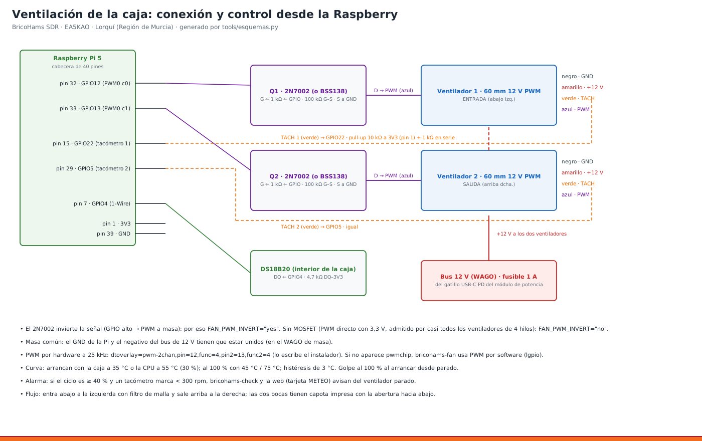

# 18 · Ventilación de la caja: conexión y control

<!-- guia-visual:inicio -->
> **Ruta visual:** [Meteorología, BME280, viento/lluvia y Pico IO](../GUIA_VISUAL_MODULOS.md#wx).
> Consulta allí requisitos, ilustración, cuadro de instalación, comprobaciones y restauración.
> Los comandos de este manual se ejecutan en Bash en la Pi; revisa el backup antes de cambiarla.
<!-- guia-visual:fin -->

> **v4 · Con el HAT puesto la cabecera de 40 pines está ocupada.** La ventilación (PWM, tacómetros y DS18B20) se conecta ahora a la **Pico «bricohams-io»** por USB: PWM GP16/GP17 por 2N7002, tacómetros GP18/GP19 con 10 kΩ a 3V3 + 1 kΩ, DS18B20 en GP22 con 4,7 kΩ. La curva y los comandos (`bricohams-fan --estado`, `--forzar`) son los mismos ([manual 20](20_PICO_IO.md), [esquema 16](../esquemas/16_pico_io.png)). Lo de abajo con pines de la Pi solo vale **sin HAT** (`IO_MODE="gpio"`).



**Qué hace:** dos ventiladores de 60 mm, 12 V, PWM de 4 hilos, controlados por la Raspberry según la temperatura de la CPU y la del aire de la caja (sonda DS18B20). El servicio es `bricohams-fan`.

## 1. Por qué así (ADR-23)
- **Carga térmica (diseño a 47 °C de aire a la sombra, ver [manual 17 · Clima de diseño](17_CAJA_V3.md)):** en verano en la Vega Media del Segura (Murcia) hay hasta 47 °C de aire y sol directo sobre la caja. Dentro de la electrónica se disipan 23 W con los equipos actuales y **~54 W** con los SDR futuros y el hub USB de 10 puertos (cálculo en la sección 1b). Sin ventilación forzada el interior pasaría de 100 °C.
- **Flujo:**
  - **entrada abajo a la izquierda** (aire fresco y sombra);
  - **salida arriba a la derecha**, donde el calor se acumula y está la Pi;
  - **las capotas**, con la boca hacia abajo, impiden que entre la lluvia.
- **PWM de 4 hilos y no 3 hilos con transistor:** el ventilador sigue con 12 V fijos y regula él mismo. A baja velocidad es silencioso, gasta poco y no mete ruido de conmutación en el bus de 12 V, cosa que sí oiría un SDR.
- **PWM por hardware en GPIO12/13** (overlay `pwm-2chan`, PWM0 del RP1 a 25 kHz):
  - no carga la CPU y no hace ruido audible;
  - si el overlay falla, el servicio pasa solo a PWM por software (`lgpio`).
- **El 2N7002:**
  - la entrada PWM del ventilador tiene pull-up interno a ~5 V; el MOSFET la tira a masa con seguridad y aísla el GPIO;
  - invierte la señal, y por eso `FAN_PWM_INVERT="yes"`;
  - **sin MOSFET:** el GPIO directo a 3,3 V funciona en casi todos los ventiladores de 4 hilos, con `FAN_PWM_INVERT="no"`.

## 1b. Estudio térmico a 47 °C (`tools/termica_caja.py`)
`python3 tools/termica_caja.py` (o `--json`, o `--opcion c`) calcula los tres módulos con las medidas de `caja_v3.scad` y los consumos de `tools/presupuesto_potencia.py`. Salida orientativa (modelo estacionario; **nada de esto está medido todavía**):

| Módulo | Calor interno | Sol absorbido (blanco, con tejadillo) | Caudal para ΔT 10 K | Caudal disponible | Interior (47 °C fuera) | Veredicto |
|---|---|---|---|---|---|---|
| electrónica | 53,5 W | 12,4 W | 18,8 m³/h (11,1 CFM) | 18,1 m³/h con los 2 ventiladores al 100 % | **56 °C** | ok (límite 60 °C) |
| potencia | 8,3 W | 6,6 W | 3,4 m³/h | 0,4 m³/h (tiro térmico) | **64 °C** | marginal |
| SAI | 7,3 W | 10,7 W | 3,5 m³/h | 0,7 m³/h (tiro térmico) | **58 °C** | overheat para la batería de plomo (límite 45 °C) |

**Electrónica: calor y supuestos**
- Equipos: 46,2 W (carriles de `presupuesto_potencia.py`: Pi 18 W, SDR USB 15 W, Hermes-Lite 13,2 W).
- Pérdidas de conversión:
  - reductor 12→5 V de la Pi al 90 %: 2,0 W;
  - hub de 10 puertos al 82 % (20 V → 5 V): 3,3 W;
  - elevador 12→20 V al 90 % (opción b del [manual 17](17_CAJA_V3.md)): 2,0 W.
- Total ≈ 53,5 W. Con los equipos actuales (sin «futuro») ≈ 23 W. Con la opción c (adaptador de 65 W en el módulo de potencia) la electrónica baja a 51,5 W y potencia sube a 8,7 W.
- Cargador de 120 W: 54 W de salida = 45 % (máximo 60 %), con rendimiento del 88 %.

**Sol (1000 W/m², sol a 60° de elevación y 30° de la normal de la cara delantera)**
- ASA blanco α ≈ 0,3, oscuro α ≈ 0,9.
- Electrónica sin tejadillo: 21,8 W absorbidos blancos / 65 W oscuros. Con tejadillo: la cara superior queda a la sombra y la delantera un 25 % (30 mm de vuelo), 12,4 W con el re-calentamiento del propio tejadillo (25 % de lo que absorbe).
- Solo entra al interior el U/h_ext ≈ 31 % de lo absorbido (pared de 3,6 mm de ASA, k = 0,17 W/mK, h exterior 10 W/m²K): 3,8 W con tejadillo, 6,8 W sin él. Por eso el tejadillo y el blanco importan menos de lo que parece: lo que manda es el calor de dentro.
- Pérdida pasiva de las paredes de la electrónica: UA ≈ 0,9 W/K.

**Ventiladores (supuesto: 60 × 25 mm, 12 V PWM, tipo Noctua NF-A6x25: 29,2 m³/h = 17,2 CFM libres y 21 Pa; confirma el modelo que montes)**
- Capota con la boca hacia abajo, malla antiinsectos y rejilla restan el 50 % del caudal de cada ventilador (rango probado 40–60 %).
- Dos ventiladores en serie (entrada abajo-izquierda y salida arriba-derecha, empuja-tira): 18,1 m³/h (10,6 CFM) al 100 %.
- Temperatura interior de la electrónica a 47 °C de ambiente:

| Ciclo | Caudal | Interior | Lectura |
|---|---|---|---|
| 100 % | 18,1 m³/h | 56 °C | ok |
| 60 % | 10,8 m³/h | 61 °C | marginal |
| 30 % | 5,4 m³/h | 70 °C | no vale |
| parados | — | > 100 °C | — |

- Sensibilidad a la pérdida por capotas/malla: 40 % → 20,9 m³/h (55 °C); 50 % → 18,1 m³/h (56 °C); 60 % → 14,9 m³/h (58 °C).
- Sin tejadillo la electrónica sube solo 0,4 K (56,4 °C), y con la caja oscura y sin tejadillo 58,5 °C; el tejadillo sirve sobre todo para la lluvia, las paredes y los módulos pasivos.
- **Conclusión:** los dos ventiladores de 60 mm bastan **solo al 100 %** (4 K de margen sobre 60 °C). No se pasa a 80 mm: no caben sin mover la fila de N y los dongles. Si la medida real sale peor, el orden de recursos es: (1) disipadores en los SDR y los reductores; (2) mover los equipos más calientes (Pi, reductores) junto a la salida y los SDR junto a la entrada; (3) más superficie de entrada o salida; (4) ventiladores de 80 mm con pared y fila de N rediseñadas.

**Potencia y SAI (rejillas pasivas, sin ventilador)**
- Potencia: el cargador de 120 W de GaN suele darse para ≤ 40 °C de ambiente y aquí el aire sube a ~64 °C. Recomendado: un ventilador de 60 mm en la rejilla de salida del módulo (fuera del alcance del `.scad` actual), o sacar el cargador a un tercer recinto en sombra.
- SAI: la batería de plomo pierde la mitad de su vida por cada +8–10 K sobre 25 °C y a partir de 40–45 °C se degrada rápido. A 47 °C de ambiente es inevitable que supere ese límite: colócalo a la sombra (cara norte o bajo el módulo de potencia), mantén la tensión de flotación compensada (13,25 V a 47 °C con −3 mV/°C/celda) y planifica cambiar la batería cada 2–3 años, o pasa a LiFePO4.

**Componentes (aire interior de la electrónica ≈ 56 °C)**

| Componente | Límite | Medida |
|---|---|---|
| Raspberry Pi 5 | 85 °C en el SoC (throttling) | refrigerador activo oficial; a plena carga el SoC estima +40 K sobre el aire (supuesto) → limita la carga continua; junto a la salida |
| RTL-SDR V4 y dongles RTL | ~70 °C | carcasa de aluminio o disipadores adhesivos en el R828D y el RTL2832U; en el flujo de entrada |
| HackRF One / Pro | ~70 °C | disipadores adhesivos en la FPGA y en los amplificadores; carcasa de aluminio |
| Airspy HF+ Discovery | ~70 °C | aluminio de serie |
| SDRplay RSPdx | ~70 °C | caja metálica; bahía de expansión, abajo, con aire de entrada |
| LilyGO / RAK4631 | ~85 °C | sin disipador; lejos de los reductores |
| Reductores 12→5 V y elevador 12→20 V | ~85 °C de placa | disipadores adhesivos; reserva el hueco «reserva» del `.scad` |
| Cargador de 120 W | ~40 °C ambiente | ver arriba (módulo de potencia) |
| Batería de plomo | 40–45 °C | ver arriba (módulo SAI) |

Los límites de los SDR y el ΔT de la Pi son supuestos de diseño: contrástalos con la hoja de datos de tu unidad.

**Cambios en el `.scad`:** `FAN_OUT` sube de z = 60 a z = 68 para que el ventilador de salida no pise el diplexor, que se mueve a la derecha para dejar sitio al hub USB; el resto de propuestas (80 mm, ventilador en potencia) quedan como recomendación.


| Cable del ventilador | Va a | Notas |
|---|---|---|
| Negro · GND | WAGO GND 12 V | **unido a GND de la Pi** (pin 39) |
| Amarillo · +12 V | WAGO +12 V, tras un **fusible de 1 A** | — |
| Verde · TACH | GPIO22 (pin 15) para el ventilador 1 · GPIO5 (pin 29) para el 2 | **pull-up de 10 kΩ a 3,3 V (pin 1) + 1 kΩ en serie**. El tacómetro es colector abierto: así nunca llegan 12 V a la Pi |
| Azul · PWM | drenador del 2N7002 (Q1/Q2) | fuente a GND · puerta ← 1 kΩ ← GPIO12 (pin 32) / GPIO13 (pin 33) · 100 kΩ puerta–fuente |

**DS18B20** (sonda de aire de la caja, colgada en el centro, lejos de la Pi):

| DS18B20 | Va a |
|---|---|
| VDD | 3,3 V (pin 1) |
| GND | pin 9 |
| DQ | GPIO4 (pin 7), con **4,7 kΩ** entre DQ y 3,3 V |

**Montaje en placa:** una placa perforada de 5 × 7 cm con los 2 MOSFET, las resistencias y una tira de pines Dupont. Va en un inserto de la rejilla junto a la Pi.

## 3. Configuración (`bricohams.env` → `/etc/bricohams/fan.env`)
| Variable | Defecto | Qué hace |
|---|---|---|
| `FAN_ENABLE` | yes | activa el servicio y los overlays |
| `FAN_PWM_GPIOS` | 12,13 | entrada, salida |
| `FAN_TACH_GPIOS` | 22,5 | — |
| `FAN_PWM_INVERT` | yes | con 2N7002 |
| `FAN_T_CPU_MIN` / `MAX` | 50 / 70 °C | — |
| `FAN_T_CAJA_MIN` / `MAX` | 40 / 55 °C | — |
| `FAN_DUTY_MIN` | 30 % | por debajo se paran |
| `FAN_HIST` | 3 °C | para que no arranquen y paren cada minuto |
| `FAN_DS18B20_ID` | vacío | el primero que aparezca en `/sys/bus/w1/devices/28-*` |

**La curva:**
- el ciclo es el **mayor** de los dos cálculos (CPU y caja);
- entre MIN y MAX sube en línea recta del 30 al 100 %;
- **al arrancar desde parado** da un golpe al 100 % durante 1,5 s, porque algunos ventiladores no arrancan al 30 %.

**El instalador:**
- añade `dtoverlay=pwm-2chan,pin=12,func=4,pin2=13,func2=4` y `dtoverlay=w1-gpio,gpiopin=4` a `/boot/firmware/config.txt`;
- **hay que reiniciar** después.

## 4. Pruebas
```bash
sudo systemctl status bricohams-fan     # activo
sudo bricohams-fan --estado             # CPU, caja, ciclo y rpm de cada ventilador
sudo systemctl stop bricohams-fan
sudo bricohams-fan --forzar 100         # 30 s a tope: deben dar > 2000 rpm
sudo bricohams-fan --forzar 0           # 30 s parados: rpm 0
sudo systemctl start bricohams-fan
ls /sys/bus/w1/devices/                 # debe aparecer 28-xxxxxxxxxxxx
cat /run/bricohams/caja.json
```
**Qué ves en la web:** la tarjeta METEO de OpenWebRX muestra «📦 Caja: 38 °C · ventiladores 45 % · 1800/1750 rpm».

**Alarma:** si el ciclo es ≥ 40 % y un ventilador da < 300 rpm, aparece «⚠ ventilador parado» en la web y en `bricohams-check`.

## 5. Problemas típicos
| Síntoma | Causa | Arreglo |
|---|---|---|
| rpm siempre 0 y el ventilador gira | falta el pull-up del TACH o la masa común | revisa 10 kΩ a 3,3 V y GND del WAGO unido a la Pi |
| giran siempre al 100 % | PWM invertido al revés | cambia `FAN_PWM_INVERT` |
| `pwmchip` no aparece | falta el overlay o no se ha reiniciado | `grep pwm-2chan /boot/firmware/config.txt`; reinicia. El servicio usará PWM por software mientras tanto |
| no hay DS18B20 | falta 4,7 kΩ o el overlay w1-gpio | `dmesg \| grep w1` |
| ruido en HF al subir los ventiladores | los 12 V llevan ruido | ferrita en los cables del ventilador y condensador de 100 µF en el WAGO |
