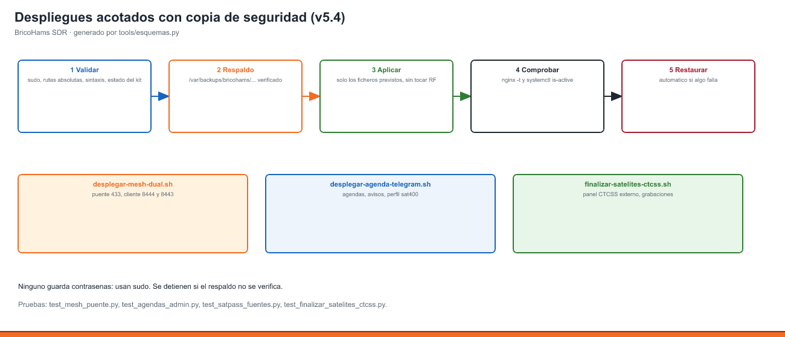

# 26 · Satélites: aviso de próximos pases, ▶ Escuchar con Doppler e imágenes METEOR

<!-- guia-visual:inicio -->
> **Ruta visual:** [Satélites, Doppler y FT2 experimental](../GUIA_VISUAL_MODULOS.md#satelites).
> Consulta allí requisitos, ilustración, cuadro de instalación, comprobaciones y restauración.
> Los comandos de este manual se ejecutan en Bash en la Pi; revisa el backup antes de cambiarla.
<!-- guia-visual:fin -->

## 1. Qué ve el oyente
- **Franja en lo alto de la web:**
  - antes del pase: «🛰️ **SO-50** en 12 min (18:42) · máx 54° · 11 min · 436,795 NFM **[▶ Escuchar]**»;
  - durante el pase: «🔴 EN DIRECTO: ISS · hasta las 19:03».
  - Solo avisa de los pases de más de 15° de elevación.
- **Botón «PASES»** en la barra superior: tabla de los próximos pases (hora, máxima elevación, duración, frecuencia y azimut de entrada→salida), cada uno con su ▶.
- **▶ Escuchar:**
  1. cambia al receptor y perfil de satélites que toca (`sat|sat2m`, `sat|sat70` o `sat|meteor`);
  2. sintoniza la bajada en su modo;
  3. **arranca el seguimiento Doppler** del plugin `doppler` con los mismos elementos orbitales. La frecuencia se corrige cada segundo.
- **Imágenes METEOR-M2-3/M2-4 (LRPT 137,9 MHz):**
  - las decodifica **SatDump** como servicio de fondo de OpenWebRX+ cuando el receptor de satélites está libre;
  - aparecen en el menú **Files** de la web;
  - el instalador baja SatDump de GitHub si `SATDUMP_ENABLE="yes"`.
  - en el waterfall la señal LRPT solo se oye como ruido digital: la imagen no se ve en directo, sale en **Files** al acabar el pase;
  - algunas compilaciones de SatDump 2.x buscan sus plugins solo en `/usr/local/lib/satdump`. Si faltan, el pase se salta sin imagen; el instalador crea el enlace `/usr/local/lib/satdump → /usr/lib/satdump` y `bricohams-check` avisa si no está.

## 2. Cómo se calcula (ADR-31)
- **`bricohams-satpass`**, cada 15 min (temporizador systemd):
  1. descarga los elementos orbitales de **CelesTrak** (formato OMM/JSON) cada 12 h, con copia en `/var/lib/bricohams/tle.json` por si no hay Internet;
  2. propaga con **SGP4** (`python3-sgp4`) las próximas 24 h desde el QTH (`STATION_LAT/LON/ASL`);
  3. escribe `plugins/receiver/satelites/pases.json`.
- **Precisión:** la prueba `tests/test_satpass.py` compara con Skyfield: entrada en horizonte a ±10 s y elevación máxima a ±1°.
- **Lista de satélites:** `data/satelites.json`.
- **Filtros de consulta:** Settings → Satélites y el botón PASES permiten elegir
  2 m, 70 cm, 137 MHz o 400 MHz y un intervalo inclusivo de frecuencias en MHz.
  Aceptan coma decimal; para una frecuencia exacta, usa el mismo valor en ambos
  extremos. No cambian las grabaciones, las exclusiones ni los avisos.
- **Respaldo orbital:** si falla CelesTrak, se consultan las TLE de SatNOGS y se
  convierten a OMM con SGP4, comprobando el NORAD de ambas líneas. Si fallan ambas
  fuentes se conserva la copia y se registra el error; sin elementos no se inventan pases.

  | Satélite | NORAD | Bajada | Modo | Perfil |
  |---|---|---|---|---|
  | ISS | 25544 | 145,800 | NFM | sat2m |
  | SO-50 | 27607 | 436,795 | NFM | sat70 |
  | AO-91 | 43017 | 145,960 | NFM | sat2m |
  | RS-44 | 44909 | 435,640 | USB | sat70 |
  | FO-29 (JAS-2) | 24278 | 435,850 | USB | sat70 |
  | Replicator-2 | 69927 | 400,500 | NFM (audio de GFSK) | sat400 |
  | SAKHACUBE-CHOLBON (RS18S) | 67290 | 437,350 | NFM (telemetría/SSTV en eventos) | sat70 |
  | TO-108 | 44881 | 145,925 | USB | sat2m |
  | IO-117 GreenCube | 53106 | 435,310 | USB | sat70 |
  | MARMOTSat (CO-128) | 69912 | 145,875 | NFM (digipeater FSK 1200 AX.100 modo 5 y CW) | sat2m |
  | METEOR-M2-3 | 57166 | 137,900 | NFM / LRPT | meteor |
  | METEOR-M2-4 | 59051 | 137,900 | NFM / LRPT | meteor |

  Para añadir uno, pon una línea con su número NORAD, la bajada, el modo y el perfil, y lanza `sudo systemctl start bricohams-satpass`.

  Replicator-2 no es un repetidor de voz: transmite GFSK 9600. SatNOGS lo
  identifica provisionalmente como 98267, pero sus TLE siguen el NORAD 69927;
  `satnogs_id` conserva esa correspondencia sin confundir las órbitas.
  El perfil `sat400` evita intentar recibir 400,500 MHz dentro de la ventana de 70 cm.
  MARMOTSat (UVic CfAR) se sigue con el NORAD 69912 de CelesTrak; SatNOGS lo lista como 98272.
  Su digipeater es FSK 1200 con tramas AX.100 modo 5 (como GreenCube), no AFSK AX.25: el
  decodificador «packet» de OpenWebRX+ no lo lee y aquí solo se graba el audio. Sus emisiones
  de HF (29,410 MHz) y de 436,125 MHz no caen en los perfiles de satélites.
  Grabar audio FM no equivale a decodificar GFSK/GMSK. FO-29 depende del horario
  del operador; que exista un pase no garantiza actividad. No se asignan códigos
  AMSAT no verificados a las nuevas entradas.

  Fuentes: [FO-29](https://db.satnogs.org/satellite/XTKP-9404-9174-4088-2406/),
  [Replicator-2](https://db.satnogs.org/satellite/VCDK-6912-2495-5415-3885/) y
  [SAKHACUBE-CHOLBON](https://www.yksa.space/projects/missions/sakhacube-cholbon).

## 3. Duplex y transmisión
La estación **solo recibe**. «Autoconfigurar el duplex» aquí significa sintonizar la **bajada** con su Doppler. La subida y el tono de cada satélite van en la nota del marcador y en la tabla del manual 27, para quien vaya a transmitir con su equipo.

## 4. Comprobación
```bash
sudo -u openwebrx bricohams-satpass --ver    # pases de las próximas 24 h
systemctl list-timers bricohams-satpass.timer
command -v satdump && satdump --help | head -3
ls -l /usr/local/lib/satdump                 # enlace a /usr/lib/satdump
```
- **En la web:** pulsa **PASES** y después ▶ en un pase en curso. La frecuencia del receptor debe moverse sola unos pocos kHz durante el pase.

## 4 bis. Instalar solo este módulo en otro OpenWebRX+
> Guía completa solo de instalación y configuración: [manual 48](48_MODULO_SATELITES.md).

Para una Pi que ya tiene **OpenWebRX+ nativo** funcionando y no quiere el resto del kit:

```bash
cp bricohams.env.example bricohams.env   # rellena CALLSIGN y STATION_LAT/LON/ASL (o STATION_LOCATOR)
sudo bash install.sh --modulo satelites
```

- **Instala:** el cálculo de pases cada 15 min, la franja de aviso y el botón **PASES** con
  ▶ Escuchar y Doppler, la grabación de pases en **Files**, el calendario
  `/static/plugins/receiver/satelites/pases.ics`, el archivo permanente de Files y SatDump
  si `SATDUMP_ENABLE="yes"`.
- **No toca:** receptores, perfiles, marcadores, otros plugins, nginx ni el panel de
  administración. En `plugins/receiver/init.js` solo añade, entre las marcas
  `// >>> bricohams-satelites` y `// <<< bricohams-satelites`, la carga de los plugins
  `doppler` y `satelites`, y guarda antes una copia `init.js.antes-*`. Si el `init.js` es el
  completo de BricoHams, no lo cambia.
- **Agenda:** se ajusta en `bricohams.env` con `SATREC_ENABLE`, `SATREC_MIN_EL`,
  `SATREC_EXCLUIR`, `SATREC_METEOR`, `SATREC_DIAS`, `SATREC_MAX_MB` y `AMSAT_REPORT`, y se
  aplica repitiendo la orden. La página «Satélites y agendas de captura» de `/settings` forma
  parte del panel de administración y requiere la instalación completa.
- **▶ Escuchar** cambia a los perfiles `sat|…` solo si existen en ese receptor; si no, sintoniza
  en el perfil actual y activa el Doppler.
- **Requisitos:** OpenWebRX+ nativo (`OWRX_BACKEND=native`, no Docker), usuario `openwebrx` y
  QTH en `bricohams.env`. Si falta algo, el instalador se detiene sin cambiar nada.

## 4 ter. Rotor AZ/EL (opcional)
Con el rotor PortableSatLite, la yagi V/U sigue sola los pases que se graban y aparca con viento: [manual 49](49_ROTOR_AZEL.md).

## 5. Grabación automática, calendario e informe AMSAT (v5.0)
Los pases de más de 20° se graban solos en MP3 y salen en **Files** y en la página «Clima en red» (`/bricohams/clima.html`), con su calendario `.ics` y el borrador del informe para AMSAT: [manual 42](42_CLIMA_RED_SATELITES_GRABACION.md).

## v5.4: filtros, CTCSS externo y despliegue



sudo tools/finalizar-satelites-ctcss.sh <kit-instalado> desactiva el panel CTCSS externo y deja intacto el subtono FM integrado; hace copia verificada y reinicia solo ricohams-satrec. Pruebas: 	ests/test_finalizar_satelites_ctcss.py, 	ests/test_satelites_filtros.cjs y 	ests/test_satpass_fuentes.py (nunca se asocia un TLE de otro NORAD).