# 52 · Montaje de las piezas impresas en 3D
<!-- guia-visual:inicio -->
> **Ruta visual:** [Caja, antenas, filtros, alimentación y anclajes](../GUIA_VISUAL_MODULOS.md#hardware).
> Consulta allí requisitos, ilustración, cuadro de instalación, comprobaciones y restauración.
> Los comandos de este manual se ejecutan en Bash en la Pi; revisa el backup antes de cambiarla.
<!-- guia-visual:fin -->


**BricoHams SDR · montaje paso a paso de todas las piezas impresas de la estación**

Autores: Anatol EA5KAO · Diego EA5JEF · Pedro Roca Molina · <https://bricohams.org>

Este manual reúne, en un solo sitio, el **orden de montaje de las 110 piezas STL** del kit:
caja v2, caja v3 (electrónica, potencia y SAI), antenas y anclajes. No sustituye a los manuales
[10](10_CAJA_3D.md), [11](11_MASTIL_Y_ANTENAS.md), [12](12_QUAD_2M70.md), [13](13_DISCONES.md),
[14](14_ADSB_LNA.md), [15](15_LAZO_MLA30.md), [17](17_CAJA_V3.md), [18](18_VENTILACION.md),
[19](19_VIENTO_Y_LLUVIA.md), [20](20_PICO_IO.md) y [21](21_ANCLAJES.md): ellos explican el cableado,
la RF y la puesta en marcha; este explica **cómo se ensamblan las piezas**.

> **Regla de este manual.** Las cotas, tornillos e insertos salen de los ficheros `.scad` de
> `hardware/` y de los manuales citados. Lo que no figura en ninguno se marca como
> **PENDIENTE DE CONFIRMAR**: no lo des por bueno sin medirlo en tu pieza. Si un manual y el `.scad`
> discrepan, manda el `.scad` y la discrepancia se indica.
>
> ⚠ **Seguridad.** La caja v2 y los módulos de potencia y SAI de la v3 alojan 230 V. Trabaja siempre
> sin tensión y con diferencial de 30 mA aguas arriba. El SAI debe estar desenchufado, con la batería
> desconectada y con 5 minutos de espera. El trabajo en altura y en red eléctrica requiere personal
> cualificado y cumplir la normativa local.

## Índice

1. [Material, herramientas y consumibles](#1-material-herramientas-y-consumibles)
2. [Tabla maestra de piezas (110 STL)](#2-tabla-maestra-de-piezas-110-stl)
3. [Convenciones comunes de montaje](#3-convenciones-comunes-de-montaje)
4. [Grupo A · Caja v2](#4-grupo-a--caja-v2)
5. [Grupo B · Caja v3: electrónica](#5-grupo-b--caja-v3-electrónica)
6. [Grupo C · Caja v3: potencia y SAI](#6-grupo-c--caja-v3-potencia-y-sai)
   - [6 bis. Distribución de componentes y cableado](#6-bis-distribución-de-componentes-y-cableado)
7. [Grupo D · Antenas: quad 2 m / 70 cm](#7-grupo-d--antenas-quad-2-m--70-cm)
8. [Grupo E · Antenas: discones y ADS-B](#8-grupo-e--antenas-discones-y-ads-b)
9. [Grupo F · Antenas: MLA-30, GPS y accesorios RF](#9-grupo-f--antenas-mla-30-gps-y-accesorios-rf)
10. [Grupo G · Anclajes: crucetas](#10-grupo-g--anclajes-crucetas)
11. [Grupo H · Anclajes: sensores y Pico](#11-grupo-h--anclajes-sensores-y-pico)
12. [Mapa de piezas en el mástil y montaje final](#12-mapa-de-piezas-en-el-mástil-y-montaje-final)
13. [Lista de comprobación antes de subir al mástil](#13-lista-de-comprobación-antes-de-subir-al-mástil)
14. [Valores pendientes de confirmar](#14-valores-pendientes-de-confirmar)
15. [Cómo regenerar las imágenes](#15-cómo-regenerar-las-imágenes)

| Diagrama | Grupo |
|---|---|
| [31_montaje_caja_v2.svg](../esquemas/31_montaje_caja_v2.svg) | A · Caja v2 |
| [32_montaje_caja_v3_electronica.svg](../esquemas/32_montaje_caja_v3_electronica.svg) | B · Caja v3 electrónica |
| [33_montaje_caja_v3_potencia_sai.svg](../esquemas/33_montaje_caja_v3_potencia_sai.svg) | C · Potencia y SAI |
| [34_montaje_quad.svg](../esquemas/34_montaje_quad.svg) | D · Quad 2 m / 70 cm |
| [35_montaje_discone_adsb.svg](../esquemas/35_montaje_discone_adsb.svg) | E · Discones y ADS-B |
| [36_montaje_mla_gps.svg](../esquemas/36_montaje_mla_gps.svg) | F · MLA-30, GPS y accesorios |
| [37_montaje_crucetas.svg](../esquemas/37_montaje_crucetas.svg) | G · Crucetas |
| [38_montaje_sensores_pico.svg](../esquemas/38_montaje_sensores_pico.svg) | H · Sensores y Pico |
| [39_mapa_piezas_mastil.svg](../esquemas/39_mapa_piezas_mastil.svg) | Mapa en el mástil |
| [40_rejilla_caja_v2.svg](../esquemas/40_rejilla_caja_v2.svg) · [41](../esquemas/41_rejilla_v3_electronica.svg) · [42](../esquemas/42_rejilla_v3_potencia.svg) · [43](../esquemas/43_rejilla_v3_sai.svg) | 6 bis · Rejillas y bandejas |
| [44_cableado_caja_v2.svg](../esquemas/44_cableado_caja_v2.svg) · [45](../esquemas/45_cableado_v3_electronica.svg) · [46](../esquemas/46_cableado_v3_potencia.svg) · [47](../esquemas/47_cableado_v3_sai.svg) | 6 bis · Cableado por caja |
| [48_interconexion_estacion.svg](../esquemas/48_interconexion_estacion.svg) · [49_protecciones.svg](../esquemas/49_protecciones.svg) | 6 bis · Estación y protecciones |

Los diagramas se generan con `python3 tools/esquemas.py`. Los números de los círculos naranjas
coinciden con los números de paso agrupados de cada sección.

## 1. Material, herramientas y consumibles

**Impresión.** Anycubic Kobra S1 (250 × 250 × 250 mm) con ASA, según el
[manual 43](43_KOBRA_S1_ASA.md). El TPU 95A no es compatible con la ACE Pro: se imprime desde el
portabobinas externo. Los perfiles de ese manual **no están validados**: haz una prueba antes de imprimir
una caja completa. Importa los STL al 100 %, sin escalar ni compensar contracción.
Las piezas grandes de la v3 (cuerpo de electrónica 246 × 244,6 × 199 mm) **no caben con un borde de 5 mm**:
imprímelas sin borde o con otra orientación ([manual 43](43_KOBRA_S1_ASA.md)).

| Herramienta / consumible | Para qué |
|---|---|
| Soldador con punta para insertos | Insertos roscados de latón: 230-245 °C en la v2 y 220 °C en la v3 |
| Insertos de latón M3 (agujero 4,0 × 6 mm), M4 (5,6 × 8,5 mm) y M5 (agujero de 7,0 mm en la v3) | Roscas en el plástico |
| Tornillería M2, M2.5, M3, M4, M5, M6 y M8 | Ver tabla maestra y cada grupo |
| Tuercas hexagonales M6 (11,3 × 5,4 mm), tuercas ciegas M4 | Crucetas y garita |
| Arandelas planas y de goma | Tapas, tejadillo y crucetas |
| TPU 95A | `*_junta_*`, `pasamuros_usb`, `tapon_*`, fundas: se imprimen, no se compran |
| Pasamuros SMA con junta tórica, pasamuros N, prensaestopas PG7, PG9, M20 y M25 | Entradas de cable y RF |
| Cianoacrilato | 4 puntos por junta de tapa en la v3 |
| Cinta autoamalgamante, bridas, silicona neutra | Fundas, sujeción de coaxial, radomo y capuchón |
| Abrazaderas de tornillo sin fin de 12 mm, U de M8 y M6 | Fijación al mástil |
| Llaves Allen, llaves fijas y destornilladores | Apriete. Par de apriete: **PENDIENTE DE CONFIRMAR** |
| Calibre o pie de rey, nivel | Comprobar agujeros y la plataforma del pluviómetro |
| Multímetro y NanoVNA | Comprobaciones previas ([manual 45](45_NANOVNA.md)) |

## 2. Tabla maestra de piezas (110 STL)

Cada STL existente aparece **una sola vez**. Los STL están en `hardware/<grupo>/stl/`:
caja v2 16, caja v3 48 (25 de electrónica, 10 de potencia y 13 de SAI), antenas 30 y anclajes 16.
«Como exportada» significa que se imprime en la orientación en que está el STL.
La columna de soportes recoge los agujeros en forma de gota, que no necesitan soportes; cuando el `.scad` y los
manuales no lo dicen, se marca **PENDIENTE DE CONFIRMAR**.
Materiales de la caja v2: [manual 10](10_CAJA_3D.md); caja v3: [manual 17](17_CAJA_V3.md);
antenas: manuales [12](12_QUAD_2M70.md) y [13](13_DISCONES.md); anclajes: [manual 21](21_ANCLAJES.md).

### 2.1 Caja v2 (`hardware/caja/stl/`, 16 piezas)

PETG blanco con 8 perímetros, gyroide al 25 % y borde de 5 mm en `cuerpo` y `tapa` ([manual 10](10_CAJA_3D.md)).

| Vista | Archivo | Grupo | Cant. | Material | Orientación | Soportes | Tornillería / insertos / juntas |
|---|---|---|---|---|---|---|---|
| 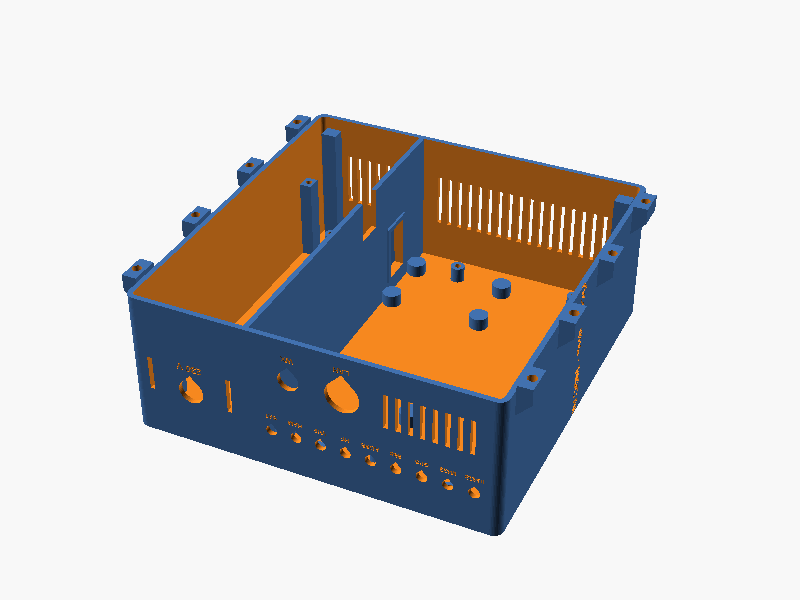 | `cuerpo.stl` | A | 1 | PETG blanco | Trasera sobre la cama ([render](../../hardware/caja/render/cuerpo_impresion.png)) | No | Insertos M4 (8 orejas y 8 de soportes de mástil), M3 en bosses; 9 SMA, PG7, M20, PG9 |
| 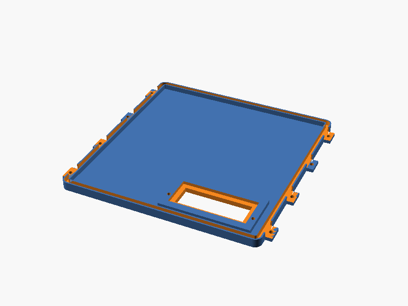 | `tapa.stl` | A | 1 | PETG blanco | Cara exterior sobre la cama | No | 8 × M4×12 con arandela; ranura para `junta_tapa` |
| 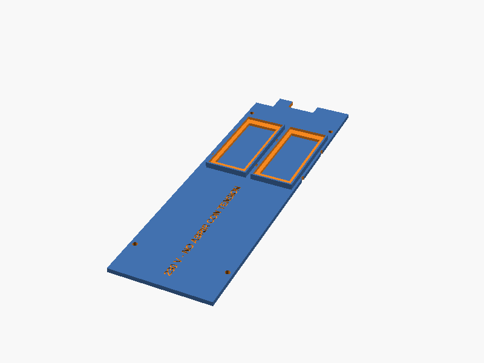 | `tapa_potencia.stl` | A | 1 | PETG | Como exportada | No | 4 insertos M3 · 4 × M3×8 |
| 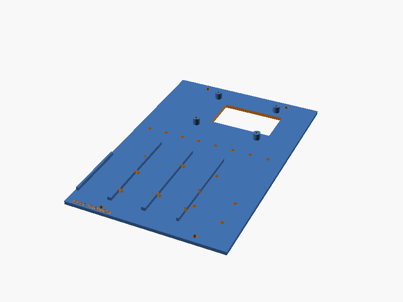 | `placa_electronica.stl` | A | 1 | PETG | Como exportada | No | 4 × M3×8 a bosses · Pi 5: 4 × M2.5×6 autorroscantes |
| 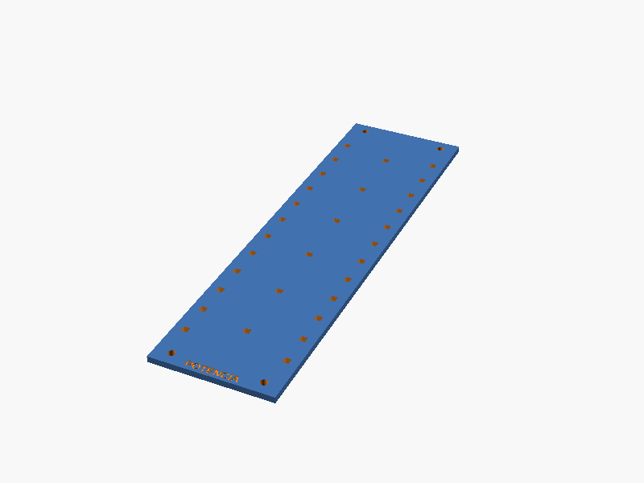 | `placa_potencia.stl` | A | 1 | PETG | Como exportada | No | 4 × M3×8 a bosses |
| 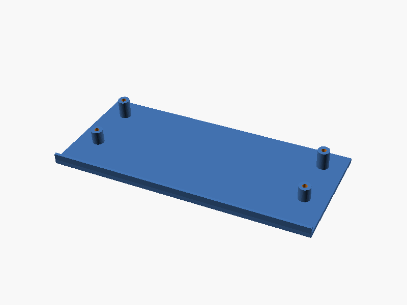 | `tejadillo.stl` | A | 1 | PETG blanco | Como exportada | No | 4 insertos M4 · 2 × M4×30 (traseros) + 2 × M4×25 (delanteros) con arandelas de goma |
| 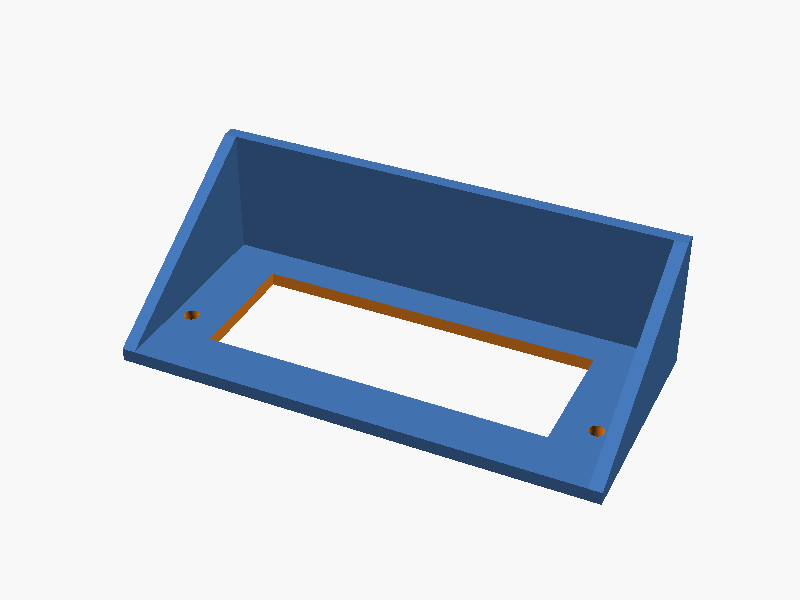 | `visera.stl` | A | 1 | PETG blanco | Como exportada | No | 2 insertos M3 · 2 × M3×8 |
| 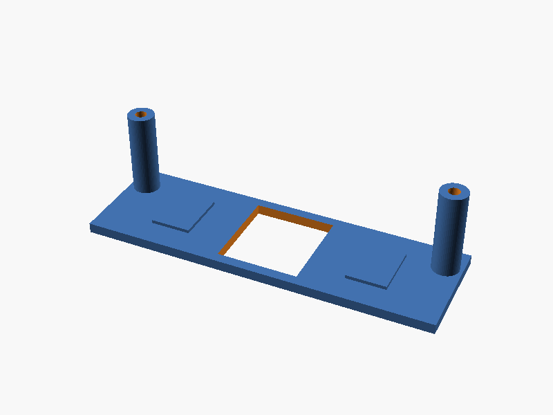 | `soporte_camara.stl` | A | 1 | PETG negro | Como exportada | No | 2 insertos M3 · 2 × M3×35; espuma de 1 mm |
| 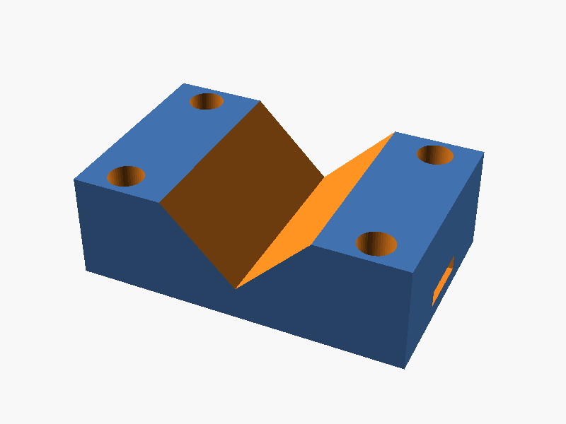 | `soporte_mastil.stl` | A | 2 | PETG | Como exportada | No | 4 × M4×20 por soporte · abrazaderas de 12 mm |
| 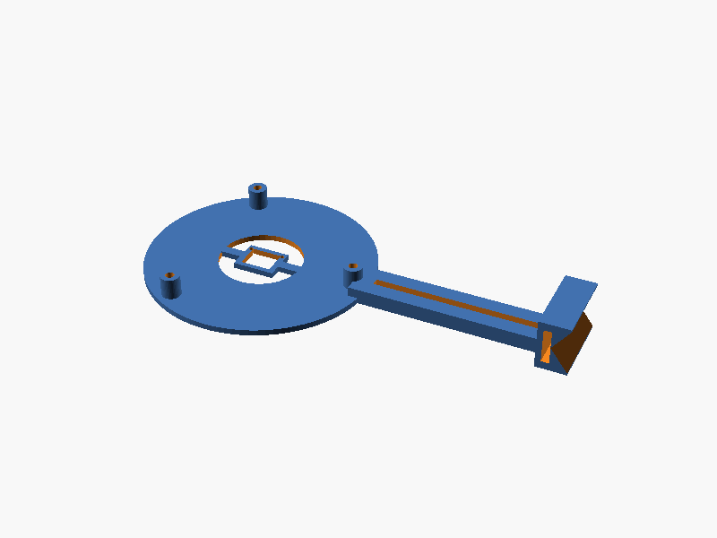 | `garita_base.stl` | A | 1 | PETG blanco | Como exportada | No | 3 varillas M4×140 · tuercas ciegas · 2 × M2×8 (sensor) |
| 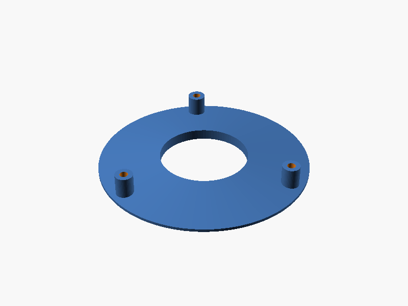 | `garita_plato.stl` | A | 6 | PETG blanco | Como exportada | No | 3 varillas M4×140 (comunes) |
| 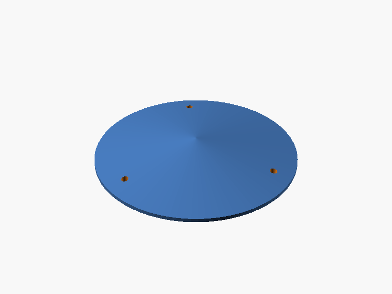 | `garita_tapa.stl` | A | 1 | PETG blanco | Como exportada | No | Tuercas ciegas M4 |
| 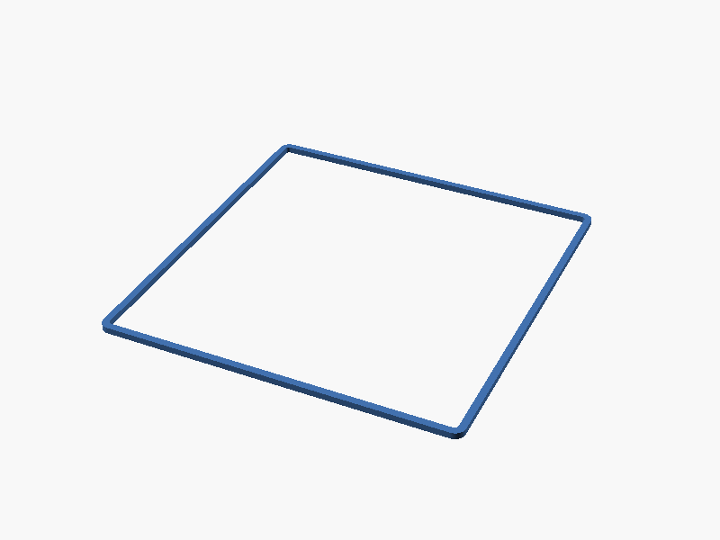 | `junta_tapa.stl` | A | 1 | TPU 95A | Como exportada | No | Va en la ranura de la tapa (4,4 × 4 mm) |
| 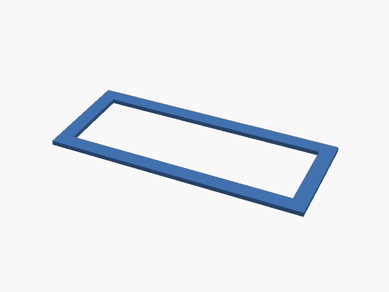 | `junta_ventana.stl` | A | 1 | TPU 95A | Como exportada | No | Con policarbonato; junta de 1,5 mm |
| 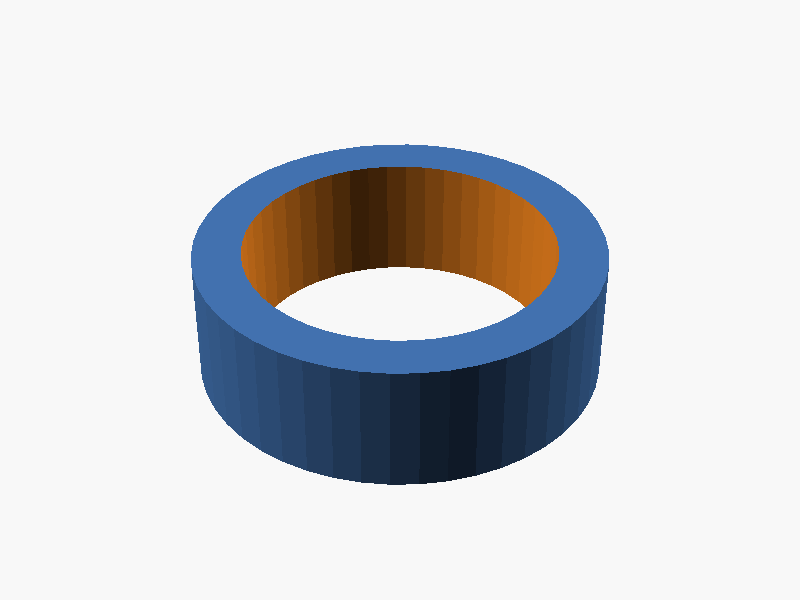 | `separador_ir.stl` | A | 1 | TPU 95A negro | Como exportada | No | Opcional / no necesario con Camera Module 3 Wide (evita reflejos de los LED IR de la WPI408) |
| 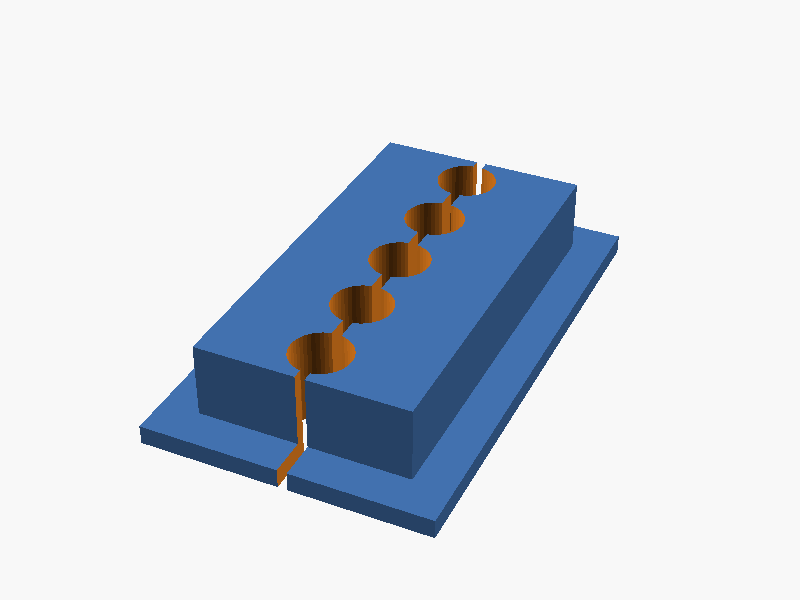 | `pasamuros_usb.stl` | A | 1 | TPU 95A | Como exportada | No | Paso del tabique (hueco de 18 × 34 mm), 5 pasos de cable |

### 2.2 Caja v3 (`hardware/caja_v3/stl/`, 48 piezas)

Salvo indicación, las piezas rígidas v3 son de ASA blanco; `cuerpo` y `tapa`, con 9 perímetros y gyroide al 30 %;
`tejadillo`, con 6 perímetros; `placa_rejilla`, al 40 %; `pletina_pared` y `soporte_mastil`, al 60 %;
bandejas y postes, al 40 % con 4 perímetros; `capota`, `rejilla_ventilador`, `visera` y `soporte_camara`, al 30 %;
soportes de dongle, hub, LilyGO, RAK, SDRplay y WAGO, `soporte_schuko` y `brida_cargador`, al 40 %;
`soporte_bateria`, al 60 % con 6 perímetros; `guia_pcb`, `pletina_trafo`, `soporte_filtro` y `soporte_wago` del SAI, al 50 %;
el TPU (`junta_tapa`, `tapon_n`, `tapon_pg`), al 100 % ([manual 17](17_CAJA_V3.md)).
Orientación: cuerpo boca arriba; tapa con la cara exterior sobre la cama; el resto, como exportada.

**Electrónica (25)**

| Vista | Archivo | Grupo | Cant. | Material | Orientación | Soportes | Tornillería / insertos / juntas |
|---|---|---|---|---|---|---|---|
| 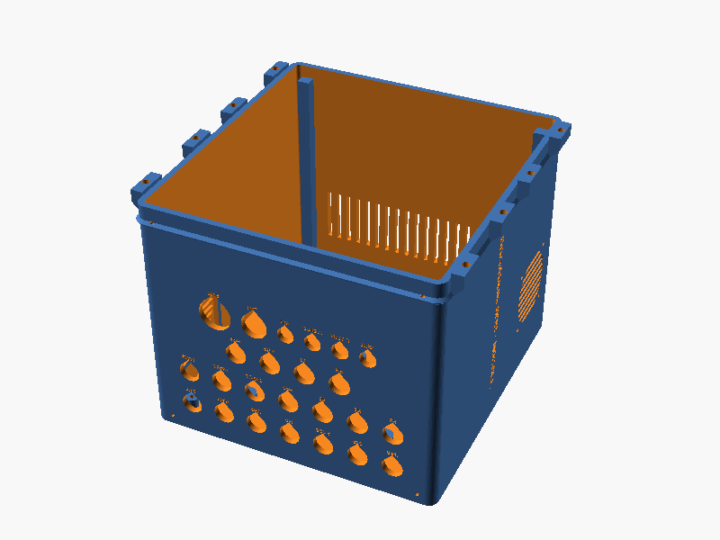 | `electronica_cuerpo.stl` | B | 1 | ASA | Boca arriba | No | Insertos M4 (orejas y pilares), M5 traseros; N 16,2 mm; M25, M20, PG7 |
| 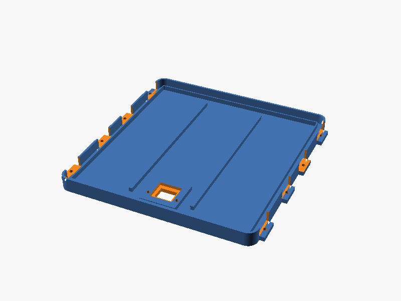 | `electronica_tapa.stl` | B | 1 | ASA | Cara exterior sobre la cama | No | 8 × M4×16 (8 orejas en el `.scad`) |
| 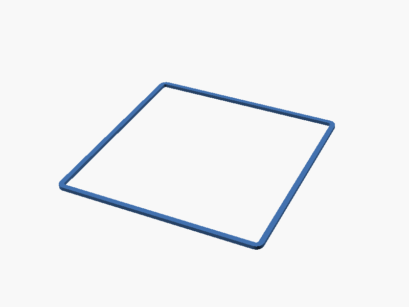 | `electronica_junta_tapa.stl` | B | 1 | TPU 95A | Como exportada | No | Ranura de 5,8 mm; 4 puntos de cianoacrilato |
| 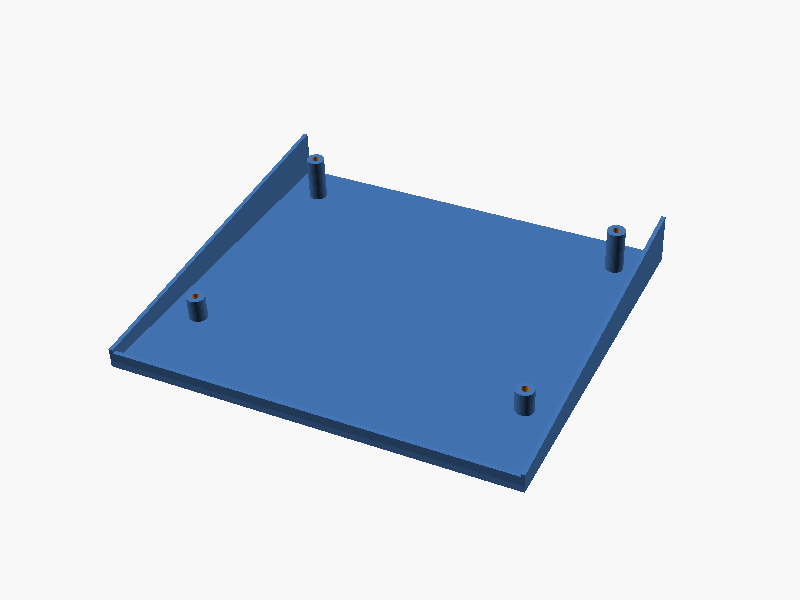 | `electronica_tejadillo.stl` | B | 1 | ASA | Como exportada | No | 4 insertos M4; M4 (longitud PENDIENTE DE CONFIRMAR) |
| 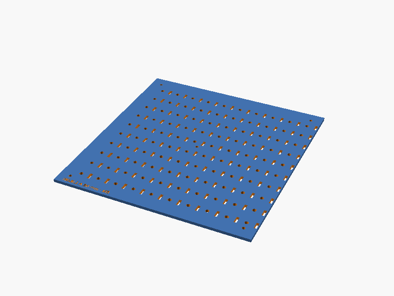 | `electronica_placa_rejilla.stl` | B | 1 | ASA, 40 % | Como exportada | No | Insertos M3 en cada nudo; 5 × M3 a bosses |
| 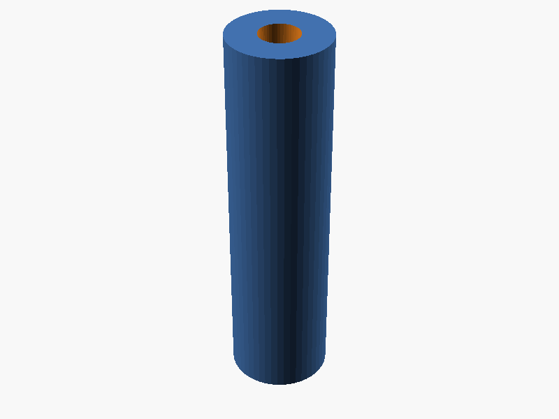 | `electronica_poste_bandeja.stl` | B | 6 | ASA | Como exportada | No | M3: longitud PENDIENTE DE CONFIRMAR |
| 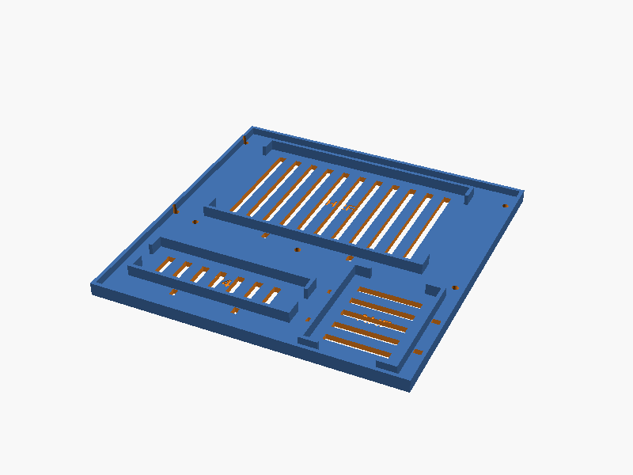 | `electronica_bandeja_sdr.stl` | B | 1 | ASA, 40 % | Como exportada | No | Sobre 6 postes; bridas |
| 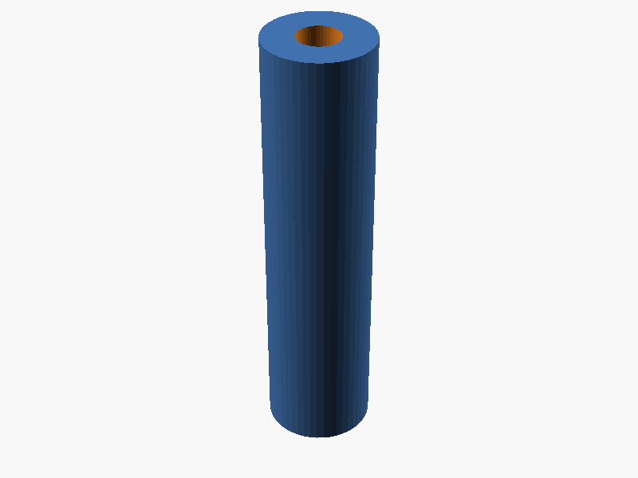 | `electronica_poste_medio.stl` | B | 6 | ASA | Como exportada | No | M3: PENDIENTE DE CONFIRMAR |
| 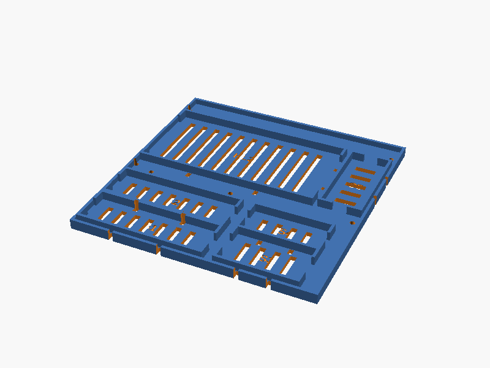 | `electronica_bandeja_sdr2.stl` | B | 1 | ASA, 40 % | Como exportada | No | Sobre 6 postes medios |
| 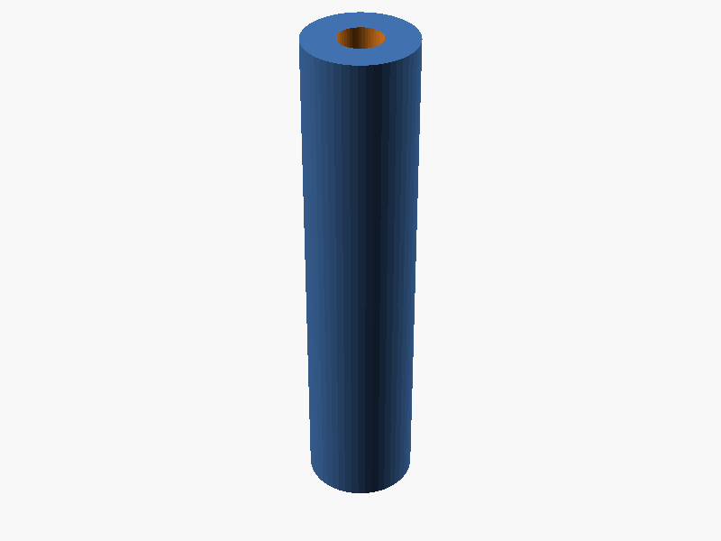 | `electronica_poste_superior.stl` | B | 4 | ASA | Como exportada | No | M3: PENDIENTE DE CONFIRMAR |
| 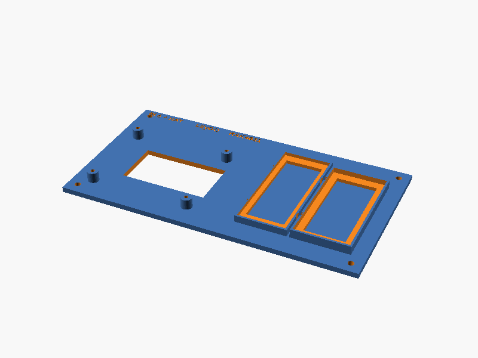 | `electronica_bandeja.stl` | B | 1 | ASA, 40 % | Como exportada | No | Pi 5: M2.5 autorroscante (agujero 2,4 mm) |
| 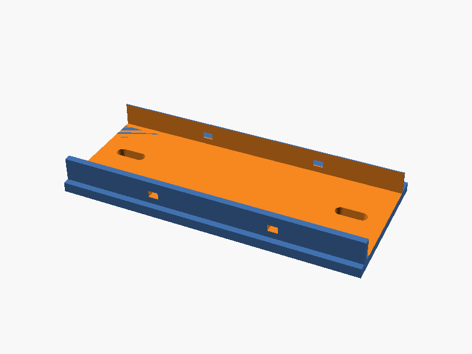 | `electronica_soporte_dongle.stl` | B | 3 (fila de la rejilla; más en la segunda bandeja: PENDIENTE DE CONFIRMAR) | ASA, 40 % | Como exportada | No | M3 o bridas: PENDIENTE DE CONFIRMAR |
| 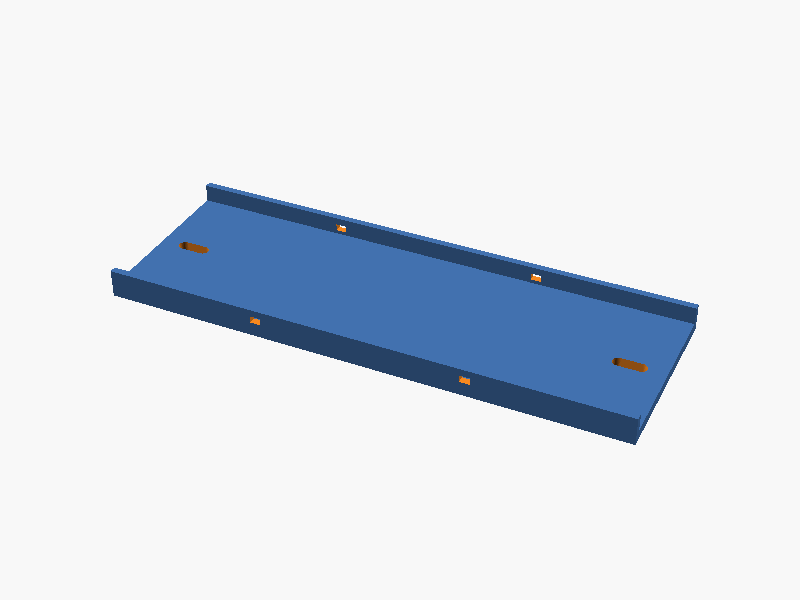 | `electronica_soporte_hub.stl` | B | 1 | ASA, 40 % | Como exportada | No | Dos ranuras para bridas |
| 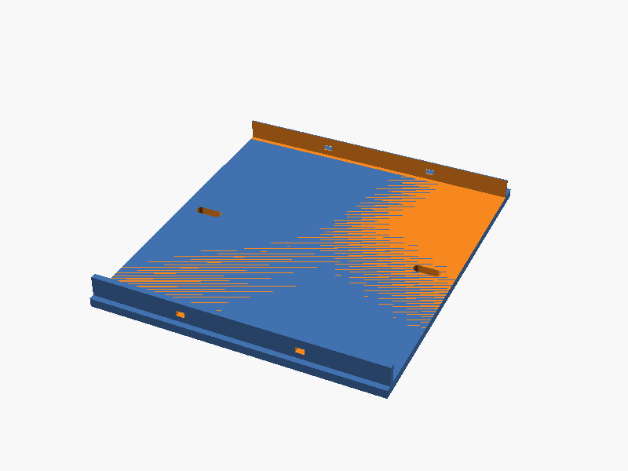 | `electronica_soporte_sdrplay.stl` | B | 1 | ASA, 40 % | Como exportada | No | Fijación: PENDIENTE DE CONFIRMAR |
| 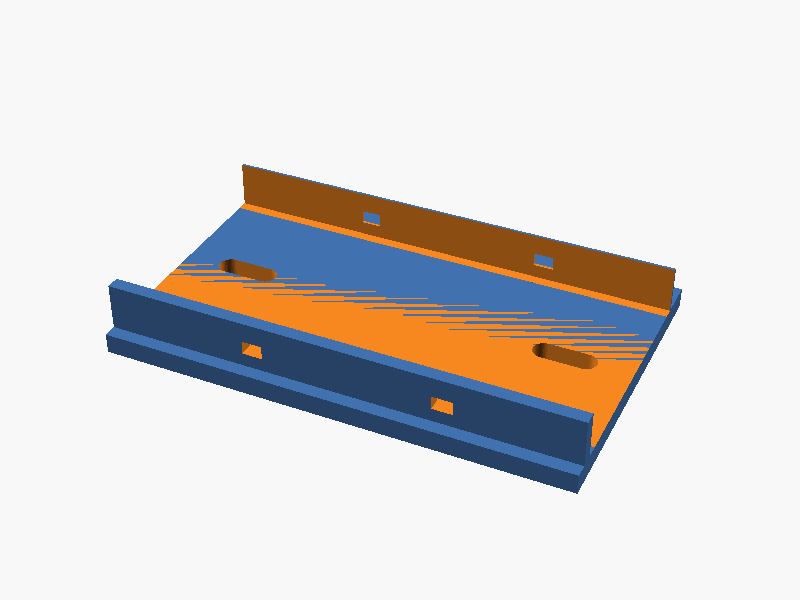 | `electronica_soporte_lilygo.stl` | B | 1 | ASA, 40 % | Como exportada | No | M3 o bridas: PENDIENTE DE CONFIRMAR |
| 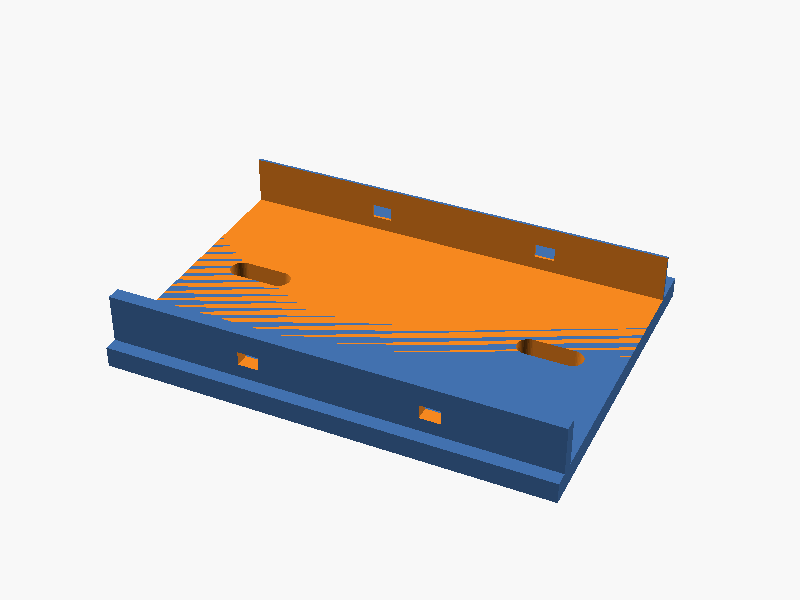 | `electronica_soporte_rak.stl` | B | 1 | ASA, 40 % | Como exportada | No | M3 o bridas: PENDIENTE DE CONFIRMAR |
|  | `electronica_soporte_wago.stl` | B | 1 | ASA, 40 % | Como exportada | No | Para 3 WAGO 221-415; fijación PENDIENTE DE CONFIRMAR |
| 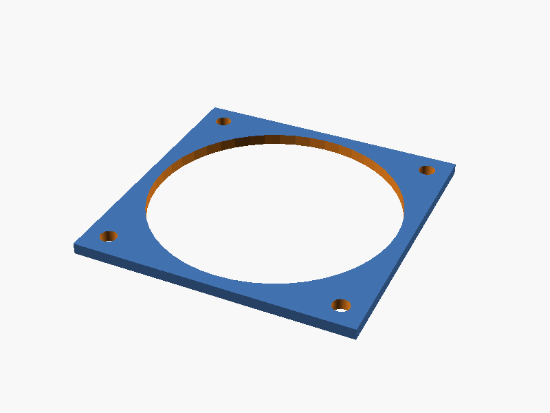 | `electronica_rejilla_ventilador.stl` | B | 2 | ASA, 30 % | Como exportada | No | Malla inox 1 mm; tornillos del ventilador a 50 mm (3,6 mm) |
| 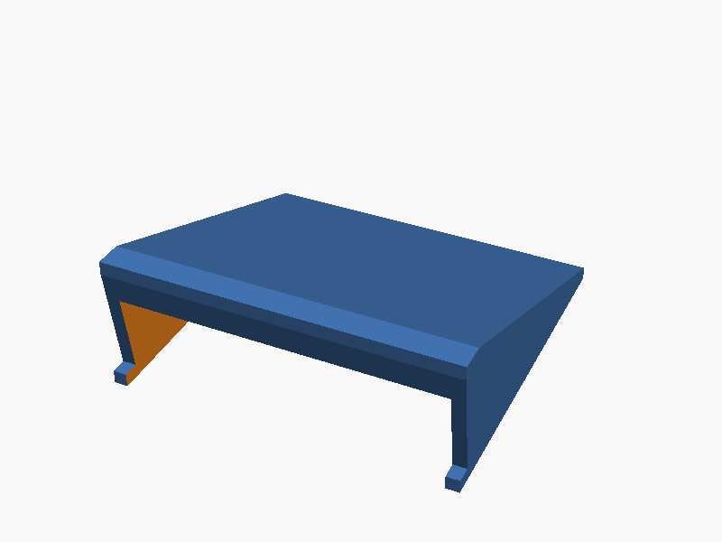 | `electronica_capota.stl` | B | 2 | ASA, 30 % | Como exportada | No | Boca hacia abajo; fijación PENDIENTE DE CONFIRMAR |
| 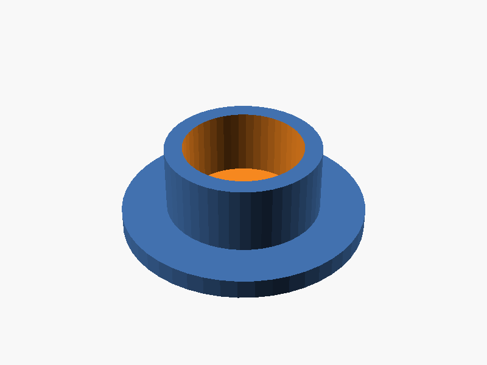 | `electronica_tapon_n.stl` | B | Los N libres | TPU 95A | Como exportada | No | A presión en agujero de 16,2 mm: PENDIENTE DE CONFIRMAR |
| 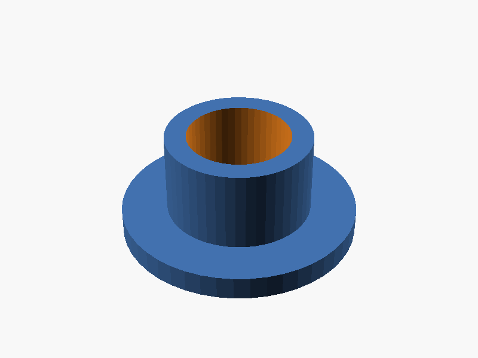 | `electronica_tapon_pg.stl` | B | Los PG libres (y el respiradero VENT) | TPU 95A | Como exportada | No | En PG7; con respiradero (membrana ePTFE) para VENT |
| 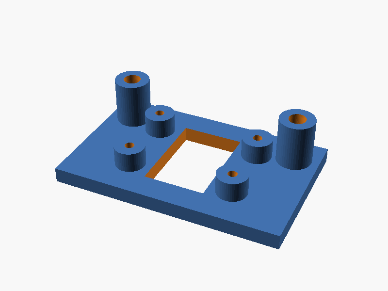 | `electronica_soporte_camara.stl` | B | 1 (opcional) | ASA, 30 % | Como exportada | No | 4 × M2 autorroscantes o insertos M2 · 2 insertos M3 de collar |
| 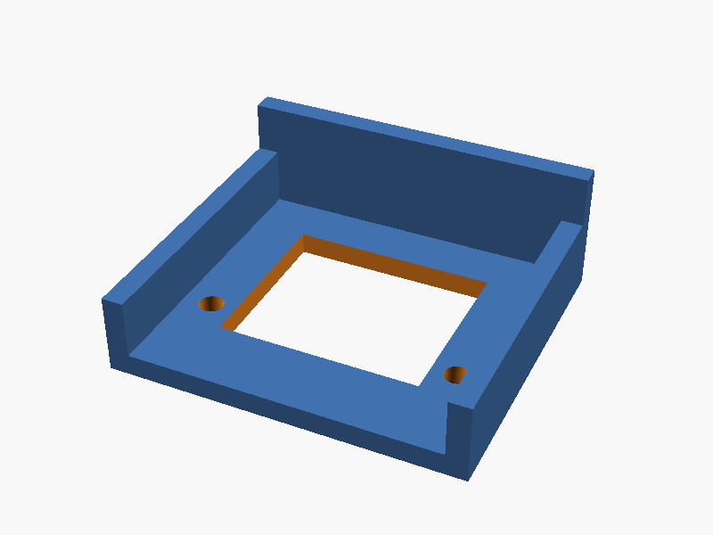 | `electronica_visera.stl` | B | 1 (opcional) | ASA, 30 % | Como exportada | No | 2 × M3 |
|  | `electronica_pletina_pared.stl` | B | 2 | ASA, 60 % | Como exportada | No | M5 (longitud PENDIENTE DE CONFIRMAR) + 4 tacos |
|  | `electronica_soporte_mastil.stl` | B | 2 (alternativa a la pletina) | ASA, 60 % | Como exportada | No | M5 + U M8 |

**Potencia (10)**

| Vista | Archivo | Grupo | Cant. | Material | Orientación | Soportes | Tornillería / insertos / juntas |
|---|---|---|---|---|---|---|---|
| 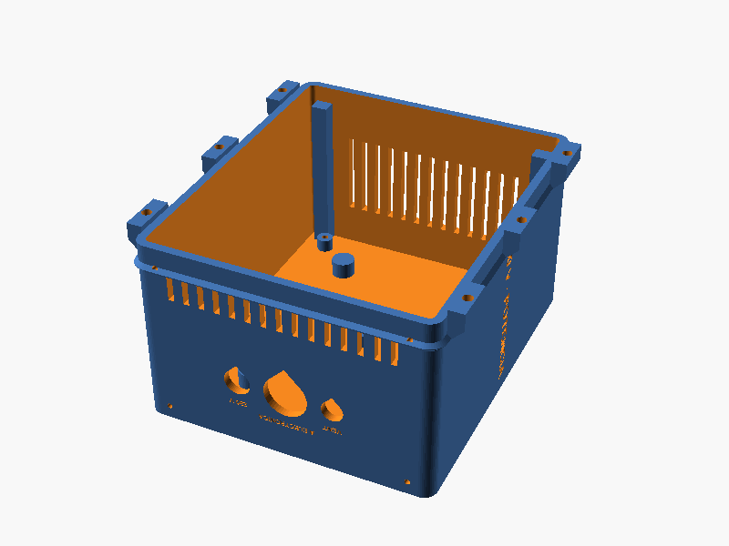 | `potencia_cuerpo.stl` | C | 1 | ASA | Boca arriba | No | Insertos M4 (orejas y pilares), M5 traseros; PG9, M25 y PG7 VENT |
| 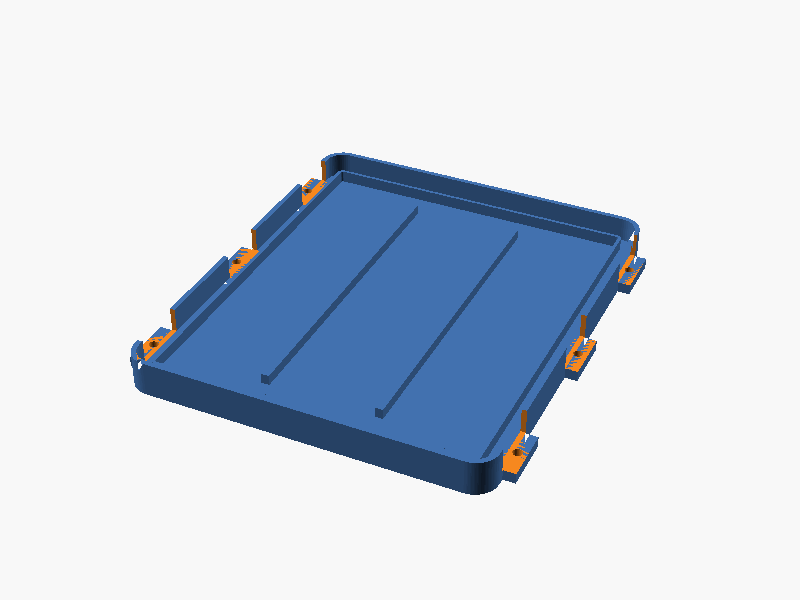 | `potencia_tapa.stl` | C | 1 | ASA | Cara exterior sobre la cama | No | 6 × M4×16 (6 orejas en el `.scad`) |
| 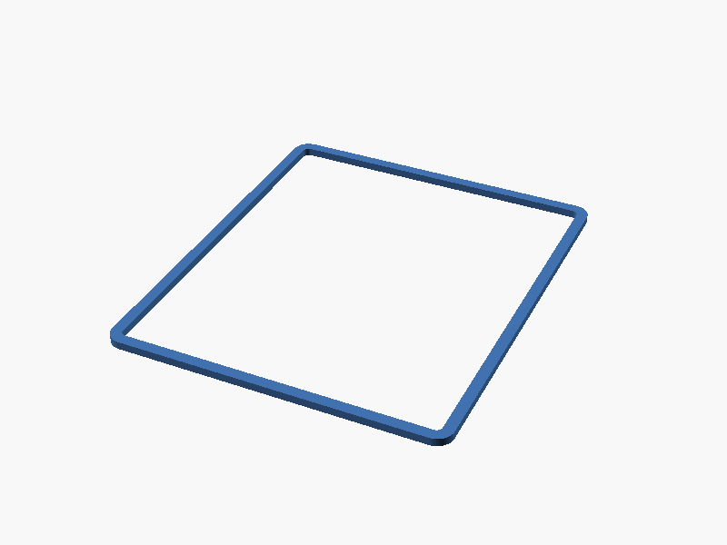 | `potencia_junta_tapa.stl` | C | 1 | TPU 95A | Como exportada | No | Ranura de 5,8 mm |
| 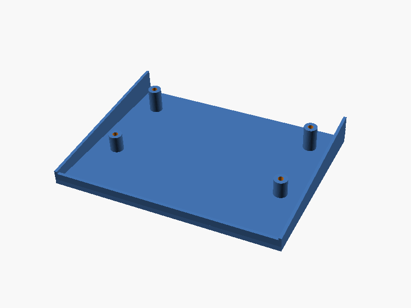 | `potencia_tejadillo.stl` | C | 1 | ASA | Como exportada | No | 4 insertos M4 |
| 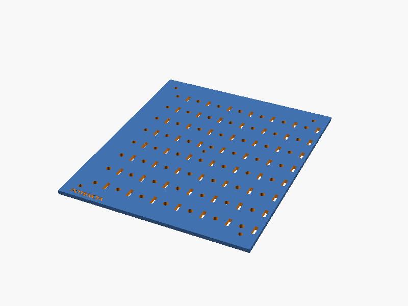 | `potencia_placa_rejilla.stl` | C | 1 | ASA, 40 % | Como exportada | No | Bosses M3 |
| 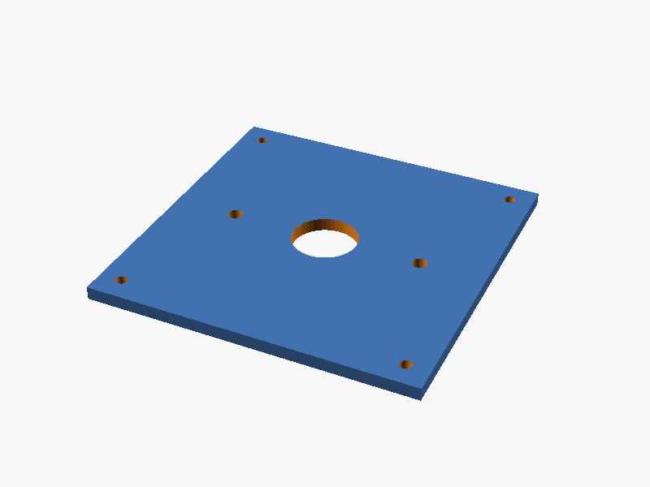 | `potencia_soporte_schuko.stl` | C | 1 | ASA, 40 % | Como exportada | No | M4 a ±30 mm + 4 × M3 |
| 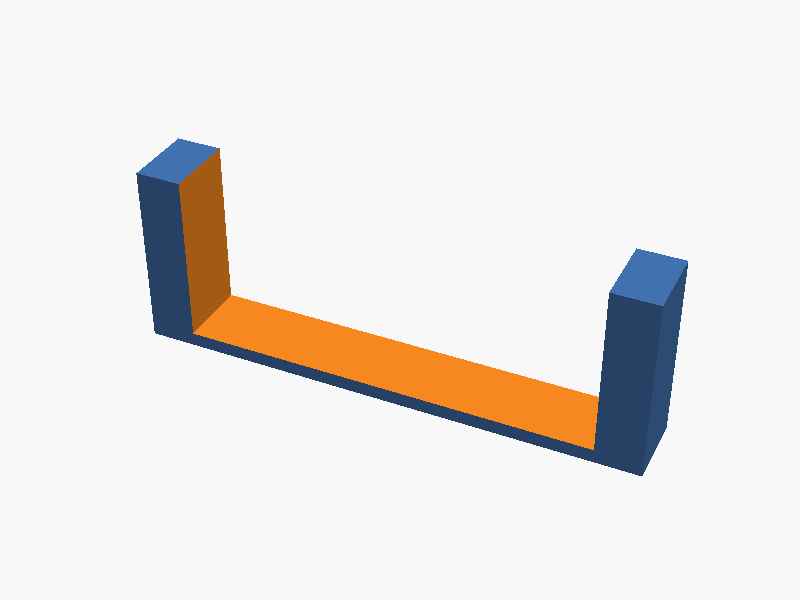 | `potencia_brida_cargador.stl` | C | 1 | ASA, 40 % | Como exportada | No | 2 × M3 |
| 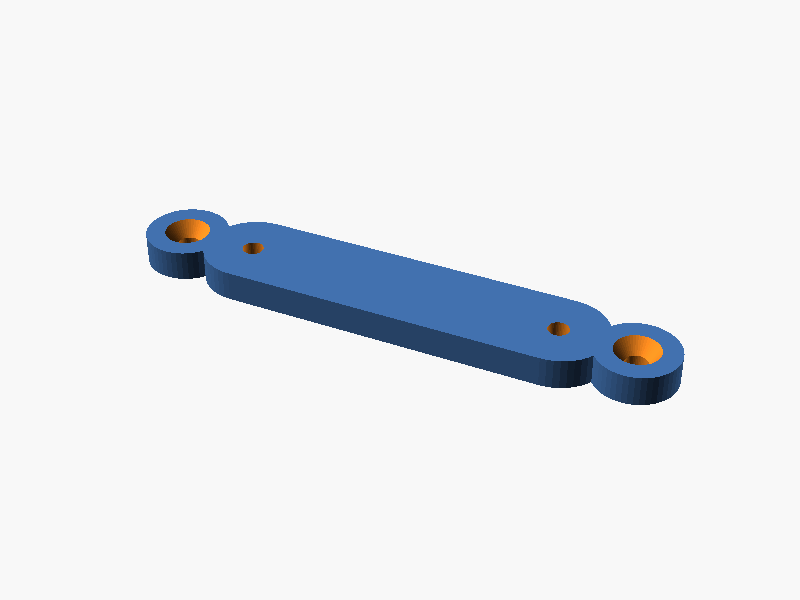 | `potencia_pletina_pared.stl` | C | 2 | ASA, 60 % | Como exportada | No | M5 + 4 tacos |
| 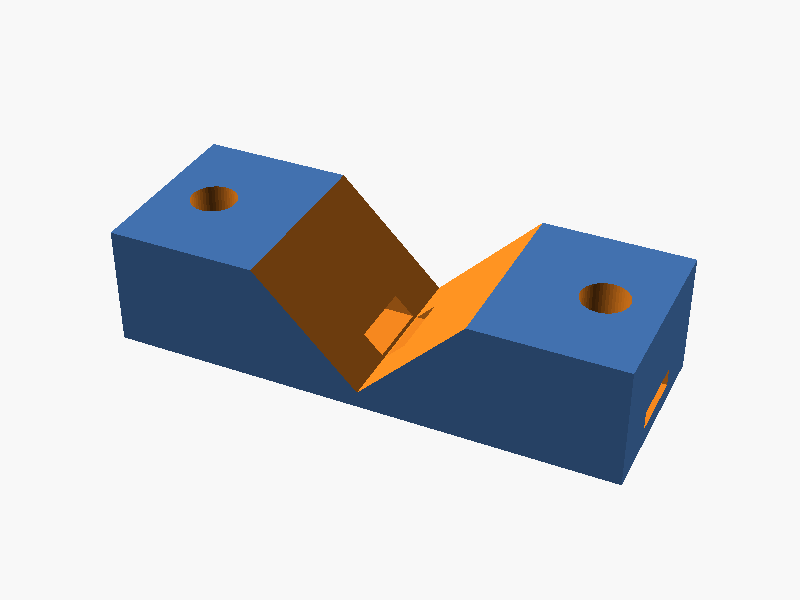 | `potencia_soporte_mastil.stl` | C | 2 (alternativa) | ASA, 60 % | Como exportada | No | M5 + U M8 |
|  | `potencia_tapon_pg.stl` | C | Los PG libres | TPU 95A | Como exportada | No | A presión |

**SAI (13)**

| Vista | Archivo | Grupo | Cant. | Material | Orientación | Soportes | Tornillería / insertos / juntas |
|---|---|---|---|---|---|---|---|
| 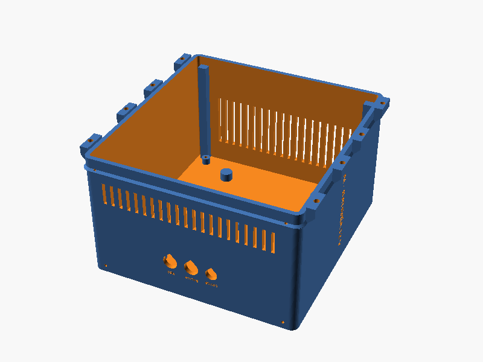 | `sai_cuerpo.stl` | C | 1 | ASA | Boca arriba | No | Insertos M4 y M5; PG9 ×2, PG7; ventilas superior e inferior |
| 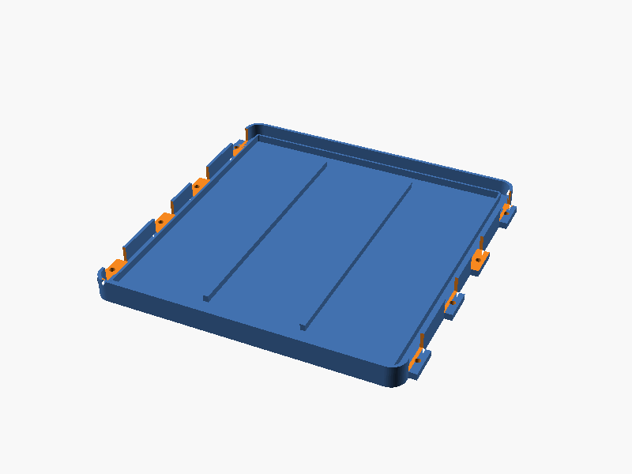 | `sai_tapa.stl` | C | 1 | ASA | Cara exterior sobre la cama | No | 8 × M4×16 (8 orejas en el `.scad`) |
|  | `sai_junta_tapa.stl` | C | 1 | TPU 95A | Como exportada | No | Ranura de 5,8 mm |
| 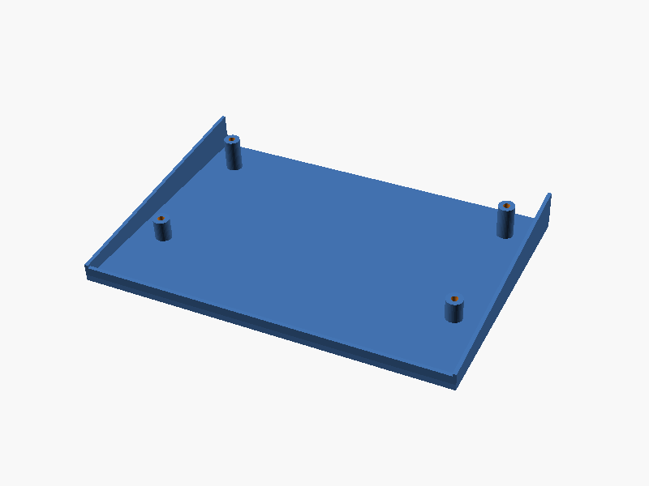 | `sai_tejadillo.stl` | C | 1 | ASA | Como exportada | No | 4 insertos M4 |
|  | `sai_placa_rejilla.stl` | C | 1 | ASA, 40 % | Como exportada | No | Bosses M3 |
|  | `sai_soporte_bateria.stl` | C | 1 | ASA, 60 %, 6 perímetros | Como exportada | No | Correas por ventanas de correa (22 mm en el `.scad`; 20 mm en los manuales) |
|  | `sai_guia_pcb.stl` | C | 2 | ASA, 50 % | Como exportada | No | M3 prisionero (ranura 2,2 mm) |
|  | `sai_pletina_trafo.stl` | C | 1 | ASA, 50 % | Como exportada | No | Agujeros ranurados M5 |
|  | `sai_soporte_filtro.stl` | C | 2 | ASA, 50 % | Como exportada | No | Ranuras M4 |
|  | `sai_soporte_wago.stl` | C | 1 | ASA, 50 % | Como exportada | No | Fijación PENDIENTE DE CONFIRMAR |
|  | `sai_pletina_pared.stl` | C | 2 | ASA, 60 % | Como exportada | No | M5 + 4 tacos |
|  | `sai_soporte_mastil.stl` | C | 2 (alternativa) | ASA, 60 % | Como exportada | No | M5 + U M8 |
|  | `sai_tapon_pg.stl` | C | Los PG libres | TPU 95A | Como exportada | No | A presión |

### 2.3 Antenas (`hardware/antenas/stl/`, 30 piezas)

Material general: ASA o PETG blanco; fundas, junta y tapones en TPU 95A ([manuales 12](12_QUAD_2M70.md) y
[13](13_DISCONES.md)). Perímetros, relleno y orientación de impresión no figuran en el `.scad`:
se marcan **PENDIENTE DE CONFIRMAR**, salvo en las piezas con agujeros en gota.

| Vista | Archivo | Grupo | Cant. | Material | Orientación | Soportes | Tornillería / insertos / juntas |
|---|---|---|---|---|---|---|---|
|  | `quad_buje_2m.stl` | D | 2 | ASA / PETG blanco | PENDIENTE DE CONFIRMAR | No (agujeros en gota) | M3 autorroscante en varilla; 2 prisioneros M5 por buje |
|  | `quad_buje_70.stl` | D | 2 | ASA / PETG blanco | PENDIENTE DE CONFIRMAR | No (agujeros en gota) | M3 autorroscante; 2 prisioneros M5 por buje |
|  | `quad_puntera_8.stl` | D | 7 | ASA / PETG blanco | PENDIENTE DE CONFIRMAR | PENDIENTE DE CONFIRMAR | Sobre varilla Ø8 |
|  | `quad_puntera_6.stl` | D | 8 | ASA / PETG blanco | PENDIENTE DE CONFIRMAR | PENDIENTE DE CONFIRMAR | Sobre varilla Ø6 |
|  | `quad_clip_70.stl` | D | 3 | ASA / PETG blanco | PENDIENTE DE CONFIRMAR | PENDIENTE DE CONFIRMAR | Sin tornillería indicada |
|  | `quad_alim_2m.stl` | D | 1 | ASA / PETG blanco | PENDIENTE DE CONFIRMAR | PENDIENTE DE CONFIRMAR | 2 insertos M3 de latón (terminales a 12 mm) |
|  | `quad_alim_70.stl` | D | 1 | ASA / PETG blanco | PENDIENTE DE CONFIRMAR | PENDIENTE DE CONFIRMAR | 2 insertos M3 de latón (terminales a 12 mm) |
|  | `quad_abrazadera.stl` | D | 1 | ASA / PETG blanco | PENDIENTE DE CONFIRMAR | PENDIENTE DE CONFIRMAR | U M8 (mástil) y U M6 (boom): medidas PENDIENTE DE CONFIRMAR |
|  | `discone_aislador.stl` | E | 1 por discone | ASA / PETG blanco | PENDIENTE DE CONFIRMAR | PENDIENTE DE CONFIRMAR | 3 insertos M4 arriba y 3 abajo |
|  | `discone_plantilla_disco.stl` | E | 1 | ASA / PETG blanco | PENDIENTE DE CONFIRMAR | PENDIENTE DE CONFIRMAR | Herramienta, 12 agujeros |
|  | `discone_plantilla_cono.stl` | E | 1 | ASA / PETG blanco | PENDIENTE DE CONFIRMAR | PENDIENTE DE CONFIRMAR | Herramienta, semiángulo 30° |
|  | `discone_adaptador_mastil.stl` | E | 1 | ASA / PETG blanco | PENDIENTE DE CONFIRMAR | PENDIENTE DE CONFIRMAR | 4 × M4 al cubo; 2 × M6 pasantes |
|  | `discone_capuchon.stl` | E | 1 | ASA / PETG blanco | PENDIENTE DE CONFIRMAR | PENDIENTE DE CONFIRMAR | Sobre el cubo del disco, con silicona neutra ([manual 13](13_DISCONES.md)) |
|  | `tapon_varilla.stl` | E | 12 | TPU 95A | PENDIENTE DE CONFIRMAR | PENDIENTE DE CONFIRMAR | Agujero Ø2,5 para cordino; fijación a la varilla PENDIENTE DE CONFIRMAR |
|  | `adsb_base.stl` | E | 1 | ASA / PETG blanco | PENDIENTE DE CONFIRMAR | PENDIENTE DE CONFIRMAR | SMA de panel 6,6 mm; PG7 12,7 mm; 4 agujeros de 2,8 mm |
|  | `adsb_tapa.stl` | E | 1 | ASA / PETG blanco | PENDIENTE DE CONFIRMAR | PENDIENTE DE CONFIRMAR | 4 × M3 + junta TPU de 1 mm |
|  | `adsb_radomo.stl` | E | 1 | ASA / PETG blanco | PENDIENTE DE CONFIRMAR | PENDIENTE DE CONFIRMAR | Silicona neutra ([manual 14](14_ADSB_LNA.md)); tornillos PENDIENTE DE CONFIRMAR |
|  | `mla_caja_base.stl` | F | 1 | ASA / PETG blanco | PENDIENTE DE CONFIRMAR | PENDIENTE DE CONFIRMAR | 4 bosses M3; PG7 |
|  | `mla_caja_tapa.stl` | F | 1 | ASA / PETG blanco | PENDIENTE DE CONFIRMAR | PENDIENTE DE CONFIRMAR | 4 × M3×12 inox ([manual 15](15_LAZO_MLA30.md)) |
|  | `mla_junta.stl` | F | 1 | TPU 95A (1,6 mm) | PENDIENTE DE CONFIRMAR | PENDIENTE DE CONFIRMAR | Entre base y tapa |
|  | `mla_cruz.stl` | F | 1 | ASA / PETG blanco | PENDIENTE DE CONFIRMAR | PENDIENTE DE CONFIRMAR | U M6; varillas Ø10 |
|  | `mla_clip_lazo.stl` | F | 4 | ASA / PETG blanco | PENDIENTE DE CONFIRMAR | PENDIENTE DE CONFIRMAR | Para coaxial Ø7 |
|  | `gps_soporte.stl` | F | 1 | ASA / PETG blanco | PENDIENTE DE CONFIRMAR | PENDIENTE DE CONFIRMAR | 4 agujeros M6 (Ø6,6): tornillería PENDIENTE DE CONFIRMAR |
|  | `soporte_fibra.stl` | F | 3 | ASA / PETG blanco | PENDIENTE DE CONFIRMAR | PENDIENTE DE CONFIRMAR | M6 (longitud PENDIENTE DE CONFIRMAR) |
|  | `brazo_mastil.stl` | F | 4 | ASA / PETG blanco | PENDIENTE DE CONFIRMAR | PENDIENTE DE CONFIRMAR | M8 al mástil y M6 al brazo: medidas PENDIENTE DE CONFIRMAR |
|  | `tapon_brazo.stl` | F | 6 | ASA / PETG blanco | PENDIENTE DE CONFIRMAR | PENDIENTE DE CONFIRMAR | Fijación PENDIENTE DE CONFIRMAR |
|  | `separador_coax.stl` | F | 15 | ASA / PETG blanco | PENDIENTE DE CONFIRMAR | PENDIENTE DE CONFIRMAR | 1 brida (medida PENDIENTE DE CONFIRMAR); coaxial Ø7,5 |
|  | `clip_filtro.stl` | F | PENDIENTE DE CONFIRMAR | ASA / PETG blanco | PENDIENTE DE CONFIRMAR | PENDIENTE DE CONFIRMAR | 1 brida (medida PENDIENTE DE CONFIRMAR); filtro de unos 13 × 13 mm |
|  | `funda_sma.stl` | F | 6 (manual 11) | TPU 95A | PENDIENTE DE CONFIRMAR | PENDIENTE DE CONFIRMAR | Cinta autoamalgamante |
|  | `funda_n.stl` | F | 12 (manual 11) | TPU 95A | PENDIENTE DE CONFIRMAR | PENDIENTE DE CONFIRMAR | Cinta autoamalgamante |

### 2.4 Anclajes (`hardware/anclajes/stl/`, 16 piezas)

Material: ASA o PETG blanco ([manual 21](21_ANCLAJES.md)). Cada cruceta lleva 4 × M6×50 (lado mástil) o M6×40
(boom, fibra, tubo), 4 tuercas M6, 4 arandelas y 2 tornillos autotaladrantes de 4,8 × 19 mm.

| Vista | Archivo | Grupo | Cant. | Material | Orientación | Soportes | Tornillería / insertos / juntas |
|---|---|---|---|---|---|---|---|
|  | `cruceta_mastil_brazo_cuerpo.stl` | G | 3 | ASA / PETG blanco | Como exportada | No | 4 tuercas hex M6 (11,3 × 5,4 mm) |
|  | `cruceta_mastil_brazo_tapa_mastil.stl` | G | 3 | ASA / PETG blanco | Como exportada | No | 2 × M6×50 + 2 arandelas + 1 autotaladrante 4,8 × 19 |
|  | `cruceta_mastil_brazo_tapa_brazo.stl` | G | 3 | ASA / PETG blanco | Como exportada | No | 2 × M6×40 + 2 arandelas + 1 autotaladrante 4,8 × 19 |
|  | `cruceta_mastil_quad_cuerpo.stl` | G | 1 | ASA / PETG blanco | Como exportada | No | 4 tuercas hex M6 |
|  | `cruceta_mastil_quad_tapa_mastil.stl` | G | 1 | ASA / PETG blanco | Como exportada | No | 2 × M6×50 + autotaladrante |
|  | `cruceta_mastil_quad_tapa_boom.stl` | G | 1 | ASA / PETG blanco | Como exportada | No | 2 × M6×40 + autotaladrante |
|  | `cruceta_brazo_fibra_cuerpo.stl` | G | 1 | ASA / PETG blanco | Como exportada | No | 4 tuercas hex M6 |
|  | `cruceta_brazo_fibra_tapa_brazo.stl` | G | 1 | ASA / PETG blanco | Como exportada | No | 2 × M6×40 + autotaladrante |
|  | `cruceta_brazo_fibra_tapa_fibra.stl` | G | 1 | ASA / PETG blanco | Como exportada | No | 2 × M6×40 + autotaladrante |
|  | `cruceta_brazo_tubo_cuerpo.stl` | G | 5 según uso (manual 21: ADS-B, 2 Bigsignal y 2 sensores de viento) | ASA / PETG blanco | Como exportada | No | 4 tuercas hex M6 |
|  | `cruceta_brazo_tubo_tapa.stl` | G | 2 por cuerpo | ASA / PETG blanco | Como exportada | No | 2 × M6×40 + autotaladrante |
|  | `adsb_tapa_tubo.stl` | G | 1 (alternativa a `adsb_tapa`) | ASA / PETG blanco | Volteada, brida sobre la cama | No | 4 × M3×12 + 2 prisioneros M5 |
|  | `sensor_viento_brida.stl` | H | 2 | ASA / PETG blanco | Volteada | No | Patrón A: 4 tuercas M5 (Ø9,4); patrón B: 4 tuercas M4 (Ø8,1); 2 prisioneros M5 |
|  | `pluvio_vaso.stl` | H | 1 | ASA / PETG blanco | Volteado | No | 3 insertos M5; 2 prisioneros M5 |
|  | `pluvio_plataforma.stl` | H | 1 | ASA / PETG blanco | PENDIENTE DE CONFIRMAR | PENDIENTE DE CONFIRMAR | 3 × M5×40 con muelles; 3 × M3 en ranuras |
|  | `pico_soporte.stl` | H | 1 | ASA / PETG blanco | PENDIENTE DE CONFIRMAR | PENDIENTE DE CONFIRMAR | 4 × M3×8; 8 × M2×6 |

## 3. Convenciones comunes de montaje

**Insertos de latón.** Caliéntalos con el soldador (230-245 °C en la v2, 220 °C en la v3) y empújalos en
perpendicular, desde fuera hacia dentro, hasta que queden a ras. Agujeros de diseño: M3 4,0 mm (largo 6 mm),
M4 5,6 mm (largo 8,5 mm) y M5 7,0 mm en la v3. Enrosca un tornillo de prueba al enfriarse.

**Tuercas capturadas.** Las crucetas llevan la tuerca M6 en un alojamiento hexagonal de 11,3 × 5,4 mm: empújala
a fondo antes de cerrar la tapa. No uses tuercas autoblocantes de nailon sin comprobar que caben.

**Juntas de TPU.** La junta va en la ranura de la tapa, sin estirarla. En la v2 es de 4,4 × 4 mm en una ranura de 4,2 mm
(compresión de unos 25 %); en la v3, de 5,6 × 4 mm en una de 5,8 mm.

**Pasamuros.**

| Tipo | Agujero | Dónde |
|---|---|---|
| SMA de panel | 6,6 mm | Caja v2 (9 posiciones, paso 15 mm, z = 26) y ADS-B |
| N de panel | 16,2 mm | Caja v3 electrónica (filas z = 26, 56 y 86, paso 27 mm) |
| PG7 | 12,7 mm | WX, VIENTO, LLUVIA, VENT (membrana ePTFE), DATOS, ADS-B y MLA |
| PG9 | 15,5 mm | 230 V, RED y SALIDA |
| M20 | 20,4 mm | LAN |
| M25 | 25,4 mm | PWR y salida A ELECTRONICA |

Los pasamuros libres se cierran con `tapon_n` o `tapon_pg` (TPU).

**Estanqueidad.** Lazo de goteo en cada cable antes de entrar en una caja. Coaxial con `separador_coax` cada 50 cm
y a 30 mm del mástil. Fundas `funda_sma` y `funda_n` con cinta autoamalgamante sobre cada conector exterior.

**Apriete.** Aprieta las tapas en cruz y a mano hasta que la junta quede comprimida. No hay pares de apriete en los
`.scad` ni en los manuales: **PENDIENTE DE CONFIRMAR**.

## 4. Grupo A · Caja v2


Referencias: [manual 10](10_CAJA_3D.md), [render del montaje](../../hardware/caja/render/montaje.png),
[despiece](../../hardware/caja/render/despiece.png), [interior](../../hardware/caja/render/interior.png),
[trasera](../../hardware/caja/render/montaje_trasera.png), [inferior](../../hardware/caja/render/montaje_inferior.png).
Piezas sueltas: [tapa interior](../../hardware/caja/render/tapa_interior.png),
[tapa de potencia](../../hardware/caja/render/tapa_potencia.png),
[placa electrónica](../../hardware/caja/render/placa_electronica.png),
[tejadillo](../../hardware/caja/render/tejadillo.png), [visera](../../hardware/caja/render/visera.png),
[soporte de cámara](../../hardware/caja/render/soporte_camara.png),
[soporte de mástil](../../hardware/caja/render/soporte_mastil.png),
[garita](../../hardware/caja/render/garita_base.png) y [pasamuros USB](../../hardware/caja/render/pasamuros_usb.png).

Medidas: 224 × 232 × 90 mm, pared de 3,2 mm, tapa de 4 mm.

**Despieces (antes de empezar)**


*Caja v2: `tapa` y `junta_tapa` bajan sobre las orejas del `cuerpo` (eje de la tapa, 8 × M4 a los insertos); `placa_electronica`, `placa_potencia` y `tapa_potencia` entran por la boca a sus bosses (4 × M3 cada una); los 2 `soporte_mastil` se atornillan por detrás al `cuerpo` y el `tejadillo` sube sobre los 4 pilares.*


*Cámara: `junta_ventana` y policarbonato se apoyan contra la ventana desde dentro; `soporte_camara` los presiona con 2 × M3 hacia los insertos del `cuerpo`; la `visera` se cierra por fuera con 2 × M3 en sentido opuesto.*


*Garita: `garita_base`, 6 × `garita_plato` y `garita_tapa` se apilan en vertical sobre las 3 varillas M4×140 y se cierran con tuercas ciegas.*

> **Cámara.** El `.scad` y el [manual 10](10_CAJA_3D.md) de la caja v2 modelan la WPI408 (OV5647 con dos LED IR):
> ventana de 76 × 26 mm en (160, 196), policarbonato de 86 × 36 × 2 mm y espuma de 1 mm contra las placas IR.
> El kit público usa la **Raspberry Pi Camera Module 3 Wide** (IMX708, sin IR). Si se ajusta `soporte_camara`
> y la ventana a ese módulo: **PENDIENTE DE CONFIRMAR**. `separador_ir` es opcional / no necesario con Camera Module 3 Wide.

| Paso | Acción | Piezas | Tornillería / consumibles |
|---|---|---|---|
| 1a | Inserta los M4 de las 8 orejas (y = 22, 84, 148 y 210, 4 por lado) | `cuerpo` | 8 insertos M4 |
| 1b | Inserta los M4 de los 2 soportes de mástil (y = 45 e y = 187; 30 × 19 mm) | `cuerpo` | 8 insertos M4 |
| 1c | Inserta los M4 de los pilares (12,20), (212,20), (12,70), (212,70) | `tejadillo` | 4 insertos M4 |
| 1d | Inserta los M3: 8 de las placas, 4 de la tapa interior, 2 de la visera y 2 del soporte de cámara | `cuerpo`, `tapa`, `visera`, `soporte_camara` | 16 insertos M3 en total ([manual 10](10_CAJA_3D.md)) |
| 2a | Monta los 9 SMA: SAT, HAM, VHF, HF, ADSB, 868, GPS, M433, IG433 | `cuerpo` | 9 SMA + junta tórica; latiguillo RG316 de 20 cm |
| 2b | Monta los prensaestopas WX (PG7), LAN (M20) y 230 V (PG9) | `cuerpo` | PG7, M20, PG9 |
| 3 | Fija la placa de potencia a sus 4 bosses | `placa_potencia` | 4 × M3×8 (separación 10 mm, placa de 3 mm) |
| 4 | Conecta 230 V por PG9 a los 2 WAGO 221-412 (sin tensión) | — | 2 × WAGO 221-412 |
| 5 | Fija la tapa interior a 4 insertos M3 (2 en y = 30 y 2 en y = 200) a CP_Z = 56 mm | `tapa_potencia` | 4 × M3×8 |
| 6 | Pasa los cables por el hueco del tabique (18 × 34 mm) con el pasamuros | `pasamuros_usb` | — |
| 7 | Fija la placa electrónica a los bosses (30,6), (110,6), (30,204), (110,204) | `placa_electronica` | 4 × M3×8 |
| 8 | Fija la Pi 5 (58 × 49 mm) a la placa | — | 4 × M2.5×6 autorroscantes |
| 9 | Monta la LilyGO sobre la tapa interior y pasa los coaxiales por el hueco | — | — |
| 10 | Coloca `junta_ventana` y el policarbonato en la ventana de la cámara | `junta_ventana` | Policarbonato; junta de 1,5 mm |
| 11 | Monta la cámara con `soporte_camara` por dentro (`separador_ir` opcional con Camera Module 3 Wide) | `soporte_camara` | 2 × M3×35; espuma de 1 mm |
| 12 | Cierra la visera por fuera | `visera` | 2 × M3×8 |
| 13 | Encaja `junta_tapa` en la ranura de la tapa | `junta_tapa` | — |
| 14 | Cierra la tapa en cruz hasta que toque las orejas | `tapa` | 8 × M4×12 con arandela |
| 15 | Atornilla los 2 soportes de mástil a la trasera | `soporte_mastil` ×2 | 4 × M4×20 cada uno; abrazaderas de 12 mm |
| 16 | Monta el tejadillo sobre los 4 pilares | `tejadillo` | 2 × M4×30 (traseros) + 2 × M4×25 (delanteros) con arandelas de goma |
| 17 | Monta la garita: 6 platos sobre 3 varillas | `garita_base`, `garita_plato` ×6, `garita_tapa` | 3 varillas M4×140, 6 tuercas ciegas, 2 × M2×8 para el sensor |

Los pasos 1 a 17 corresponden a los 9 pasos del diagrama: 1→1; 2→2; 3-4→3; 5-6→4; 7-9→5; 10-12→6; 13-14→7; 15→8; 16-17→9.

**Comprobación.**
- Todos los insertos giran el tornillo sin holgura y quedan a ras.
- La tapa toca las orejas y la junta se ve comprimida de forma uniforme.
- La cámara ve a través de la ventana sin reflejos.
- Cada SMA tiene su etiqueta y su latiguillo; los PG no tienen holgura.

**Montaje terminado**


*Caja v2 cerrada: tapa y junta asentadas sobre las orejas, placas en sus bosses, soportes de mástil y tejadillo en su sitio.*


*Cámara montada: junta y policarbonato entre el soporte y la ventana; visera por fuera.*


*Garita montada: platos apilados entre la base y la tapa sobre las varillas.*

**Errores frecuentes.**
- Apretar de más los 8 × M4×12 y deformar la tapa.
- Olvidar la junta tórica de un SMA.
- Insertar los M4 de los soportes de mástil desde dentro.
- Trabajar el compartimento de 230 V con tensión.

## 5. Grupo B · Caja v3: electrónica


Referencias: [manual 17](17_CAJA_V3.md), [ventilación](18_VENTILACION.md),
[montaje](../../hardware/caja_v3/render/electronica_montaje.png),
[interior](../../hardware/caja_v3/render/electronica_interior.png),
[inferior](../../hardware/caja_v3/render/electronica_inferior.png),
[bandeja SDR](../../hardware/caja_v3/render/electronica_bandeja_sdr.png),
[bandeja SDR 2](../../hardware/caja_v3/render/electronica_bandeja_sdr2.png).

Medidas: 228 × 240 × 192 mm, pared de 4,8 mm, tapa de 5,2 mm.

**Despieces (antes de empezar)**


*Cuerpo, junta y tapa: `electronica_junta_tapa` entra en la ranura de la tapa y la tapa baja sobre las orejas del `electronica_cuerpo` (8 × M4×16); el `electronica_tejadillo` sube sobre sus pilares y la `electronica_placa_rejilla` entra por la boca a sus bosses (5 × M3).*


*Postes y bandejas: los postes se atornillan a la rejilla en vertical y cada bandeja (`bandeja_sdr`, `bandeja_sdr2`, `bandeja`) baja sobre sus postes.*


*Soportes: `soporte_dongle`, `soporte_hub` y `soporte_wago` bajan sobre la rejilla con M3 (otros soportes, `soporte_sdrplay`, `soporte_lilygo` y `soporte_rak`, se fijan igual: fijación PENDIENTE DE CONFIRMAR).*


*Ventilación: la `electronica_rejilla_ventilador` entra por dentro de la pared con el ventilador y la `electronica_capota` se coloca por fuera con la boca hacia abajo.*


*Cámara (opcional): el cristal se apoya en el cajeado exterior, `electronica_soporte_camara` sujeta el módulo por dentro y la `electronica_visera` se cierra por fuera con 2 × M3.*


*Tapones: `electronica_tapon_n` y `electronica_tapon_pg` entran a presión desde fuera en los agujeros libres.*

| Paso | Acción | Piezas | Tornillería / consumibles |
|---|---|---|---|
| 1a | Inserta los M4 de las orejas (y = 24, 92, 148 y 216, 4 por lado) | `electronica_cuerpo` | Insertos M4 |
| 1b | Inserta los M4 de los pilares del tejadillo | `electronica_cuerpo`, `electronica_tejadillo` | 4 insertos M4 |
| 1c | Inserta los M5 de la trasera (y = 40 y 200; x al 25 % y 75 %) | `electronica_cuerpo` | Insertos M5 (agujero 7,0 mm) |
| 1d | Inserta un M3 en cada nudo de la rejilla (paso 20 mm) | `electronica_placa_rejilla` | Insertos M3 |
| 2 | Encaja `electronica_junta_tapa` en la ranura de 5,8 mm | `electronica_junta_tapa` | 4 puntos de cianoacrilato |
| 3a | Monta los N de panel en las filas z = 26, 56 y 86 | `electronica_cuerpo` | N de panel; latiguillos N-SMA RG-316 |
| 3b | Monta los prensaestopas a z = 116: M25 PWR, M20 LAN, PG7 WX, VIENTO, LLUVIA y VENT | `electronica_cuerpo` | M25, M20, PG7; VENT con membrana ePTFE |
| 3c | Cierra los libres con `electronica_tapon_n` y `electronica_tapon_pg` | tapones | — |
| 4a | Monta el ventilador de entrada (pared izquierda, y 55, z 60) soplando hacia dentro | `electronica_rejilla_ventilador` | Ventilador 60 mm, malla inox 1 mm, tornillos a 50 mm |
| 4b | Monta el ventilador de salida (pared derecha, y 190, z 68) soplando hacia fuera | `electronica_rejilla_ventilador` | Ídem |
| 4c | Pon por fuera cada `electronica_capota` con la boca hacia abajo | `electronica_capota` | Fijación PENDIENTE DE CONFIRMAR |
| 5a | Fija la rejilla a los 5 bosses (4 esquinas y centro; separación 8 mm) | `electronica_placa_rejilla` | 5 × M3 |
| 5b | Fija dongles, hub, SDRplay y WAGO a la rejilla | soportes | M3 o bridas: PENDIENTE DE CONFIRMAR |
| 6a | Monta los 6 postes de la bandeja SDR | `electronica_poste_bandeja` ×6 | M3: PENDIENTE DE CONFIRMAR |
| 6b | Fija `electronica_bandeja_sdr` (167 × 170 mm, DECK_H = 38 mm) y los SDR con bridas | `electronica_bandeja_sdr` | Bridas |
| 7 | Monta los 6 postes medios y `electronica_bandeja_sdr2` (DECK2_H = 82 mm) | `electronica_poste_medio` ×6, `electronica_bandeja_sdr2` | M3: PENDIENTE DE CONFIRMAR |
| 8a | Monta los 4 postes superiores y la bandeja (170 × 92 mm, BAND_H = 131 mm) | `electronica_poste_superior` ×4, `electronica_bandeja` | M3: PENDIENTE DE CONFIRMAR |
| 8b | Fija la Pi 5 en (8,10) a la bandeja | — | M2.5 autorroscante (agujero 2,4 mm, 58 × 49 mm) |
| 8c | Coloca LilyGO (x = 98) y RAK (129,12) en sus soportes | `electronica_soporte_lilygo`, `electronica_soporte_rak` | M3 o bridas: PENDIENTE DE CONFIRMAR |
| 8d | (Opcional) Monta la cámara Camera Module 3 Wide: ventana de 20 × 16 mm en (W/2, 210), cajeado exterior de 27 × 26 mm con cristal de policarbonato o metacrilato de 2 mm y sellador | `electronica_soporte_camara`, `electronica_visera` | 4 × M2 autorroscantes o insertos M2 (agujeros 21 × 12,5 mm: confirmar con plano), 2 insertos M3 de collar, 2 × M3 de la visera |
| 9a | Fija la caja a pared con `electronica_pletina_pared` ×2 (o al mástil con `electronica_soporte_mastil` ×2) | pletinas o soportes | M5 + 4 tacos, o M5 + 2 U M8 |
| 9b | Cierra la tapa en cruz | `electronica_tapa` | 8 × M4×16 (el [manual 17](17_CAJA_V3.md) dice 16: PENDIENTE DE CONFIRMAR) |
| 9c | Monta el tejadillo al final | `electronica_tejadillo` | M4 + arandelas de goma: longitud PENDIENTE DE CONFIRMAR |

> **Alturas.** El `.scad` usa DECK_H = 38, DECK2_H = 82 y BAND_H = 131 mm, lo que da postes de 38, 41 y 46 mm. El
> [manual 17](17_CAJA_V3.md) habla de postes de 30 mm y una bandeja a 71 mm sobre la rejilla. **PENDIENTE DE CONFIRMAR**:
> mide tus postes impresos y sigue el `.scad`, que es la fuente de verdad de este manual.
>
> **Tapa.** El `.scad` define 8 orejas en la electrónica y en el SAI y 6 en la potencia (y = 24, 100 y 176), mientras que
> el manual 17 cuenta 16 tornillos M4×16. Se sigue el `.scad`; **PENDIENTE DE CONFIRMAR**.

**Comprobación.** `sudo bricohams-check`; los dos ventiladores giran y el aire entra por la izquierda y sale por la
derecha; prueba de manguera de 2 minutos con todo cerrado ([manual 17](17_CAJA_V3.md)).

**Montaje terminado**


*Caja cerrada con junta, tapa, tejadillo y rejilla en su posición.*


*Postes y bandejas apilados sobre la rejilla.*


*Soportes de dongle, hub y WAGO sobre la rejilla.*


*Rejilla de ventilador y capota en la pared.*


*Soporte, cristal y visera de la cámara montados.*


*Tapones asentados en sus agujeros.*

**Errores frecuentes.**
- Ventilador invertido (entra por donde debe salir).
- Capota con la boca hacia arriba: entra agua.
- Bandeja suelta por falta de tornillos en los postes.
- Cable sin lazo de goteo en un PG.

## 6. Grupo C · Caja v3: potencia y SAI


Referencias: [potencia, montaje](../../hardware/caja_v3/render/potencia_montaje.png) e
[interior](../../hardware/caja_v3/render/potencia_interior.png); [SAI, montaje](../../hardware/caja_v3/render/sai_montaje.png) e
[interior](../../hardware/caja_v3/render/sai_interior.png). Medidas: potencia 170 × 200 × 112 mm; SAI 228 × 240 × 140 mm.

⚠ SAI desenchufado, batería desconectada y 5 minutos de espera. No modifiques la placa del SAI.

**Despieces (antes de empezar)**


*Potencia: `potencia_placa_rejilla` entra por la boca a los bosses del `potencia_cuerpo`; `potencia_soporte_schuko` y `potencia_brida_cargador` bajan sobre la rejilla con M3; `potencia_junta_tapa` y `potencia_tapa` cierran en cruz y el `potencia_tejadillo` sube sobre sus pilares.*


*SAI: `sai_soporte_bateria`, `sai_guia_pcb`, `sai_pletina_trafo`, `sai_soporte_filtro` y `sai_soporte_wago` bajan en vertical sobre la `sai_placa_rejilla`; después se cierran `sai_junta_tapa` y `sai_tapa`.*

| Paso | Acción | Piezas | Tornillería / consumibles |
|---|---|---|---|
| 1a | Potencia: inserta los M4 de las orejas (y = 24, 100 y 176) y los M5 traseros (y = 40 y 160) | `potencia_cuerpo` | Insertos M4 y M5 |
| 1b | SAI: inserta los M4 (y = 24, 92, 148 y 216) y los M5 traseros (y = 40 y 200) | `sai_cuerpo` | Insertos M4 y M5 |
| 1c | Inserta los M4 de los 4 pilares de cada tejadillo | `potencia_tejadillo`, `sai_tejadillo` | 4 insertos M4 por pieza |
| 1d | Encaja cada junta en su ranura de 5,8 mm | `potencia_junta_tapa`, `sai_junta_tapa` | Cianoacrilato |
| 2a | Monta el PG9 «230 V» (entrada) en potencia | `potencia_cuerpo` | PG9 |
| 2b | Monta el M25 «A ELECTRONICA» (salida) en potencia | `potencia_cuerpo` | M25; manguera 4 × 0,75 H07RN-F |
| 2c | Monta el PG7 «VENT» con membrana ePTFE y cierra los PG libres | `potencia_cuerpo`, `potencia_tapon_pg` | PG7 |
| 3a | Fija la placa rejilla de potencia a los bosses | `potencia_placa_rejilla` | M3 |
| 3b | Fija el Schuko de superficie (≈ 80 × 80 × 42 mm) | `potencia_soporte_schuko` | M4 a ±30 mm + 4 × M3 |
| 3c | Fija el cargador con su brida (110 × 16 × 40 mm) | `potencia_brida_cargador` | 2 × M3 |
| 3d | Cablea disparador PD, fusible y WAGO ([manual 17](17_CAJA_V3.md)) | — | WAGO |
| 4a | SAI: fija la placa rejilla | `sai_placa_rejilla` | M3 |
| 4b | SAI: coloca el soporte de batería en BAT (50,4) | `sai_soporte_bateria` | Correas por las ventanas de correa (22 mm en el `.scad`) |
| 4c | SAI: monta las 2 guías de PCB en y = 18 y 168 (PCB en (6,6)) | `sai_guia_pcb` ×2 | M3 prisionero (ranura 2,2 mm) |
| 5a | SAI: monta la pletina del trafo en (50,118) | `sai_pletina_trafo` | M5 ranurado |
| 5b | SAI: monta los 2 soportes de filtro EMI_OUT (138,118) y EMI_IN (176,118) | `sai_soporte_filtro` ×2 | M4 ranurado |
| 5c | SAI: monta el WAGO en DC (50,194) | `sai_soporte_wago` | Fijación PENDIENTE DE CONFIRMAR |
| 6 | SAI: pon el fusible ATO 15 A en BAT+ (a ≤ 10 cm del borne) y conecta PE a los filtros EMI | — | Fusible ATO 15 A |
| 7a | SAI: monta PG9 «RED», PG9 «SALIDA» y PG7 «DATOS» | `sai_cuerpo` | PG9, PG7 |
| 7b | Cierra los PG libres | `sai_tapon_pg` | — |
| 7c | Cierra las tapas en cruz | `potencia_tapa`, `sai_tapa` | M4×16: 6 (potencia) y 8 (SAI) según el `.scad` |
| 8a | Fija cada caja con 2 pletinas a pared (4 tacos) o 2 soportes a U M8 | `*_pletina_pared` ×2 o `*_soporte_mastil` ×2 | M5 y U: longitud PENDIENTE DE CONFIRMAR |
| 8b | Monta los tejadillos al final | `potencia_tejadillo`, `sai_tejadillo` | M4: longitud PENDIENTE DE CONFIRMAR |

**Comprobación.**
- La potencia queda más baja que la electrónica.
- Las ventilas superior e inferior del SAI siguen abiertas (hidrógeno).
- PE conectado a los filtros EMI y continuidad comprobada.
- Prueba de manguera de 2 minutos ([manual 17](17_CAJA_V3.md)).

**Montaje terminado**


*Potencia con Schuko, brida del cargador, junta y tapa montados.*


*SAI con soportes, guías, pletina y WAGO asentados sobre la rejilla.*

**Errores frecuentes.**
- Tapar las ventilas del SAI.
- Poner el fusible lejos del borne de la batería.
- Confundir PG9 de red y de salida (etiqueta cada cable).

## 6 bis. Distribución de componentes y cableado

> ⚠ **Seguridad (230 V).** Todo lo que sigue en las cajas v2, v3 potencia y v3 SAI trabaja con tensión de red. Solo personal cualificado, siempre sin tensión, con diferencial de 30 mA aguas arriba y respetando la normativa local. Este capítulo describe **dónde va cada pieza y cómo se conecta**; no sustituye al reglamento eléctrico ni al manual de cada componente.

**Fuentes y reglas del capítulo.** Mecánica (posiciones, taladros, soportes): `hardware/caja/caja_bricohams.scad` y `hardware/caja_v3/caja_v3.scad`, que mandan. Eléctrico: `docs/HARDWARE_Y_GPIO.md`, `docs/MEMORIA_TECNICA.md` y los manuales 10, 11, 16–20. `docs/COMPONENTES.md` es la ficha del *software* y no lista modelos de hardware, por lo que los modelos salen de la memoria técnica y de los manuales. Lo que ninguna fuente fija se marca **PENDIENTE DE CONFIRMAR**. Todas las coordenadas son (x, y) en mm sobre la placa o la bandeja (origen en su esquina inferior izquierda vista desde arriba; **y crece hacia el fondo de la caja**, y la pared de pasamuros queda en y = 0 salvo que se indique) y se ven a escala en los diagramas `40`–`43`.

**Diagramas de este capítulo** (también en la tabla del índice):

| Diagrama | Contenido |
|---|---|
| [40_rejilla_caja_v2.svg](../esquemas/40_rejilla_caja_v2.svg) | Placas `placa_electronica`, `placa_potencia` y `tapa_potencia` de la v2 |
| [41_rejilla_v3_electronica.svg](../esquemas/41_rejilla_v3_electronica.svg) | `placa_electronica`, `bandeja_sdr`, `bandeja_sdr2` y bandeja de la Pi |
| [42_rejilla_v3_potencia.svg](../esquemas/42_rejilla_v3_potencia.svg) | `placa_potencia` v3 |
| [43_rejilla_v3_sai.svg](../esquemas/43_rejilla_v3_sai.svg) | `placa_rejilla` del SAI |
| [44_cableado_caja_v2.svg](../esquemas/44_cableado_caja_v2.svg) | Cableado interno v2 (A1…A12) |
| [45_cableado_v3_electronica.svg](../esquemas/45_cableado_v3_electronica.svg) | Cableado interno v3 electrónica (E1…E20) |
| [46_cableado_v3_potencia.svg](../esquemas/46_cableado_v3_potencia.svg) | Cableado interno v3 potencia (P1…P8) |
| [47_cableado_v3_sai.svg](../esquemas/47_cableado_v3_sai.svg) | Cableado interno v3 SAI (S1…S9) |
| [48_interconexion_estacion.svg](../esquemas/48_interconexion_estacion.svg) | Estación completa (X1…, C1…C20) |
| [49_protecciones.svg](../esquemas/49_protecciones.svg) | Cadena de protecciones de la red a las cargas |

**Código de colores** de los diagramas y del cableado: L 230 V marrón · N 230 V azul · PE verde/amarillo · 12 V rojo / GND negro · 5 V naranja · USB azul índigo · coaxial RF violeta · señal / I²C / 1-Wire turquesa.

**Discrepancias entre fuentes que afectan a este capítulo** (se sigue el `.scad` para la mecánica y HARDWARE_Y_GPIO / manual 17 para lo eléctrico):

- Cámara: el `.scad` v2 y el manual 10 hablan de la WPI408 (OV5647 con LED IR, ventana 76 × 26); el `.scad` v3, el manual 17 y la memoria técnica de la Camera Module 3 Wide. **El kit público usa la Module 3 Wide, sin LED IR**; las menciones a LED IR / OV5647 de HARDWARE_Y_GPIO son residuales.
- Pasamuros N de la v3 electrónica: el `.scad` taladra **18** (7 + 7 + 4); el manual 17 y HARDWARE_Y_GPIO hablan de 14 (o 7 + 3). Se sigue el `.scad`.
- Profundidad de la v3 electrónica: 192 mm en el `.scad` y el manual 17; HARDWARE_Y_GPIO §8 dice 140 (es la del SAI).
- Fuente de 12 V: HARDWARE_Y_GPIO / memoria (gatillo PD → fusibles → WAGO) frente al manual 17 §1.5 (el PD de 12 V no está garantizado: opciones A/B/C). La caja v3 potencia del `.scad` aloja «WAGO + fusibles» y la v3 electrónica, además, una bahía de reserva para ATO y reductores; el diagrama 15 sitúa el bus en el módulo de electrónica. Aquí se documenta **el bus 12 V en la electrónica** y los fusibles también en la reserva de esa caja, y se avisa de la discrepancia.
- Alimentación del hub: opción c del manual 17 §1.4 (adaptador original de 65 W, 20 V, en el módulo de potencia) frente a la regleta de 12 V de la memoria técnica.
- Alimentación de la Pi 5: cable PD directo de 0,5–1 m frente a reductor 12 → 5,1 V cuando los módulos están a más de 1,5 m.
- Manguera entre módulos: la memoria técnica dice 2 × 1 mm² (sin PE); el manual 17 exige 3G1,5 con PE para la parte de 230 V. Aquí: **3G1,5 con PE** en la v3 y 2 × 1 mm² solo en la v2 (clase II).
- Ventiladores y sensores: los manuales 18 y 19 aún citan pines GPIO de la Pi; la versión actual usa el Pico (`IO_MODE="pico"`, manual 20). Se sigue el Pico.
- Alturas de poste y tornillos de tapa: ver §14.

### 6 bis.1 Caja v2

La v2 es una sola caja de 224 × 232 × 90 mm (pared 3,2 mm) con un **compartimento de potencia a la izquierda** (≈ 70 mm; `placa_potencia`) y la electrónica a la derecha (`placa_electronica`), separados por un tabique con el pasamuros `pasamuros_usb` (18 × 34 mm en y = 176, z = 16) y una muesca para coaxial en y = 140. El cargador es **clase II** y la caja de plástico: **no hay PE en la v2**.

#### 6 bis.1.1 Mapa de la rejilla y bandejas

Diagrama: [`40_rejilla_caja_v2.svg`](../esquemas/40_rejilla_caja_v2.svg).

**`placa_electronica`** (PE = [79,6 · 6 · 138 × 210] absolutos; coordenadas locales)

| Componente (modelo) | Soporte impreso | Posición (x, y) | Tamaño mm | Fijación | Orientación de conectores |
|---|---|---|---|---|---|
| Raspberry Pi 5 (+ HAT) | PENDIENTE DE CONFIRMAR (no consta pieza de soporte en el `.scad`) | (42, 141) | 85 × 56 | 4 × M2,5, taladros 58 × 49 | PENDIENTE DE CONFIRMAR (el `.scad` no fija el lado del USB/Ethernet) |
| RTL-SDR Mini | `soporte_dongle` | (x = 5, y = 16) | 26 × 54 | tornillos del soporte | USB hacia el hub (cara +y del tabique); SMA hacia la fila SMA (y = 0) |
| RTL-SDR V3 | `soporte_dongle` | (x = 33, y = 16) | 26 × 85 | ídem | ídem |
| FlightStick / dongle ADS-B | `soporte_dongle` | (x = 63, y = 16) | 26 × 85 | ídem | ídem |
| Diplexor HF/VHF | PENDIENTE (sin soporte propio en el `.scad`) | (93, 16) | 26 × 50 | PENDIENTE (tornillería) | SMA hacia el lado de pasamuros |
| Pico I/O | PENDIENTE DE CONFIRMAR (sin posición en el `.scad` v2) | — | — | — | — |

**`placa_potencia`** (PP = [9,2 · 6 · 58 × 210])

| Componente | Soporte | Posición abs. (x, y) | Tamaño | Fijación | Conectores |
|---|---|---|---|---|---|
| Cargador USB-C 45 W (65 × 95 × 30) | solo bridas (`brida_*`) | (5,7, 10) abs. | 65 × 95 | bridas de nailon | Salidas USB-C/USB-A hacia el tabique (+x); **sobresale 7 mm de la placa de 58 mm** (discrepancia: la pieza es más ancha que la placa) |
| Hub USB (40 × 100 × 22) | `soporte_hub` | (18,2, 111) abs. → local (9, 105) | 40 × 100 | tornillos del soporte | Puertos hacia el tabique; modelo de la regleta: PENDIENTE (la memoria cita una regleta Vansuny) |
| 2 × WAGO 221-412 (L y N) | sin soporte | PENDIENTE (cerca del PG9) | — | cable a la placa con bridas | — |

**`tapa_potencia`** (CP_Z = 56, ancho 69, alto ≈ 210 PENDIENTE)

| Componente | Soporte | Posición (x, y) | Fijación | Conectores |
|---|---|---|---|---|
| LilyGO Mesh (433 MHz) | `soporte_lilygo` | (5, 118) | tornillos del soporte | USB hacia el hub; SMA hacia la fila de pasamuros |
| LilyGO iGate (433 MHz) | `soporte_lilygo` | (38, 118) | ídem | ídem |

**Cámara.** Camera Module 3 Wide en la ventana de la tapa (centro CAM_C = (160, 196), ventana 76 × 26 mm del `.scad`, diseñada para la WPI408): ajuste de `soporte_camara` a la Module 3 Wide **PENDIENTE DE CONFIRMAR** (§14); cinta CSI 15 → 22 pines.

#### 6 bis.1.2 Mapa de pasamuros

| Pasamuros | Posición (x, z) | Cable que lo atraviesa | Tipo / Ø (rango típico del prensaestopas) | De → A |
|---|---|---|---|---|
| PG9 «230 V» | (38,2, 36) | Manguera de red H07RN-F 2 × 1 mm² (sin PE) | 4–8 mm | Toma / SAI → WAGO 221-412 de la placa de potencia |
| SMA SAT | (88,6, 26) | RG-316 interno + coaxial externo (C8 eggbeater) | Ø 6,6 mm | Antena SAT → RTL-SDR del HAT |
| SMA HAM | (103,6, 26) | C2 quad / diplexor | Ø 6,6 mm | Quad → Mini RTL-SDR |
| SMA VHF | (118,6, 26) | C1 discone VHF | Ø 6,6 mm | Discone → diplexor (VHF) → V3 |
| SMA HF | (133,6, 26) | C9 MLA-30 (RG-58) | Ø 6,6 mm | MLA-30 → diplexor (HF) → V3 |
| SMA ADSB | (148,6, 26) | C3 ADS-B + LNA (bias-tee 5 V) | Ø 6,6 mm | LNA → bias-tee → FlightStick |
| SMA 868 | (163,6, 26) | C6 antena 868 MHz | Ø 6,6 mm | Antena → SX1262 del HAT |
| SMA GPS | (178,6, 26) | C4 GPS activa (RG-174 + extensión) | Ø 6,6 mm | Antena GPS → GPS del HAT |
| SMA M433 | (193,6, 26) | C5 fibra 433 | Ø 6,6 mm | Antena → LilyGO Mesh |
| SMA IG433 | (208,6, 26) | C7 Bigsignal 433 | Ø 6,6 mm | Antena → FBP-433s → LilyGO iGate |
| PG7 «WX» | (100,4, 64) | C11 BME280 4 × 0,25 apantallado ≤ 5 m | 3–6,5 mm | Sensor → Pico / I²C |
| M20 «LAN» | (132,4, 64) | C17 Cat6 FTP exterior (RJ45) | 6–12 mm | Router → Pi 5 |

Los 9 SMA van en una fila (z = 26, paso 15 mm). No hay pasamuros de viento ni lluvia en la v2 (los sensores de viento/lluvia son de la v3: PENDIENTE DE CONFIRMAR cómo se conectan a una v2).

#### 6 bis.1.3 Cableado interno

Diagrama: [`44_cableado_caja_v2.svg`](../esquemas/44_cableado_caja_v2.svg).

| Nº | De → A | Cable | Sección / tipo | Conector | Long. aprox. | Notas |
|---|---|---|---|---|---|---|
| A1 | Red 230 V → PG9 «230 V» | H07RN-F 2 × 1 | 1 mm² L + N | Enchufe Schuko en el exterior | según instalación | Diferencial de 30 mA aguas arriba |
| A2 | PG9 → 2 × WAGO 221-412 | mismo cable | L en un WAGO, N en el otro | WAGO | < 15 cm dentro de la caja | Opción A: el cable del cargador se corta a 15 cm y se empalma aquí |
| A3 | WAGO → cargador 45 W | cable de red del cargador (8 figurado) | 2 × (≈ 0,75–1 mm²) | WAGO | 15 cm | Cargador clase II: no lleva PE |
| A4 | Cargador USB-C → Pi 5 | USB-C PD 5 V 3 A | 5 V | USB-C | PENDIENTE | |
| A5 | Cargador USB-A → hub USB | USB-A (alimentación del hub) | 5 V | USB-A | PENDIENTE | |
| A6 | Hub → Pi 5 (USB 3.0 azul) | USB 3.0 | 5 V + datos | USB-A/USB-B | 0,5 m | Pasa por `pasamuros_usb` |
| A7 | Hub → Mini, V3, Flight | USB-A | datos 5 V | USB-A | 0,2–0,3 m | Por `pasamuros_usb` |
| A8 | Hub → 2 × LilyGO | USB-A / USB-C | datos 5 V | USB | 0,3 m | `/dev/lilygo-mesh`, `/dev/lilygo-igate` |
| A9 | Pasamuros SMA → dongles/HAT | RG-316 SMA–SMA | 50 Ω | SMA macho/macho | 20 cm | Una fila de 9 |
| A10 | PG7 WX → Pico / Pi | 4 × 0,25 apantallado | SDA, SCL, 3V3, GND | Terminal/pines | ≤ 5 m exterior | Pantalla a GND solo del lado de la caja |
| A11 | M20 LAN → Pi 5 | Cat6 FTP | 4 pares | RJ45 | exterior ≤ 90 m (norma) | Drip loop exterior |
| A12 | Cámara → Pi 5 (CSI) | FFC | 15 → 22 pines | CSI | 300 mm | Módulo 3 Wide |
| A13 | Diplexor ↔ RTL-SDR V3 | RG-316 | 50 Ω | SMA | 20 cm | VHF y HF comparten V3 |

Masas: 5 V GND común vía USB; **no hay PE** ni masa de RF en la caja de plástico (el mástil se pone a tierra por fuera).

#### 6 bis.1.4 Protecciones

Las fuentes **no definen ningún filtro EMI, fusible ni WAGO de protección para la v2**: solo los dos WAGO 221-412 de empalme (L, N), el cargador de clase II y el diferencial de 30 mA aguas arriba. Cualquier filtro o fusible adicional es **PENDIENTE DE CONFIRMAR**. Orden de la corriente: red → diferencial 30 mA → PG9 → WAGO (L) / WAGO (N) → cargador 45 W → 5 V a Pi y hub. Coaxial: descargador opcional recomendado a la tierra del edificio (manual 11 §7).

#### 6 bis.1.5 Cableado exterior

La v2 sustituye a las tres cajas v3: recibe la red por su PG9, los coaxiales por los 9 SMA, el sensor por PG7 WX y la red por M20 LAN (véase la tabla X de §6 bis.5 y el diagrama 48).

#### 6 bis.1.6 Comprobaciones antes de dar tensión

Aplica la lista de §6 bis.6 con estos puntos propios: (1) polaridad L/N en los WAGO 221-412; (2) cargador **sin** PE: la caja es de plástico; (3) cable del cargador empalmado solo con WAGO y tapa cerrada; (4) USB y SMA sin tensión de red.

### 6 bis.2 Caja v3 electrónica

228 × 240 × 192 mm (pared 4,8). Placa `placa_electronica` PL = [7,8 · 7,8 · 210,8 × 222,8], espesor 3,2, separada 8 mm del fondo, con insertos M3 cada 20 mm y 5 bosses (4 esquinas + centro). Sobre ella van tres niveles: `bandeja_sdr` (+38 mm), `bandeja_sdr2` (+82 mm) y la bandeja de la Pi (+131 mm); postes de 38 / 41 / 46 mm (el manual 17 dice 30 / 71: ver §14). **Sin 230 V** en este módulo.

#### 6 bis.2.1 Mapa de la rejilla y bandejas

Diagrama: [`41_rejilla_v3_electronica.svg`](../esquemas/41_rejilla_v3_electronica.svg).

**`placa_electronica`** (coordenadas locales)

| Componente | Soporte | Posición (x, y) | Tamaño (an × la × alt) | Fijación | Orientación de conectores |
|---|---|---|---|---|---|
| RTL-SDR (1.º dongle) | `soporte_dongle` | (12, 28) | 26 × 85 × 13 | M3 a insertos | USB hacia +y (lado del hub); SMA hacia −y (pared de pasamuros) — PENDIENTE de confirmar contra el modelo real |
| 2.º dongle | `soporte_dongle` | (46, 28) | 26 × 85 × 13 | ídem | ídem |
| 3.er dongle | `soporte_dongle` | (80, 28) | 26 × 85 × 13 | ídem | ídem |
| SDRplay RSPdx | `soporte_sdrplay` | (114, 28) | caja 100 × 90 (volumen 98 × 88 × 32) | M3 | USB/SMA según modelo; **sobresale ≈ 3 mm** del borde de la placa (210,8) |
| Hub USB 10 puertos (Amazon Basics) | `soporte_hub` | (20, 136) | 145 × 44 × 23 (PENDIENTE de medir) | M3 | Puertos: lado PENDIENTE DE CONFIRMAR; entrada USB 3.0 «upstream» hacia la Pi |
| Diplexor HF/VHF | sin soporte propio (`clip_filtro`/bridas, PENDIENTE) | (182, 132) | 26 × 50 × 20 | PENDIENTE | SMA hacia la pared de pasamuros |
| 3 × WAGO 221-415 | `soporte_wago` | (90, 186) | 60 × 26 × 10 | M3 | Cables de 12 V por el lado del hub |
| Bahía de reserva | — | (20, 186) | 60 × 26 × 22 | — | Fusibles ATO por rama, reductores 12→5 V y 12→20 V, fusible de 3 A del HL2 (reserva) |

**`bandeja_sdr`** (+38 mm; 167 × 170)

| Componente | Soporte | Posición (x, y) | Tamaño | Fijación | Conectores |
|---|---|---|---|---|---|
| HackRF One | `soporte_dongle`/según `.scad` | (20, 82) | 120 × 75 × 20 | M3 | **SMA al oeste (W), USB al este (E)** |
| RTL-SDR V4 | `soporte_dongle` | (12, 20) | 85 × 26 × 13 | M3 | USB hacia el hub |
| Airspy HF+ | `soporte_dongle` | (112, 6) | 45 × 60 × 12 | M3 | Conectores delante y atrás |

**`bandeja_sdr2`** (+82 mm; tamaño no registrado: se supone 167 × 170, PENDIENTE DE CONFIRMAR)

| Componente | Soporte | Posición (x, y) | Tamaño | Notas |
|---|---|---|---|---|
| Hermes-Lite 2 | `soporte_*` del `.scad` | (4, 85) | 125 × 62 × 36 | 12 V + Ethernet; destino del Ethernet: PENDIENTE DE CONFIRMAR |
| S1 / S2 | `soporte_dongle` | (4, 6) / (4, 36) | — | Dongles adicionales (cantidad PENDIENTE) |
| S3 / S4 | `soporte_dongle` | (100, 6) / (100, 38) | 52 × 30 / 52 × 24 | idem |
| S5 | — | (136, 86) | 26 × 60 | idem |

**Bandeja de la Pi** (+131 mm; 170 × 92)

| Componente | Soporte | Posición (x, y) | Tamaño | Fijación | Conectores |
|---|---|---|---|---|---|
| Raspberry Pi 5 + HAT | postes de la bandeja | (8, 10) | 85 × 56 | 4 × M2,5, 58 × 49 | PENDIENTE (lado USB/Ethernet) |
| LilyGO | `soporte_lilygo` | (98, 12) | 29,4 × 67,4 | tornillos del soporte | USB y SMA PENDIENTE |
| RAK19007 + RAK4631 (iGate, GPS en la ranura A) | `soporte_rak` | (129, 12) | 32,8 × 62,8 | idem | USB hacia el hub |

**Pico I/O**: va en el soporte `pico_soporte` (manual 20); posición dentro de la caja **PENDIENTE DE CONFIRMAR**. **Cámara** en la tapa: Module 3 Wide, `soporte_camara` + `visera`, ventana 20 × 16 mm en (114, 210), PCB 25 × 24 × 12,4, M2 21 × 12,5 (PENDIENTE confirmar), cinta CSI 15 → 22 pines de 300 mm. **Ventiladores** 60 mm: entrada en la pared izquierda (y = 55, z = 60), salida en la derecha (y = 190, z = 68); tornillos a 50 mm, taladro de 57 mm, con `rejilla_ventilador` y `capota`.

#### 6 bis.2.2 Mapa de pasamuros

Todos en la pared de pasamuros.

| Pasamuros | Posición (x, z) | Cable | Tipo / Ø | De → A |
|---|---|---|---|---|
| M25 «PWR» | (58,4, 116) | Manguera 4 × 0,75 + cable USB-C PD 5 V | 13–18 mm | Caja potencia → WAGO 12 V y Pi |
| M20 «LAN» | (89,3, 116) | C17 Cat6 FTP | 6–12 mm | Router → Pi / HL2 |
| PG7 «WX» | (113,85, 116) | C11 BME280 | 3–6,5 mm | Garita → Pico GP4/GP5 |
| PG7 «VIENTO» | (134,55, 116) | C12 RS485 4 hilos | 3–6,5 mm | Anemómetro + veleta → USB-RS485 / 12 V |
| PG7 «LLUVIA» | (155,25, 116) | C13 2 hilos (reed) | 3–6,5 mm | Pluviómetro → Pico GP15 |
| PG7 «VENT» | (175,95, 116) | **sin cable**: membrana ePTFE | — | Respiradero |
| 18 × N Ø 16,2 | z = 26: x = 33, 60, 87, 114, 141, 168, 195 → SAT, HAM, VHF, HF, ADSB, 868, GPS | RG-316 N-SMA 20 cm + coaxial exterior | N hembra | Antena → receptor |
|  | z = 56: M433, IG433, DISC2, HF2, R1, R2, R3 (mismos x) | ídem | N | M433 → LilyGO; IG433 → FBP-433s → RAK/LilyGO; DISC2/HF2/R1–R3 libres (`tapon_n`) |
|  | z = 86: x = 73,5 / 100,5 / 127,5 / 154,5 → HRF, AHF, V4, R4 | ídem | N | HackRF, Airspy HF+, RTL-SDR V4, reserva |

Pasamuros no usados: `tapon_n`. 4 orificios de drenaje Ø 3,2. Ventilación: ventiladores IN/OUT y ePTFE. **No hay PG libre** para el cable de datos del SAI: su ruta a la Pi es PENDIENTE DE CONFIRMAR.

#### 6 bis.2.3 Cableado interno

Diagrama: [`45_cableado_v3_electronica.svg`](../esquemas/45_cableado_v3_electronica.svg).

| Nº | De → A | Cable | Sección / tipo | Conector | Long. aprox. | Notas |
|---|---|---|---|---|---|---|
| E1 | M25 (USB-C PD de la caja potencia) → Pi 5 | USB-C PD 5 V 3 A | 5 V | USB-C | 0,5–1 m | O reductor 12→5,1 V 5 A si los módulos > 1,5 m |
| E2 | M25 manguera 12 V → WAGO 221-415 «A» (+12 V) y «B» (GND) | H07RN-F 4 × 0,75 | +12 V (rojo), GND (negro), 2 libres | WAGO | ≤ 5 m | Ferrita mix 31 (4 vueltas) en la entrada |
| E3 | WAGO A → filtro π 12 V → fusibles ATO | rojo/negro | 0,75–1 mm² | Faston | PENDIENTE | π: 2 × 2200 µF + 100 nF + 10 µH/5 A (posición PENDIENTE) |
| E4 | ATO 2 A → hub USB | 12 V | 0,75 mm² | WAGO / barril | PENDIENTE | |
| E5 | ATO 1 A → ventilador IN | 4 hilos (amarillo +12, negro GND, verde TACH, azul PWM) | 0,25–0,5 mm² | Conector del ventilador | 30 cm | C18 |
| E6 | ATO 1 A → ventilador OUT | idem | idem | idem | 30 cm | Fusible independiente |
| E7 | ATO 1 A → RS485 viento (+12 V) | marrón (+12), negro (GND) | 0,25–0,5 mm² | Borna | hasta PG7 | Viento 12 V con fusible de 1 A |
| E8 | WAGO → HL2 (12 V) | rojo/negro | 1 mm² | Conector del HL2 | PENDIENTE | Fusible de 3 A en la bahía de reserva |
| E9 | WAGO → 2 reductores 12→5 V (reserva) | — | — | — | — | PENDIENTE |
| E10 | Hub → Mini, V3, Flight, RSPdx, V4, AHF, HackRF | USB | 5 V + datos | USB-A/B/C | 0,2–0,5 m | El hub es el único nodo USB hacia la Pi |
| E11 | Pico GP16/GP17 → MOSFET 2N7002 → PWM de ventiladores | señal | 0,25 mm² | Cabecera | 30 cm | Gate 1 kΩ, 100 kΩ G-S |
| E12 | Pico GP18/GP19 ← TACH de los ventiladores | señal | 0,25 mm² | Cabecera | 30 cm | 1 kΩ serie + 10 kΩ a 3V3 |
| E13 | PG7 WX → Pico GP4/GP5 (I²C0) | 4 × 0,25 apantallado | SDA, SCL, 3V3 (pin 36), GND (pin 38) | Cabecera | ≤ 5 m | |
| E14 | PG7 LLUVIA → Pico GP15 | 2 hilos | 0,25 mm² | Borna | — | 10 kΩ a 3V3 + 100 nF |
| E15 | Hub → Pi 5 (USB 3.0 azul) | USB 3.0 | datos | USB-A | 0,5 m | |
| E16 | Hub → bias-tee, inyector MLA, LilyGO, RAK, Pico (micro-USB), USB-RS485 | USB | 5 V | USB / micro-USB | 0,3 m | Pico y alimentación solo-power para bias-tee/inyector |
| E17 | N (18 pasamuros) → receptores | RG-316 N-SMA | 50 Ω | N macho–SMA macho | 20 cm | C10 |
| E18 | Cámara → Pi 5 | FFC | 15 → 22 pines | CSI | 300 mm | C20 |
| E19 | M20 LAN → Pi 5 (y HL2) | Cat6 FTP | — | RJ45 | ≈ 0,3 m internos | PENDIENTE destino del HL2 |
| E20 | GND común | GND del WAGO ↔ Pico (pin 38) ↔ MOSFET ↔ ventiladores | 0,25–1 mm² | — | — | **No hay PE en este módulo**: PENDIENTE DE CONFIRMAR si la caja o los N se ponen a tierra |

Asignación **propuesta** de los WAGO 221-415 (PENDIENTE DE CONFIRMAR, no viene en las fuentes): **WAGO A** = +12 V: pos. 1 manguera +12 V, pos. 2 ATO 2 A (hub), pos. 3 ATO 1 A (ventiladores), pos. 4 ATO 1 A (viento), pos. 5 reserva (HL2/reductores); **WAGO B** = GND: pos. 1 manguera GND, pos. 2–5 GND de hub, ventiladores, Pico/MOSFET y reserva; **WAGO C** = reserva / los dos conductores libres de la manguera (20 V del hub opción c; no unir su retorno a GND hasta confirmar).

#### 6 bis.2.4 Protecciones

Orden de la corriente de 12 V: manguera 12 V (con **ferrita mix 31**, 4 vueltas, en la entrada) → WAGO A → [filtro π 12 V, posición PENDIENTE] → ATO por rama (**2 A hub · 1 A ventilador IN · 1 A ventilador OUT · 1 A viento**, la bahía de reserva (20, 186) los aloja) → cargas. El HL2 lleva fusible de 3 A (reserva). El resto de protecciones de 230 V (EMI, ATO 15 A, diferencial) están en los módulos SAI y potencia (§6 bis.3.4 y §6 bis.4.4). Un TVS SMBJ15A solo se monta si se usa la opción B del manual 17 §1.5. Coaxiales: descargador opcional, drip loop, `funda_n`.

#### 6 bis.2.5 Cableado exterior

Ver §6 bis.5 (tabla X y C1…C20) y el diagrama [`48`](../esquemas/48_interconexion_estacion.svg): esta caja recibe la manguera de 12 V y el USB-C PD de la caja potencia, la red, 9 + 3 coaxiales y los sensores.

#### 6 bis.2.6 Comprobaciones antes de dar tensión

Además de §6 bis.6: polaridad +12 V / GND en los WAGO antes de conectar la Pi; ATO de cada rama con su valor (2 / 1 / 1 A); Pico alimentado solo por el hub (nunca 5/12 V a sus pines); GND común.

### 6 bis.3 Caja v3 SAI

228 × 240 × 140 mm. `placa_rejilla` 210,8 × 222,8. Batería de plomo 12 V en `soporte_bateria`; PCB SAI de canto en 2 × `guia_pcb`; trafo en `pletina_trafo`; dos filtros EMI en `soporte_filtro`; fusible ATO 15 A y WAGO en `soporte_wago`. Ventila de entrada abajo y salida arriba: **hidrógeno, siempre despejadas**.

#### 6 bis.3.1 Mapa de la rejilla

Diagrama: [`43_rejilla_v3_sai.svg`](../esquemas/43_rejilla_v3_sai.svg).

| Componente | Soporte | Posición (x, y) | Tamaño (an × la × alt) | Fijación | Orientación |
|---|---|---|---|---|---|
| Batería 12 V (151 × 100 × 65) de pie | `soporte_bateria` | (50, 4) | 159 × 106 × 74 | 2 correas (ventanas 22 mm en el `.scad`; 20 mm en los manuales) | **Bornes hacia arriba** |
| PCB SAI (≈ 210 × 70, de canto) | `guia_pcb` × 2 | (6, 6) | 40 × 216 × 82; guías en y = 18 y 168 | encaje en ranura | Componentes hacia +X; orientación de bornes PENDIENTE |
| Trafo (80 × 62 × 65) | `pletina_trafo` | (50, 118) | 84 × 70 × 70 | M5 | PENDIENTE (cables según placa) |
| Filtro EMI de **salida** (85 × 50 × 30) | `soporte_filtro` | (138, 118) | 34 × 86 × 54 | M4 en ranuras | Bornes hacia la pared de pasamuros (cerca del PG9 «SALIDA») |
| Filtro EMI de **entrada** | `soporte_filtro` | (176, 118) | 34 × 86 × 54 | M4 en ranuras | Bornes hacia el PG9 «RED» |
| Fusible ATO 15 A + WAGO | `soporte_wago` | (50, 194) | 84 × 28 × 25 | M3 | ≤ 10 cm del borne + |

La orientación exacta de bornes y las dimensiones reales de trafo, placa y filtros son **PENDIENTES DE CONFIRMAR**.

#### 6 bis.3.2 Mapa de pasamuros

| Pasamuros | Posición (x, z) | Cable | Tipo / Ø | De → A |
|---|---|---|---|---|
| PG9 «RED» | (91,9, 40) | H07RN-F 3G1,5 | 4–8 mm | Red 230 V → EMI entrada |
| PG9 «SALIDA» | (115,4, 40) | H07RN-F 3G1,5 | 4–8 mm | EMI salida → PG9 «230 V» de potencia |
| PG7 «DATOS» | (137,5, 40) | USB / serie del SAI | 3–6,5 mm | SAI → NUT en la Pi (ruta PENDIENTE) |
| Ventilas | entrada abajo, salida arriba | — | — | Evacuar H₂; no obstruir |

#### 6 bis.3.3 Cableado interno

Diagrama: [`47_cableado_v3_sai.svg`](../esquemas/47_cableado_v3_sai.svg).

| Nº | De → A | Cable | Sección / tipo | Conector | Long. aprox. | Notas |
|---|---|---|---|---|---|---|
| S1 | PG9 «RED» → EMI entrada (L, N, PE) | H07RN-F 3G1,5 | 1,5 mm² (L marrón, N azul, PE verde/amarillo) | Faston / terminales | PENDIENTE | PE al terminal de tierra del filtro |
| S2 | EMI entrada → PCB SAI (AC in) | 3 × 1,5 | 1,5 mm² | Faston | PENDIENTE | |
| S3 | PCB SAI (AC out) → EMI salida | 3 × 1,5 | 1,5 mm² | Faston | PENDIENTE | Filtro lo más cerca posible del PG9 «SALIDA» |
| S4 | EMI salida → PG9 «SALIDA» | H07RN-F 3G1,5 | 1,5 mm² | Terminal | PENDIENTE | **Ferrita mix 31, 4 vueltas, Ø int. ≥ 7 mm** en la salida de 230 V |
| S5 | BAT+ → ATO 15 A → PCB (BAT+) | rojo | 1,5 mm² | Faston | **fusible ≤ 10 cm del borne** | ATO a ≤ 10 cm; cables rojo/negro |
| S6 | BAT− → PCB SAI (BAT−) | negro | 1,5 mm² | Faston | PENDIENTE | Separación placa–batería ≥ 6 mm |
| S7 | PCB SAI datos → PG7 «DATOS» | USB / serie | — | USB | PENDIENTE | PENDIENTE destino |
| S8 | Trafo ↔ PCB SAI | según placa | PENDIENTE | PENDIENTE | PENDIENTE | |
| S9 | PE: EMI entrada ↔ EMI salida | verde/amarillo | 1,5 mm² | Faston | PENDIENTE | Continuidad PE de extremo a extremo |

#### 6 bis.3.4 Protecciones

Orden de la corriente: **PG9 «RED» → EMI entrada** (monofásico de chasis, 250 V 6 A, 2 etapas, borne de tierra, fuga ≤ 0,5 mA; p. ej. FN2010-6, 6EF1, 6VK1) → **PCB SAI** (trafo + batería) → **EMI salida** → ferrita mix 31 → **PG9 «SALIDA»**. Lado de continua: BAT+ → **ATO 15 A (≤ 10 cm del borne)** → PCB. Aguas arriba de toda la caja: **diferencial 30 mA** en la toma; el **magnetotérmico es PENDIENTE DE CONFIRMAR** (las fuentes no lo fijan). PE continuo: PG9 RED → EMI entrada → EMI salida → PG9 SALIDA → Schuko.

#### 6 bis.3.5 Cableado exterior

Entrada de red por «RED», salida a potencia por «SALIDA», datos por «DATOS» (tabla X). Autonomía ≈ 1,1 h; flotación 13,65 V a 25 °C.

#### 6 bis.3.6 Comprobaciones antes de dar tensión

Además de §6 bis.6: desenchufar y desconectar la batería para cualquier intervención y esperar 5 min; fusible ATO de 15 A montado; ventilas libres; separación ≥ 6 mm entre placa y batería; etiquetar PG9 RED / SALIDA.

### 6 bis.4 Caja v3 potencia

170 × 200 × 112 mm. `placa_rejilla` 154,4 × 182,4 (origen absoluto 7,8; local = abs − 7,8).

#### 6 bis.4.1 Mapa de la rejilla

Diagrama: [`42_rejilla_v3_potencia.svg`](../esquemas/42_rejilla_v3_potencia.svg).

| Componente | Soporte | Posición | Tamaño | Fijación | Conectores |
|---|---|---|---|---|---|
| Base Schuko | `soporte_schuko` | abs. (45, 30) | 80 × 80 × 42 | 2 × M4 a ± 30 + 4 × M3 a ± 43 | Entrada L/N/PE hacia el PG9 (cara inferior); modelo PENDIENTE |
| Cargador 120 W | enchufado en la base | abs. (50, 40) | 70 × 70 × 32 | — | **Puertos USB-C1 / USB-C2 / USB-A hacia arriba** (PENDIENTE de confirmar lado) |
| Brida del cargador | `brida_cargador` | abs. (30, 112) | 110 × 16 × 40 | 2 × M3 | Sujeta el cargador |
| Gatillo PD 12 V | sin soporte | abs. (20, 140) | 60 × 20 × 14 | PENDIENTE | Entrada USB-C del cargador |
| WAGO + fusibles | sin soporte | abs. (90, 140) | 60 × 26 × 10 | PENDIENTE | |

#### 6 bis.4.2 Mapa de pasamuros

| Pasamuros | Posición (x, z) | Cable | Tipo / Ø | De → A |
|---|---|---|---|---|
| PG9 «230 V» | (57,95, 40) | H07RN-F 3G1,5 | 4–8 mm | PG9 «SALIDA» del SAI → Schuko |
| M25 «A ELECTRÓNICA» | (86,4, 40) | Manguera 4 × 0,75 + USB-C PD | 13–18 mm | → M25 PWR de la electrónica |
| PG7 «VENT» | (113,45, 40) | Sin cable (ePTFE) | — | Respiradero |

#### 6 bis.4.3 Cableado interno

Diagrama: [`46_cableado_v3_potencia.svg`](../esquemas/46_cableado_v3_potencia.svg).

| Nº | De → A | Cable | Sección / tipo | Conector | Long. aprox. | Notas |
|---|---|---|---|---|---|---|
| P1 | PG9 L → base Schuko L | marrón | 1,5 mm² | borna de la base | PENDIENTE | |
| P2 | PG9 N → base Schuko N | azul | 1,5 mm² | borna | PENDIENTE | |
| P3 | PG9 PE → base Schuko PE | verde/amarillo | 1,5 mm² | borna | PENDIENTE | Continuidad PE obligatoria |
| P4 | Base → cargador 120 W | enchufe directo | — | Schuko | — | |
| P5 | USB-C 1 del cargador → M25 → Pi | USB-C PD 5 V 3 A | 5 V | USB-C | 0,5–1 m | Con bucle de cable |
| P6 | USB-C 2 → gatillo PD | USB-C | 12 V negociado | USB-C | corto | PENDIENTE: el PD de 12 V no está garantizado (manual 17 §1.5) |
| P7 | Gatillo PD → ATO general (PENDIENTE) → WAGO 221-415 | rojo/negro | 0,75–1 mm² | WAGO | PENDIENTE | |
| P8 | WAGO → M25 | H07RN-F 4 × 0,75 (+12 V, GND, 2 libres) | 0,75 mm² | — | ≤ 5 m | Ferrita en la entrada de la electrónica |

#### 6 bis.4.4 Protecciones

Orden: PG9 «230 V» (PE continuo) → base Schuko → cargador 120 W → gatillo PD → ATO general (**PENDIENTE DE CONFIRMAR**) → WAGO 221-415 → manguera de 12 V → electrónica (ferrita mix 31, 4 vueltas, en el 12 V). La **protección contra sobretensión y sobrecorriente** está aguas arriba (diferencial, EMI del SAI). Opciones de 12 V A/B/C en manual 17 §1.5; opción c del hub (adaptador de 65 W en una 2.ª base, retornos de 20 V por los 2 hilos libres) PENDIENTE.

#### 6 bis.4.5 Cableado exterior

Entrada de 230 V desde el SAI; salida de 12 V y 5 V a la electrónica (tabla X).

#### 6 bis.4.6 Comprobaciones antes de dar tensión

Además de §6 bis.6: PE continuo desde el PG9 SALIDA del SAI hasta la base; cargador asentado y con su brida.

### 6 bis.5 Cableado entre cajas y con el exterior

Diagrama: [`48_interconexion_estacion.svg`](../esquemas/48_interconexion_estacion.svg). Protecciones: [`49_protecciones.svg`](../esquemas/49_protecciones.svg).

| Nº | Enlace | Cable | Conductores / sección | Conector extremo A → B | Pasamuros usado | Long. máx. | Notas |
|---|---|---|---|---|---|---|---|
| X1 | Red 230 V → caja SAI | H07RN-F 3G1,5 | L, N, PE 1,5 mm² | Schuko → terminal | PG9 «RED» (SAI) | según instalación | Diferencial 30 mA; magnetotérmico PENDIENTE; bucle de goteo |
| X2 | SAI → caja potencia | H07RN-F 3G1,5 | L, N, PE 1,5 mm² | terminal → borna Schuko | PG9 «SALIDA» (SAI) → PG9 «230 V» (potencia) | ≈ 1–5 m | Cable con ferrita; PE continuo |
| X3 | Potencia → electrónica (12 V) | H07RN-F 4 × 0,75 | +12 V, GND, 2 libres | WAGO → WAGO | M25 → M25 | ≤ 5 m | Ferrita en la entrada |
| X3b | Potencia → electrónica (5 V Pi) | USB-C PD 5 V 3 A | 5 V | USB-C | M25 | 0,5–1 m (> 1,5 m: reductor) | |
| X4 | SAI → electrónica (datos NUT) | USB / serie | — | USB | PG7 «DATOS» → PENDIENTE | PENDIENTE | La electrónica no tiene PG libre |
| X5 | Toma de tierra edificio → PE del SAI | verde/amarillo | 1,5 mm² (por el cable de red) | — | PG9 RED | — | |
| X6 | Mástil → toma de tierra | cobre | 16 mm² | terminal | exterior | PENDIENTE | «como en cualquier ICT» (manual 11 §7) |
| X10 | Red Ethernet → Pi | Cat6 FTP exterior | 4 pares | RJ45 | M20 «LAN» | 90 m (norma) | PoE / HAT PoE: PENDIENTE |

**Antenas y sensores** (cables C1…C20; todos con bucle de goteo bajo el pasamuros, `funda_n` + cinta autovulcanizante, abrazados cada 50 cm con `separador_coax` a 30 mm del tubo; descargador coaxial por línea opcional y recomendado a la tierra de la caja):

| Nº | Enlace | Cable | Conector A → B | Pasamuros | Long. | Notas |
|---|---|---|---|---|---|---|
| C1 | Discone VHF → caja | H155 / LMR-240 | N–N | N VHF | ≈ 7 m | |
| C2 | Quad / diplexor → HAM | RG-59 + RG-58 (λ/4) | N–N | N HAM | ≈ 7 m | |
| C3 | ADS-B + LNA → ADSB | LMR-400 / Hyperflex 5 | N–N | N ADSB | ≈ 7 m | Bias-tee 5 V en la caja; LNA máx. 5 V |
| C4 | GPS activa → GPS | RG-174 5 m + extensión N | SMA–N | N GPS | 5 m | |
| C5 | Fibra 433 → M433 | H155 | N–N | N M433 | ≈ 7 m | |
| C6 | Bigsignal 868 → 868 | H155 | N–N | N 868 | ≈ 6 m | |
| C7 | Bigsignal 433 → IG433 | H155 | N–N | N IG433 | ≈ 6 m | FBP-433s en `clip_filtro` |
| C8 | Eggbeater → SAT | RG-213 / H155 | N–N | N SAT | PENDIENTE | |
| C9 | MLA-30 → HF | RG-58 | N–N | N HF | 10 m | Inyector 12 V desde USB; MLA ≥ 5 m de la caja |
| C10 | Interno N → SMA | RG-316 | N macho–SMA macho | — | 20 cm | |
| C11 | BME280 → WX | 4 × 0,25 apantallado | — | PG7 WX | ≤ 5 m | |
| C12 | Anemómetro + veleta → VIENTO | 4 hilos (+12 V marrón, GND negro, A+ amarillo, B− azul) | — | PG7 VIENTO | ≈ 7 m | Direcciones 1 (anem.) / 2 (veleta); terminador 120 Ω solo si > 10 m; pantalla a GND solo en la caja |
| C13 | Pluviómetro → LLUVIA | 2 hilos | — | PG7 LLUVIA | — | Reed |
| C20 | Cámara | FFC interno | CSI | — | 300 mm | Module 3 Wide |

**Mástil y tierra.** Mástil a tierra con 16 mm². Módulos a ≈ 5 m del pie del mástil; potencia por debajo de la electrónica y SAI por debajo de la potencia, a la sombra. Descargadores coaxiales opcionales a la tierra de la caja: tipo y puesta a tierra **PENDIENTE DE CONFIRMAR**. Cámara PoE: PENDIENTE (el kit usa la cámara de la tapa por CSI).

### 6 bis.6 Comprobaciones eléctricas previas al primer encendido

Con **todo sin tensión, batería desconectada y 5 min de espera**:

- [ ] **Continuidad PE** PG9 RED → EMI entrada → EMI salida → PG9 SALIDA → Schuko (< 0,5 Ω).
- [ ] **Aislamiento** L/N respecto a PE en cada cable de red (> 1 MΩ; sin los filtros EMI conectados si el instrumento lo exige).
- [ ] **Polaridad** L marrón / N azul / PE verde-amarillo en cada borna y WAGO; +12 V rojo / GND negro.
- [ ] **Fusibles**: ATO 15 A (batería, ≤ 10 cm del borne +); ATO de 2 A (hub), 1 A (ventilador IN), 1 A (ventilador OUT), 1 A (viento); fusible de 3 A del HL2 (reserva).
- [ ] **Diferencial 30 mA** probado con su botón de test; magnetotérmico PENDIENTE.
- [ ] Pasamuros apretados, bucles de goteo y tapones `tapon_n` en los libres.
- [ ] Coaxiales sin cortocircuito (continuidad centro–malla) y ventilas del SAI libres.
- [ ] Con tensión: medir 12 V en el WAGO, 5 V en la Pi, y Pico sin 5/12 V en sus pines.

## 7. Grupo D · Antenas: quad 2 m / 70 cm


Referencias: [manual 12](12_QUAD_2M70.md) y [piezas de antenas](../../hardware/antenas/render/piezas.png).

**Despieces (antes de empezar)**


*Bujes: cada `quad_buje_*` se desliza por el boom en vertical y se fija con 2 prisioneros M5; las 4 varillas entran en horizontal por los agujeros del buje (M3 autorroscante) y llevan su puntera (y clip en 70 cm) en el extremo.*


*Alimentadores: la varilla entra en el bloque de `quad_alim_2m` / `quad_alim_70` y los 2 insertos M3 reciben los terminales desde arriba.*


*Abrazadera: el boom cuadrado se aloja en la ranura superior (U M6 hacia abajo) y el mástil en el canal inferior (U M8 hacia arriba), con las tuercas en el lado contrario.*

| Paso | Acción | Piezas | Tornillería / consumibles |
|---|---|---|---|
| 1a | Marca el boom cuadrado de 20 × 20 mm a 0, 248, 372 y 510 mm (cola de 500 mm) | — | — |
| 1b | Pon los 2 bujes de 2 m y los 2 de 70 cm en sus marcas | `quad_buje_2m` ×2, `quad_buje_70` ×2 | 2 prisioneros M5 por buje (8 en total) |
| 2a | Corta y atornilla las varillas Ø8 (378 y 345 mm; cruceta − 25 mm) a los bujes | varillas Ø8 | M3 autorroscante |
| 2b | Pon las punteras en las puntas Ø8 | `quad_puntera_8` ×7 | — |
| 3a | Monta las varillas Ø6 (108 y 95 mm) | varillas Ø6 | M3 autorroscante |
| 3b | Pon las punteras en las puntas Ø6 | `quad_puntera_6` ×8 | — |
| 3c | Coloca los clips del cuadro de 70 cm a 127 mm del centro | `quad_clip_70` ×3 | Según [manual 12](12_QUAD_2M70.md) |
| 4 | Tiende el hilo de cobre Ø2 por punteras y bujes | hilo Ø2 | — |
| 5a | Monta el alimentador de 2 m en la punta | `quad_alim_2m` | 2 insertos M3 de latón (12 mm) |
| 5b | Monta el alimentador de 70 cm en el lugar del clip +Y | `quad_alim_70` | 2 insertos M3 de latón (12 mm) |
| 5c | Suelda o atornilla la alimentación: RG-59 de λ/4 = 341 mm en 2 m; RG-58 o RG-316 en 70 cm | — | RG-59, RG-58 o RG-316 |
| 6 | Monta la abrazadera en la cola del boom (80 × 22 mm, ranura cuadrada) | `quad_abrazadera` | U M8 (mástil) y U M6 (boom): medidas PENDIENTE DE CONFIRMAR |
| 7 | Sube al mástil a 0,95 m con rumbo 205° | — | — |

Alternativa del [manual 21](21_ANCLAJES.md): `cruceta_mastil_quad` en lugar de `quad_abrazadera`.

**Comprobación.** Mide con NanoVNA antes de izar ([manual 12](12_QUAD_2M70.md), [45](45_NANOVNA.md)); el boom no gira en la abrazadera.

**Montaje terminado**


*Bujes en el boom con varillas, punteras y clips colocados.*


*Alimentadores con la varilla pasante y los tornillos de los terminales.*


*Abrazadera cerrada sobre el mástil y el boom.*

**Errores frecuentes.**
- Mezclar los bujes de 2 m y de 70 cm.
- Orientar el boom mal (rumbo 205°).
- Alimentador sin lazo de goteo.

## 8. Grupo E · Antenas: discones y ADS-B


Referencias: [manual 13](13_DISCONES.md), [manual 14](14_ADSB_LNA.md) y [piezas de antenas](../../hardware/antenas/render/piezas.png).

**Despieces (antes de empezar)**


*Discone, de abajo arriba sobre el eje del mástil: `discone_adaptador_mastil` (2 × M6 pasantes al mástil), cubo del cono, `discone_aislador` (3 × M4 arriba y abajo), cubo del disco y `discone_capuchon`.*


*Plantillas: el cubo de aluminio se apoya sobre `discone_plantilla_disco` y `discone_plantilla_cono` para roscar las varillas con el espaciado correcto.*


*ADS-B: `adsb_tapa` sube desde abajo (4 × M3), `adsb_radomo` baja desde arriba sobre la torreta de `adsb_base`, y el elemento y los radiales de latón entran por arriba.*

| Paso | Acción | Piezas | Tornillería / consumibles |
|---|---|---|---|
| 1 | Inserta 3 M4 arriba y 3 abajo del aislador (Ø50 × 20 mm) | `discone_aislador` | 6 insertos M4 |
| 2a | Rosca las 12 varillas Ø4 del disco (327 mm) al cubo Ø70 × 12 con la plantilla | `discone_plantilla_disco` | Cubo de aluminio |
| 2b | Fija el cubo del disco al aislador | — | 3 × M4×10 ([manual 13](13_DISCONES.md)) |
| 3a | Rosca las 12 varillas del cono (1010 mm) al otro cubo con la plantilla (semiángulo 30°) | `discone_plantilla_cono` | Cubo de aluminio |
| 3b | Fija el cubo del cono al aislador (hueco de 20 mm entre disco y cono) | — | 3 × M4×10 |
| 4 | Pon los tapones en las 12 puntas de varilla | `tapon_varilla` ×12 | Agujero Ø2,5 para cordino; fijación PENDIENTE DE CONFIRMAR |
| 5 | Une el adaptador (60 mm) al cubo y al mástil (z = 12 y z = 32) | `discone_adaptador_mastil` | 4 × M4 al cubo; 2 × M6 pasantes |
| 6 | Pon el capuchón sobre el cubo del disco con silicona neutra | `discone_capuchon` | Silicona neutra |
| 7a | ADS-B: monta el SMA de panel (6,6 mm) y el PG7 (12,7 mm) en la base | `adsb_base` | SMA, PG7 |
| 7b | ADS-B: fija el LNA (72 × 34 × 20 mm) | — | 4 agujeros de 2,8 mm |
| 8a | ADS-B: monta el elemento de 62 mm y 4 radiales de 68 mm a 45° (latón Ø2) | — | Latón Ø2 |
| 8b | ADS-B: cierra con la tapa y la junta de 1 mm | `adsb_tapa` | 4 × M3 + junta TPU 1 mm |
| 8c | ADS-B: pega el radomo | `adsb_radomo` | Silicona neutra ([manual 14](14_ADSB_LNA.md)); tornillos PENDIENTE DE CONFIRMAR |

Alternativa para sujetar el ADS-B a un tubo: `adsb_tapa_tubo` ([grupo G](#10-grupo-g--anclajes-crucetas)).

**Comprobación.** Varillas con el espaciado de la plantilla; M6 del adaptador apretados sin ovalar el mástil; LNA alimentado solo tras
verificar tensión y sentido ([manual 14](14_ADSB_LNA.md)).

**Montaje terminado**


*Discone ensamblado sobre el mástil.*


*Cubos asentados en las plantillas.*


*ADS-B cerrado con tapa y radomo.*

**Errores frecuentes.**
- Varillas desiguales en el disco.
- Faltan tapones.
- Conectar el LNA sin comprobar la polaridad del bias.

## 9. Grupo F · Antenas: MLA-30, GPS y accesorios RF


Referencias: [manual 15](15_LAZO_MLA30.md), [manual 11](11_MASTIL_Y_ANTENAS.md) y [piezas de antenas](../../hardware/antenas/render/piezas.png).

**Despieces (antes de empezar)**


*Caja MLA: `mla_junta` se apoya sobre `mla_caja_base` y `mla_caja_tapa` baja (girada 180°) con 4 × M3×12 hacia los insertos de las esquinas.*


*Cruz MLA: las 4 varillas entran en horizontal por los agujeros de `mla_cruz` (autorroscante desde arriba) y cada `mla_clip_lazo` se coloca en su extremo; la U M6 la sujeta al poste.*


*GPS: `gps_soporte` se apoya sobre el brazo con 2 U M6 (tuercas arriba) y el puck se encaja desde arriba.*


*Fibra 433: `soporte_fibra` abraza el brazo Ø25 y la fibra con U M6 cuyas tuercas se aprietan por el lado opuesto.*


*Brazo: `brazo_mastil` une el mástil (U M8 hacia arriba) y el brazo (U M6 hacia abajo); `tapon_brazo` entra en el extremo del brazo en sentido horizontal.*


*Accesorios: las fundas (`funda_sma`, `funda_n`) se deslizan sobre el cable; `clip_filtro` recibe el filtro; el coaxial entra en `separador_coax` por la ranura; `tapon_varilla` cubre la punta de la varilla.*

| Paso | Acción | Piezas | Tornillería / consumibles |
|---|---|---|---|
| 1 | Inserta los 4 M3 de las esquinas de la base (interior 90 × 60 × 36 mm) | `mla_caja_base` | 4 insertos M3 |
| 2a | Pon la junta TPU de 1,6 mm | `mla_junta` | — |
| 2b | Cierra con la tapa | `mla_caja_tapa` | 4 × M3×12 inox |
| 3 | Monta el PG7 y encaja los extremos del lazo en las medias cañas; séllalas con silicona neutra | `mla_caja_base` | PG7 |
| 4 | Monta la cruz en el poste no metálico (≥ 5 m) | `mla_cruz` | U M6; varillas Ø10 |
| 5 | Sujeta el coaxial Ø7 con los 4 clips | `mla_clip_lazo` ×4 | — |
| 6a | Cubre cada SMA con su funda | `funda_sma` | Cinta autoamalgamante |
| 6b | Cubre cada N con su funda | `funda_n` | Cinta autoamalgamante |
| 7 | GPS: monta el puck (48 × 40 × 15 mm) en el soporte | `gps_soporte` | 4 agujeros M6 (Ø6,6): tornillería PENDIENTE DE CONFIRMAR |
| 8a | Fibra 433: monta el soporte entre brazo Ø25 y fibra Ø26 | `soporte_fibra` | M6: longitud PENDIENTE DE CONFIRMAR |
| 8b | Monta cada brazo en el mástil | `brazo_mastil` | M8 al mástil y M6 al brazo: medidas PENDIENTE DE CONFIRMAR |
| 8c | Tapa los extremos de brazo | `tapon_brazo` | — |
| 8d | Sujeta el coaxial al mástil | `separador_coax` | 1 brida: medida PENDIENTE DE CONFIRMAR |
| 8e | Sujeta el filtro | `clip_filtro` | 1 brida: medida PENDIENTE DE CONFIRMAR |

**Comprobación.** Junta de la MLA asentada y sin pellizcos; fundas sin burbujas; coaxial a 30 mm del mástil.

**Montaje terminado**


*Caja MLA cerrada con junta y tapa.*


*Cruz con varillas y clips de lazo.*


*GPS sobre el brazo.*


*Soporte de fibra cerrado.*


*Brazo montado con su tapón.*


*Accesorios colocados en su sitio.*

**Errores frecuentes.**
- Usar poste metálico para la MLA.
- Funda sin cinta.
- Aplastar el coaxial con una brida.

## 10. Grupo G · Anclajes: crucetas


Referencias: [manual 21](21_ANCLAJES.md) y [render del conjunto](../../hardware/anclajes/render/montaje.png).

Existen cuatro familias:
- `cruceta_mastil_brazo` (mástil Ø40,6 ↔ brazo Ø25,4), 3 unidades.
- `cruceta_mastil_quad` (mástil ↔ boom de 20,4 mm), 1 unidad.
- `cruceta_brazo_fibra` (brazo ↔ fibra Ø26), 1 unidad.
- `cruceta_brazo_tubo` (brazo ↔ tubo), 5 según el manual 21.

Cada cruceta se compone de un cuerpo y dos tapas. La tapa A abraza el tubo superior; la tapa B, el inferior.

**Despieces (antes de empezar)**


*Mástil ↔ brazo: la tapa del brazo baja en vertical desde arriba y la del mástil sube desde abajo hacia el cuerpo; los M6 atraviesan el cuerpo hasta las tuercas cautivas.*


*Mástil ↔ quad: igual, con el boom cuadrado en el canal superior.*


*Brazo ↔ fibra: tapa de la fibra arriba, tapa del brazo abajo; M6 y antigiro en el mismo sentido.*


*Brazo ↔ tubo: la misma tapa sirve arriba y abajo.*

| Paso | Acción | Piezas | Tornillería / consumibles |
|---|---|---|---|
| 1 | Elige el juego (cuerpo + 2 tapas) según los tubos | `cruceta_*_cuerpo` | — |
| 2 | Empuja 4 tuercas hexagonales M6 (11,3 × 5,4 mm) en sus alojamientos | cuerpo | 4 tuercas M6 |
| 3 | Apoya el tubo inferior en el semicanal | cuerpo | — |
| 4 | Monta la tapa B por abajo con 2 tornillos | tapa inferior | 2 × M6×50 (mástil) o M6×40; 2 arandelas |
| 5 | Apoya el tubo superior y monta la tapa A con 2 tornillos | tapa superior | 2 × M6×40 y arandelas |
| 6 | Atornilla el autotaladrante antigiro en cada tapa (agujero de 5,2 mm a x = L/4) | tapas | Autotaladrante Ø4,8 × 19 |
| 7 | Aprieta alternando los tornillos de cada tapa | — | Par: PENDIENTE DE CONFIRMAR |

| Cruceta | Cuerpo | Tapa inferior | Tapa superior |
|---|---|---|---|
| Mástil ↔ brazo | `cruceta_mastil_brazo_cuerpo` | `cruceta_mastil_brazo_tapa_mastil` | `cruceta_mastil_brazo_tapa_brazo` |
| Mástil ↔ quad | `cruceta_mastil_quad_cuerpo` | `cruceta_mastil_quad_tapa_mastil` | `cruceta_mastil_quad_tapa_boom` |
| Brazo ↔ fibra | `cruceta_brazo_fibra_cuerpo` | `cruceta_brazo_fibra_tapa_brazo` | `cruceta_brazo_fibra_tapa_fibra` |
| Brazo ↔ tubo | `cruceta_brazo_tubo_cuerpo` | `cruceta_brazo_tubo_tapa` | `cruceta_brazo_tubo_tapa` |

Alturas de montaje en el mástil ([manual 11](11_MASTIL_Y_ANTENAS.md)): brazos a 1,7 m, 1,5 m y 0,2 m; quad a 0,95 m (boom a 205°).
Fibra: brazo E/O. Tubos: ADS-B, 2 Bigsignal y 2 sensores de viento.

La alternativa `adsb_tapa_tubo` (impresa volteada, brida sobre la cama) sustituye a `adsb_tapa` y lleva 4 × M3×12 y 2 prisioneros M5.

**Comprobación.** El conjunto no gira ni resbala por el tubo; la separación entre tapa y cuerpo es de unos 1 mm (apriete de diseño); los autotaladrantes no atraviesan el tubo.

**Montaje terminado**


*Mástil ↔ brazo cerrada.*


*Mástil ↔ quad cerrada.*


*Brazo ↔ fibra cerrada.*


*Brazo ↔ tubo cerrada.*

**Errores frecuentes.**
- Tuercas olvidadas o giradas.
- Tapas intercambiadas (la de mástil lleva M6×50).
- Apretar una sola tapa y dejar la otra floja.

## 11. Grupo H · Anclajes: sensores y Pico


Referencias: manuales [19](19_VIENTO_Y_LLUVIA.md), [20](20_PICO_IO.md) y [21](21_ANCLAJES.md); [esquema 16 del Pico](../esquemas/16_pico_io.png).

**Despieces (antes de empezar)**


*Viento: `sensor_viento_brida` baja sobre el tubo Ø25 (2 prisioneros M5) y el sensor se atornilla desde arriba con 4 tornillos a las tuercas de la brida.*


*Pluviómetro: `pluvio_vaso` baja sobre el poste Ø40 (2 prisioneros M5) y `pluvio_plataforma` se apoya encima con 3 × M5×40 y muelles que bajan a los insertos.*


*Pico: el Pico y la placa perforada bajan sobre los postes de `pico_soporte` (M2 desde arriba) y el soporte se fija a la rejilla de la caja con 4 × M3 desde abajo.*


*ADS-B en tubo: `adsb_tapa_tubo` baja sobre el tubo Ø25 (2 prisioneros M5); la base de la antena se atornilla a la tapa con 4 × M3 desde arriba.*

| Paso | Acción | Piezas | Tornillería / consumibles |
|---|---|---|---|
| 1 | Inserta las tuercas en la brida: patrón A (M5, Ø9,4) o patrón B (M4, Ø8,1) | `sensor_viento_brida` ×2 | 4 tuercas por brida |
| 2a | Coloca la brida en el tubo del brazo con la marca N hacia el norte geográfico | `sensor_viento_brida` | 2 prisioneros M5 |
| 2b | Orienta la brida de la veleta con la N al norte | `sensor_viento_brida` | — |
| 3 | Atornilla el sensor sobre la brida | — | 4 × M5 o M4 (longitud PENDIENTE DE CONFIRMAR) |
| 4a | Inserta 3 M5 en el vaso (r = 40 mm) | `pluvio_vaso` | 3 insertos M5 |
| 4b | Fija el vaso al poste Ø40 (independiente del mástil) | `pluvio_vaso` | 2 prisioneros M5 |
| 5a | Pon la plataforma (160 × 70 × 6 mm) sobre el vaso | `pluvio_plataforma` | 3 × M5×40 con muelles |
| 5b | Nivela la plataforma con los 3 M5 | `pluvio_plataforma` | 3 × M3 en ranuras |
| 6a | Atornilla el soporte a la rejilla de 20 mm de la caja v3 | `pico_soporte` | 4 × M3×8 |
| 6b | Fija el Pico y la placa perforada | — | 8 × M2×6 |
| 7 | Cablea el Pico: GP4 SDA, GP5 SCL, GP22 DS18B20, GP15 lluvia, GP16/17 PWM, GP18/19 TACH | — | 3V3 y GND |

⚠ Los pines del Pico **no toleran 5 V**. Revisa el cableado con el [esquema 16](../esquemas/16_pico_io.png) y el [manual 20](20_PICO_IO.md).

**Comprobación.** La marca N apunta al norte geográfico; la plataforma queda nivelada; `sudo bricohams-check` ve los sensores.

**Montaje terminado**


*Brida sobre el tubo con el sensor atornillado.*


*Vaso y plataforma nivelable sobre el poste.*


*Pico y placa perforada sobre su soporte.*


*Antena ADS-B atornillada a su tapa en el tubo.*

**Errores frecuentes.**
- Mezclar patrones A y B de la brida.
- Pluviómetro sin nivelar.
- 5 V en un pin del Pico.

## 12. Mapa de piezas en el mástil y montaje final


| Altura | Elemento | Piezas impresas |
|---|---|---|
| 2,9 m | Discone | Grupo E |
| 2,0 m | Collar de vientos (3 cables de acero Ø3) | Ninguna |
| 1,7 m | Brazo E/O: ADS-B (E, 0,8 m), GPS (E, 0,4 m), fibra 433 (O, 0,8 m) | `cruceta_mastil_brazo`, `brazo_mastil`, `gps_soporte`, `soporte_fibra`, `tapon_brazo` |
| 1,5 m | Brazo N/S: anemómetro (N), veleta (S) | `cruceta_mastil_brazo`, `cruceta_brazo_tubo`, `sensor_viento_brida` |
| 0,95 m | Quad a 205° | `quad_abrazadera` o `cruceta_mastil_quad` (ver [manuales 12](12_QUAD_2M70.md) y [21](21_ANCLAJES.md)) |
| 0,2 m | Brazo N/S: Bigsignal 868 (N), iGate 433 (S) | `cruceta_mastil_brazo`, `cruceta_brazo_tubo` |
| 0,05 m | Garita | `garita_*` |
| Fuera del mástil | MLA-30 (≥ 5 m, poste no metálico), pluviómetro (poste Ø40 de 1 m) | `mla_*`, `pluvio_*` |

Orden de montaje final ([manual 11](11_MASTIL_Y_ANTENAS.md)):

1. Prepara en el suelo cada brazo con su cruceta y su antena.
2. Fija la caja con sus soportes de mástil (v2: M4×20 ×4 por soporte; v3: M5 + U M8) o a pared con pletinas.
3. Monta el tejadillo y la garita.
4. Sube y fija los brazos de abajo arriba, empezando por el de 0,2 m.
5. Sube el quad, los brazos de 1,5 m y 1,7 m y, por último, el discone.
6. Coloca el collar y los 3 cables de acero Ø3 a 2,0 m.
7. Conecta cada coaxial con su funda y un lazo de goteo; añade `separador_coax` cada 50 cm.
8. Conecta el mástil a tierra con 16 mm².

## 13. Lista de comprobación antes de subir al mástil

- [ ] Todas las piezas de la tabla maestra están impresas con el material indicado.
- [ ] Insertos a ras y tornillos de prueba con rosca correcta.
- [ ] Juntas de TPU en su ranura y sin cortes.
- [ ] Pasamuros y prensaestopas apretados; los libres, con tapón.
- [ ] Lazo de goteo en cada cable.
- [ ] Tapas apretadas en cruz; prueba de manguera superada ([manual 17](17_CAJA_V3.md)).
- [ ] Ventiladores con sentido de flujo correcto; capotas con la boca hacia abajo.
- [ ] Ventilas del SAI abiertas; fusible ATO 15 A en BAT+; PE conectado.
- [ ] Antenas medidas con NanoVNA y fundas con cinta ([manual 45](45_NANOVNA.md)).
- [ ] Crucetas apretadas, sin giro, con tornillo antigiro.
- [ ] Marca N del sensor de viento al norte geográfico; pluviómetro nivelado.
- [ ] Pico sin 5 V en sus pines.
- [ ] Mástil a tierra (16 mm²) y collar de vientos montado.
- [ ] `sudo bricohams-check` sin errores con todo cerrado y alimentado.

## 14. Valores pendientes de confirmar

- Orientación, soportes, perímetros y relleno de las piezas de antenas; orientación y soportes de `pluvio_plataforma` y `pico_soporte`.
- Pares de apriete de todos los tornillos.
- Ajuste de `soporte_camara` y de la ventana de la caja v2 a la Camera Module 3 Wide; patrón de agujeros M2 (21 × 12,5 mm) de `electronica_soporte_camara`.
- Tornillería de los soportes de la v3 (`soporte_dongle`, `soporte_hub`, `soporte_sdrplay`, `soporte_lilygo`, `soporte_rak`, `soporte_wago`) y fijación de `capota`, `tapon_*`, `discone_capuchon` y `tapon_varilla`; número de `soporte_dongle` de la segunda bandeja.
- Longitud de los tornillos M4 de los tejadillos v3, M5 de pletinas y U, M3 de los postes de las bandejas y `adsb_radomo`.
- Medidas de las U de `quad_abrazadera` y `brazo_mastil`, y bridas de `separador_coax` y `clip_filtro`; cantidad de `clip_filtro`.
- Alturas de los postes de la v3 (`.scad` 38 / 41 / 46 mm frente al manual 17 con 30 mm y bandeja a 71 mm).
- Número de tornillos M4×16 de las tapas v3 (`.scad` 8 / 6 / 8 frente a 16 en el manual 17).
- Diámetro del mástil del `soporte_mastil` de la v3 (`MAST_D` 50 en el `.scad`, «PENDIENTE de medir»).
- Medida de la membrana ePTFE del respiradero VENT.
- Ventanas de correa del `sai_soporte_bateria` (22 mm en el `.scad`, 20 mm en los manuales).
- Capítulo 6 bis: modelos y dimensiones reales de hub, base Schuko, gatillo PD, placa/trafo/filtros del SAI y orientación de sus bornes; lado de los conectores de Pi, hub, LilyGO y RAK; PD de 12/20 V del cargador de 120 W; magnetotérmico; fusible general ATO; descargador coaxial, pica y cable de tierra del mástil (más allá de 16 mm²); tamaño de `bandeja_sdr2`; altura de `tapa_potencia`; posición del Pico en la v2 y en la v3; destino del Ethernet del HL2; posición del filtro π; ruta del USB del SAI hacia la Pi; asignación de los WAGO (propuesta); filtros/fusibles de la v2; PoE.

## 15. Cómo regenerar las imágenes

Las imágenes de `hardware/<grupo>/render/piezas/` (una por pieza) y `hardware/<grupo>/render/montaje/` (despieces `vista_despiece_*` y montajes `vista_montado_*`) se generan desde los `.scad` con OpenSCAD:

```bash
tools/render_montaje.sh            # todos los grupos
tools/render_montaje.sh anclajes   # solo un grupo (caja, caja_v3, antenas, anclajes)
OPENSCAD=/ruta/a/openscad tools/render_montaje.sh
```

Las vistas son solo de documentación: no modifican los STL exportados.

Los diagramas 40–49 del capítulo 6 bis salen de las funciones de `tools/esquemas.py` y se regeneran con `python3 tools/esquemas.py`.
