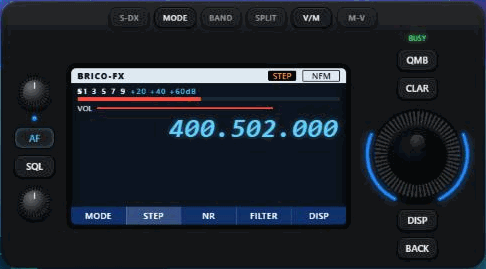

# Brico-FX — OpenWebRX+ receiver skin

A front-panel skin for [OpenWebRX+](https://github.com/luarvique/openwebrx) inspired by modern
HF/VHF/UHF all-mode transceivers: a colour "TFT" screen with big frequency digits, an S-meter,
selectable screen views (including a mini waterfall and a digital-modes view), a knurled VFO knob with
blue LED arcs, and working knobs and keys.

It is an independent plugin: it needs only OpenWebRX+ 1.2.124 or newer and does not depend on any
other skin or plugin. It adds **Brico-FX** to the receiver's theme selector; picking another theme
removes the panel completely.



## Install

Copy this folder to `htdocs/plugins/receiver/bh_skin_bricofx/` and add to your receiver `init.js`:

```js
// optional S-meter calibration (dB added to the raw level), same meaning as other OWRX+ skins
window.bh_skin_bricofx_config = { smeter: { offset_hf: 0, offset_vhf: 0, iaru_vhf: true } };
await Plugins.load('bh_skin_bricofx');
```

Then choose **Brico-FX** in *Settings → Theme*.

## Controls

| Control | Action |
|---|---|
| VFO knob | Drag in a circle, mouse wheel, or arrow keys: tunes by the current tuning step |
| AF / SQL keys + knob | Choose what the knob changes: volume (0–150) or squelch (−150…0 dB) |
| FUNC knob | Click to choose STEP / NR / FILTER, turn to change it (tuning step, noise reduction, filter width ±10 %) |
| QMB | Hold 0.6 s to store the frequency, tap to recall it |
| V/M | Recall the stored frequency |
| CLAR | Fine tuning on/off (uses the smallest tuning step while on) |
| MODE | Next demodulator mode |
| DISP / BACK | Next screen view / main view |
| Screen views | **Main** (frequency and meter), **Scope** (mini spectrum + waterfall, click to tune; ZOOM−, ZOOM+, FULL), **Digital** (mini waterfall + last decoded messages; ALL, SEARCH by callsign, CLEAR, LOG). Selecting a digital mode (FT8, FT4, WSPR, JS8, RTTY, packet…) opens the Digital view automatically. |
| BUSY lamp | Lit when the signal is above the squelch level |

Labels follow the page language (Spanish when `<html lang="es…">`, otherwise English).

## Notes

- The stock receiver controls stay in the page and are driven by the skin, so other plugins keep
  working; they are only hidden while Brico-FX is active.
- No product names or logos of any manufacturer are used.

## Licence

MIT © 2026 EA5KAO / BricoHams
