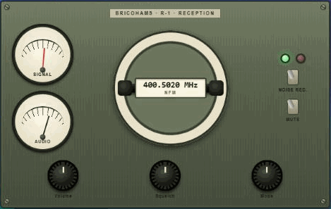

# Military — OpenWebRX+ receiver skin

A vintage field-radio skin for [OpenWebRX+](https://github.com/luarvique/openwebrx): olive steel panel
with screws and an engraved plate, analog meters with needles, a big tuning dial with a pointer handle,
black bakelite knobs, toggle switches and pilot lamps.

It is an independent plugin: it needs only OpenWebRX+ 1.2.124 or newer and does not depend on any
other skin or plugin. It adds **Military** (Spanish: *Militar*) to the receiver's theme selector;
picking another theme removes the panel completely.



## Install

Copy this folder to `htdocs/plugins/receiver/bh_skin_militar/` and add to your receiver `init.js`:

```js
// optional S-meter calibration (dB added to the raw level)
window.bh_skin_militar_config = { smeter: { offset_hf: 0, offset_vhf: 0, iaru_vhf: true } };
await Plugins.load('bh_skin_militar');
```

Then choose **Military** in *Settings → Theme*.

## Controls

| Control | Action |
|---|---|
| Tuning dial | Drag in a circle, mouse wheel, or arrow keys: tunes by the current tuning step |
| SIGNAL meter | Needle follows the real signal level (S0 … S9 … S9+60 dB, red zone above S9) |
| AUDIO meter | Shows the volume |
| VOLUME / SQUELCH knobs | Volume 0–150, squelch −150…0 dB |
| MODE knob | Previous / next demodulator mode |
| NOISE RED. / MUTE switches | Noise reduction and mute |
| Green / red lamps | Signal above squelch / muted |

Labels follow the page language (Spanish when `<html lang="es…">`, otherwise English).

## Licence

MIT © 2026 EA5KAO / BricoHams
